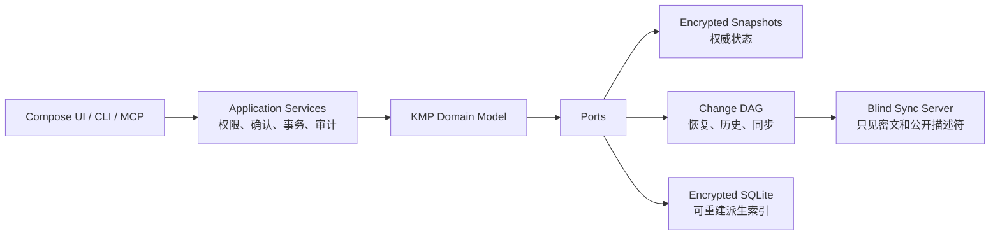

# Tagloom（织记）

Tagloom 是一个本地优先、端到端加密的个人知识系统。它以加密对象快照保存权威状态，用 Change DAG 承载恢复、历史和多设备同步，并通过笔记类型、普通标签、属性继承、稳定 Block、双向链接与受控 Agent 接口组织知识。

> 当前状态：文件系统、索引/搜索、同步分别位于 `app:file-system`、`app:index`、`app:sync` 三个 KMP 能力模块，JVM 和 Android 均已接入。SQL 与 HTTP 协议放在 `commonMain`，文件事务和工作区流程通过 `jvmAndroidMain` 复用，平台差异由 `expect/actual` 装配。共享 App 只调用能力接口；`app/desktopApp` 保留窗口入口，Android 宿主管理 Activity、ViewModel 和系统文档选择器。iOS 工厂仍为 `TODO`，服务端盲同步实现独立留在 `server`。

完整产品与技术基线见 [Tagloom 产品与技术设计草案](./Tagloom_产品与技术设计草案.md)，参与开发前请先阅读 [AGENTS.md](./AGENTS.md)。

## 已实现能力

### 领域与内容模型

- Note、Tag、PropertyDef、SavedQuery、Block、Annotation 等稳定对象模型。
- 规范化 `RichText.runs`，支持单词或短语级粗体、斜体、删除线、链接、`code`、语义文字色、语义高亮色与独立加注锚点。
- 多父标签解析、稳定拓扑顺序、循环检测、属性继承和显式冲突。
- 对象级 Change DAG、多个 heads、确定性 LWW、三方合并与 Base/Local/Remote 冲突保留。
- 标准 Markdown 与 Tagloom 扩展 Markdown 导入导出，以及有损能力清单。

### 连续 Block 编辑器

- 工作区采用“左侧笔记导航 + 中央页面编辑器”：新建、过滤与切换始终可见；笔记类型、描述、普通标签、属性和只读快照时间紧跟标题显示，不占用常驻右侧栏。
- 新建笔记先搜索并选择笔记类型：桌面居中弹窗、窄屏底部面板，支持名称过滤、方向键与 Enter 确认；取消不会留下空笔记。侧栏和窄屏均有笔记类型管理入口，使用纵向列表和可展开属性表单维护名称、多父继承、默认值、必填和只读约束。维护页自动显示可继承属性与来源，支持本级覆盖、恢复继承和显式解决多父冲突；属性名称、字段类型及选项目录保持共享定义。图标可搜索选择、更换与清除，随加密定义保存；引用中的笔记类型不可删除，未引用的定义通过 tombstone 删除。
- 正文采用连续页面排版，不再把每个 Block 渲染成独立表单卡片；悬停或聚焦时显示单一六点手柄，点击统一管理块操作，按住拖动可调整位置。
- 支持正文、三级标题、无序/有序列表、待办、引用、代码块与分割线，并可通过不抢占输入焦点的 `/` 菜单、六点手柄菜单或 Markdown 行首快捷方式转换。
- Database 与其他结构化内容使用同一套 Block 创建心智：输入 `/database` 或从 Block 手柄的“在下方插入”菜单选择“数据集”后在当前位置创建，不在侧栏提供独立创建页面；Block 内可直接修改名称、来源类型、视图、筛选和字段。
- `Enter` 拆分并延续 Block，`Backspace` 在行首合并或提升层级，`Tab` / `Shift+Tab` 调整嵌套，方向键可跨 Block 移动，`Ctrl/Cmd+S` 保存。
- 页头单一放大镜按钮或 `Ctrl/Cmd+F` 打开图标下方的查找浮层，覆盖在正文上方，不挤动标题或正文；悬停或长按按钮显示“在笔记中查找 · Ctrl/Cmd+F”。查找当前笔记的实时草稿，支持大小写切换、匹配计数与循环跳转，标题、描述、正文、代码、页签和正文表格均可定位，高亮不会写入笔记。更多菜单中的“搜索整个工作区”查询已确认内容，保留保存查询入口。
- 文本输入保留 Compose `TextFieldValue` 的光标、选区和 IME 组合态；闭合的粗体、斜体、删除线、行内 `code` Markdown 会转成结构化 Mark，多行 Markdown 可直接粘贴成 Block。带表头和分隔行的管道表格会转成可编辑表格，支持空单元格、转义管道和已有行内样式，保留前后正文并可在表格后继续输入；列对齐标记暂不保留。
- 选区浮动工具栏支持粗体、斜体、删除线、行内 `code`、链接、文字颜色、高亮颜色与独立加注；颜色保存语义 token，不把平台色值写进权威快照。
- 连续正文支持鼠标跨 Block 拖选和边缘滚动、Shift 点击／方向键延伸、Ctrl/Cmd+A 全选，以及跨块复制、剪切、删除、输入替换和格式操作。代码块参与文本选取；表格、数据库、附件及页签边界保留独立选区。选中背景按完整行高绘制，统一处理换行、加粗、行内代码和高亮底色。
- 正文复制同时提供带列表编号／项目符号和缩进的纯文本、标准 HTML 富文本及独立正文片段；笔记内粘贴恢复块类型、层级、行内样式、待办状态和代码语言。局部文字按行内内容粘贴，`Ctrl/Cmd+Shift+V` 可仅粘贴纯文本；代码输入保持纯文本语义。
- 内置 `Note` 是只能查看的根类型；自定义笔记类型使用不带 `#` 的身份 chip，普通标签使用可搜索、可自由输入并跨笔记复用的 `#chip`。
- 属性定义可复用或按“名称 → 字段格式 → 固定/自由选项 → 创建位置”创建，并支持文本、URL、邮箱、数值、布尔、日期、日期时间、单选和多选值编辑。
- 日期与时间默认使用设备地区、时区及时间制；可在设置页搜索时区，选择日期预设或自定义格式、12/24 小时制，实时预览并恢复系统默认。偏好仅保存在本机，统一影响笔记时间、日期属性、正文表格和数据集显示，不重写笔记时间；纯日期保持原日历日，日期时间编辑确认后保存标准时间点。
- 界面提供简体中文与英文资源，随系统语言选择；表格、页签、数据集菜单及数量提示使用同一资源体系。新建笔记、列、页签、视图及新工作区默认属性按当前语言命名，已有名称和用户内容在切换语言后保持原样。
- 编辑自动标记 dirty，并在停止输入 900 ms 后保存；保存过程中继续输入不会被旧保存结果误清为已保存。

### 加密、存储与恢复

- Argon2id 密码派生、HKDF 用途隔离、Workspace Master Key、Wrapping Key 与随机 DEK 的跨平台领域协议。
- XChaCha20-Poly1305 版本化信封、认证公开头、对象身份/revision 绑定和篡改拒绝规则。
- `app:file-system` 文件系统能力契约：逻辑路径、原子写入、目录落盘、加密读写、启动恢复和单写入者租约。
- `app:index` 索引与搜索能力契约：派生索引维护、全文/标签/属性/双链查询和从快照重建。
- `app:sync` 同步会话能力契约：密文变更交换、checkpoint 边界和冲突统计。

### 同步与外部入口边界

- AnySync 启发的对象 Change DAG、内容寻址密文、heads/inventory 差集同步。
- Change、Snapshot、Blob、Manifest 密文载荷和 Ed25519 作者签名。
- Ktor 自部署盲同步服务：服务端只验证公开完整性、设备身份、签名和 DAG 父关系，不持有工作区明文密钥。
- 持久化设备登记、访问凭据更新、撤销及历史公钥目录；旧凭据文件仅首次迁移，撤销在重启后继续生效。
- 本地模式与服务器模式：两种模式都能新建和凭 Recovery Key 恢复，可在设置中随时切换。服务器模式在本地保存后自动更新完整密文副本；新设备通过服务器地址与 Recovery Key 找回原工作区，本地模式通过既有文件夹与 Recovery Key 恢复。
- 本机 API、可执行 CLI、stdio MCP 共用桌面已解锁会话，提供笔记读写、类型与属性 schema 读取、查询、双链及 Markdown 导出，统一 Note allow-list、持有者确认和加密审计。
- AI 上下文硬预算、附件原名默认排除，以及可重建 Block 向量和稳定 RRF 混合排序契约。

## 当前产品边界

代码“已实现”不等于入口“已可用”。当前边界如下：

| 能力 | 当前代码状态 | 当前 UI 或运行入口 |
| --- | --- | --- |
| Block/RichText/Markdown | `core` 与 `app/shared` 已实现 | JVM Desktop 与 Android 共用编辑和持久化入口；单篇文档文件导出仍未接入 |
| 文件系统与加密读写 | 共用加密信封、NIO 原子写入、事务恢复和写入租约 | JVM 与 Android actual 已装配；Android 使用私有目录和 `Os.fsync` |
| 索引与搜索 | 共用 SQL/schema、全文、标签、属性和双链查询 | JVM 使用加密 JDBC；Android 使用 SQLCipher，索引均可从快照重建 |
| 同步 | 共用 Ktor HTTP、Change DAG 和本地密文副本 | JVM/Android 可用 `createSyncEngine(LocalSyncEngineConfiguration(...))` 显式装配；远端 Change 自动合并尚未接入 UI；服务器副本上传与恢复使用独立入口 |
| 服务端盲同步 | `server` 独立 JVM 实现，持久化设备管理与恢复确认点 | 支持受控首次登记、设备授权/撤销及 Recovery Key 派生凭据恢复 |
| 工作区模式与恢复 | 完整加密备份、流式 HTTP、版本冲突保护、本机设备保护凭据 | 共享欢迎页支持两种模式新建与恢复，设置可切换；服务器模式自动上传确认版本，不自动合并其他设备变更 |
| Android | 私有工作区、Keystore、SQLCipher、Ktor 与共享 App | 支持创建、锁定/解锁、PIN、索引重建、密文备份恢复与主密钥轮换 |
| iOS | 共享 UI 与三项能力契约可交叉编译 | 平台能力工厂为 `TODO`，需 macOS/Xcode 验证 |
| API/CLI/MCP | `app:automation` 提供回环 API、可执行 CLI 与官方 SDK stdio MCP，业务复用客户端会话 | Windows 桌面显式启用 API；CLI/MCP 使用独立会话授权，写入需持有者确认；[使用说明](./docs/local-automation.md) |
| AI/向量 | 上下文、权限、端口与混合排序契约已实现 | 未接模型或向量数据库，不在 MVP UI 展示 |

## 架构



必须保持的数据边界：

- 已确认的加密对象快照是当前业务状态的唯一权威来源。
- Change DAG 是事务恢复、同步、历史、撤销和审计载体；确认 checkpoint 后可以压缩。
- SQLite、全文、双链和向量索引均为派生数据，可以删除并从权威快照重建。
- UI、CLI、MCP 和 Agent 不能直接写文件，所有业务写入都必须经过相同的应用服务与事务协调器。

## 仓库结构

```text
Tagloom/
├── app/
│   ├── shared/                 # commonMain Compose UI、编辑器状态与能力聚合
│   ├── file-system/            # 文件读写、加密、恢复和写租约能力契约
│   ├── index/                  # 索引与搜索能力契约
│   ├── sync/                   # 同步会话能力契约
│   ├── automation/             # JVM 本机 API、CLI 与 stdio MCP 协议适配器
│   ├── desktopApp/             # 仅 JVM Desktop 窗口入口与发行配置
│   ├── androidApp/             # Android 宿主
│   └── iosApp/                 # SwiftUI/iOS 宿主工程
├── core/                       # KMP 领域模型、协议、用例与 Port
├── server/                     # Ktor 盲同步服务
├── AGENTS.md                   # 仓库开发约束
└── Tagloom_产品与技术设计草案.md
```

Gradle 模块以 [`settings.gradle.kts`](./settings.gradle.kts) 为准：

```text
:app:androidApp
:app:automation
:app:desktopApp
:app:file-system
:app:index
:app:shared
:app:sync
:core
:server
```

## 开发环境

- JDK 21；生成的 JVM 字节码目标为 Java 11。
- Android SDK；Compile/Target/Min SDK 版本以 [`gradle/libs.versions.toml`](./gradle/libs.versions.toml) 为准。
- Windows 桌面发行包需要 WiX 工具链；iOS 宿主构建和模拟器测试需要 macOS 与 Xcode。
- 依赖与插件版本由 version catalog 统一管理，不在模块脚本中复制版本号。

## 运行入口

Windows PowerShell：

```powershell
# 运行桌面窗口入口（JVM 三项能力由共享 actual 工厂装配）
.\gradlew.bat :app:desktopApp:run

# Android Debug 包
.\gradlew.bat :app:androidApp:assembleDebug

# 生成桌面发行包
.\gradlew.bat :app:desktopApp:createDistributable
```

`createDistributable` 的免安装目录位于 `app/desktopApp/build/compose/binaries/main/app`。安装包任务是否可用取决于本机 WiX 工具链；开发验收优先运行该目录中的真实 EXE，而不是只看 Gradle 构建结果。

macOS/Linux 使用 `./gradlew`。iOS 应用需在 macOS 上打开 `app/iosApp/iosApp.xcodeproj`。

本机 API 通过 `TAGLOOM_API_OWNER_TOKEN` 和 `TAGLOOM_API_PORT` 显式启用。CLI/MCP 分发物使用 `:app:automation:installDist` 构建，配置、授权、确认与客户端示例见 [外部入口使用说明](./docs/local-automation.md)。

Android APK 位于 `app/androidApp/build/outputs/apk/debug/androidApp-debug.apk`。工作区与本机解锁登记保存在不参与系统自动备份的应用私有目录；外部 URI 仅用于通过系统文档选择器导入/导出密文 ZIP。卸载应用会删除私有数据与 Keystore 密钥，跨设备恢复需要密文备份和 Recovery Key。旋转屏幕时保留内存草稿与 Recovery Key 确认状态，进程重启后从已确认快照重新认证恢复。

## 启动盲同步服务

新部署配置独立的登记访问码摘要和数据目录。登记访问码使用密码学安全随机数生成至少 32 字节，先编码为文本，再对该文本的 UTF-8 字节计算 SHA-256；服务器只保存摘要，访问码由部署者交给需要首次上传的客户端。

```powershell
$env:TAGLOOM_SYNC_BOOTSTRAP_TOKEN_SHA256 = '<sha256-of-registration-code>'
$env:TAGLOOM_SYNC_DATA_DIR = '<ciphertext-data-directory>'
# 可选；默认单个恢复归档上限 512 MiB。
$env:TAGLOOM_SYNC_MAX_RECOVERY_BYTES = '<maximum-archive-bytes>'
.\gradlew.bat :server:run
```

客户端入口：

1. **本地模式 → 全新创建**：选择空文件夹并离线生成工作区与 Recovery Key。**从本地文件夹恢复**：输入恢复密钥后选择原工作区文件夹，可设置当前设备 PIN；密文 ZIP 备份导入入口继续保留。
2. **服务器模式 → 全新创建**：填写 HTTPS 地址和登记访问码，确认保存 Recovery Key 后在应用私有目录创建工作区并上传首份密文副本。**从服务器恢复**：只需地址与 Recovery Key，自动分配独立本地副本，无需选择文件夹。
3. **设置 → 工作区模式**可随时切换。本地转服务器时输入地址与 Recovery Key，首次登记新工作区还需要登记访问码；已有服务器副本可凭密钥重新连接，客户端先认证并核对两端权威对象，一致时才允许继续上传。成功上传后启用自动更新。服务器转本地立即取消在途上传，保留原工作区、恢复密钥和服务器已确认副本；切回时复用设备凭据，不重新建库。

服务器模式仅在应用的已解锁会话中运行，每 3 秒检查已确认 manifest 版本，有变更才生成并上传密文副本；网络失败 30 秒后重试，本地编辑和保存继续可用。冲突、认证失效或密钥轮换会暂停自动上传，并在界面提示处理；设置提供“立即更新副本”供手动重试。首次服务器连接失败时，本地创建结果仍然保留，可在设置中重试。旧版手动上传配置默认保持本地模式，需要主动切换才能启用自动上传。

恢复只包含最近成功上传的内容。不同设备上传使用版本前置条件，过期设备不能覆盖较新的副本；遇到冲突时，请重新从服务器恢复为独立副本核对。主密钥轮换后需要在设置中输入新 Recovery Key 并再次上传；在新副本确认前，服务器旧副本仍使用旧密钥。新副本确认后，旧恢复定位凭据失效，历史归档保留但不再通过恢复入口提供。

旧部署可保留 `TAGLOOM_SYNC_CREDENTIALS_FILE` 完成一次性迁移；格式仍是包含 `workspaceId`、`actorId`、`tokenSha256`、`signingPublicKeyHex` 的 JSON 数组。正式登记库建立后不再重读旧凭据文件；损坏或未知版本会拒绝启动，不能回退到旧凭据。登记库位于数据目录的 `.server/devices.json`，同一目录只能启动一个服务写入者；应与密文归档一起备份。

服务仅保存密文、随机身份、公钥与认证摘要。生产部署需在外层配置 HTTPS、数据目录最小权限、备份、认证限流和上传并发限制；客户端拒绝明文 HTTP 和自动重定向。单个客户端下载同样限制为 512 MiB，大于此值请使用本地备份。旧归档自动清理尚未实现，应监控磁盘容量。管理接口契约及错误码见 [OpenAPI 3.1](./server/openapi-device-management.yaml)。

## 验证

Windows PowerShell：

```powershell
# KMP 核心与共享编辑器
.\gradlew.bat :core:jvmTest :app:shared:jvmTest :app:shared:testAndroidHostTest

# 三项能力契约与服务端协议
.\gradlew.bat :app:file-system:jvmTest `
  :app:index:jvmTest `
  :app:sync:jvmTest `
  :server:test

# 桌面入口与 Android 宿主
.\gradlew.bat :app:desktopApp:compileKotlin :app:androidApp:testDebugUnitTest
.\gradlew.bat :app:androidApp:assembleDebug :app:desktopApp:createDistributable

# 已连接 Android 真机或模拟器：真实文件、Keystore、SQLCipher 与回环 HTTP 闭环
.\gradlew.bat :app:androidApp:connectedDebugAndroidTest :app:androidApp:lintDebug
```

macOS 还应运行：

```bash
./gradlew :core:iosSimulatorArm64Test :app:shared:iosSimulatorArm64Test
```

涉及加密、文件系统、恢复或发行包的改动不能只以编译成功作为完成依据；需要执行真实目录恢复、进程重启或打包应用启动验证。

三个能力模块的公共契约位于各自 `commonMain`；`jvmAndroidMain` 复用文件事务、密码学与工作区流程，平台源集只承载目录持久化、设备保护、SQLite 驱动和宿主交互。Android 设备测试使用真实原生库、Keystore、SQLCipher 与回环 TCP，不以 Host Test 或编译替代运行验证。桌面入口负责窗口与本机 API 生命周期装配，服务端同步实现和协议测试继续独立于客户端能力模块。

## v0.2 / MVP 验收状态

JVM 与 Android 已共用三项能力和工作区业务流程。Android 派生数据库采用 SQLCipher，JVM 保持现有加密 SQLite 格式；数据库文件不跨设备复制，通过相同的权威加密快照重建。Android 验收需执行设备测试、实际编辑/重启以及密文备份的系统文档交互；iOS actual 和远端 Change 自动合并仍未实现；服务器恢复副本配置及新设备恢复已接入共享 UI。

Android 已在 API 37、x86_64、16 KB 页大小的模拟器完成三个设备集成用例，覆盖加密持久化、Keystore/PIN、索引损坏重建、备份恢复、主密钥轮换、损坏事务隔离及真实回环 HTTP 同步。实际 App 已验证编辑、自动保存、全文搜索、横竖屏切换、系统文档备份和进程重启。APK 的 arm64/x86_64 原生库及 ZIP 对齐检查通过；API 24 与 ARM 真机运行仍未验证。

## 开发原则

- 公共领域逻辑优先进入 `core/commonMain`，平台能力通过三个 KMP 能力模块的契约隔离。
- Compose UI 不直接读写加密文件、SQLite 或同步协议。
- 所有工作区写入统一经过 `TransactionCoordinator`。
- 所有业务类、业务函数、关键属性和复杂流程按照 [AGENTS.md](./AGENTS.md) 编写中文 KDoc/Doc 注释。
- 不新增语义模糊的 `*Helper`，不在超过约 500 行的文件中继续堆叠职责。
- 不提交本机路径、账号、Token、密钥、Cookie、内网地址、环境文件和生成产物。

## 文档

- [产品与技术设计草案](./Tagloom_产品与技术设计草案.md)
- [本机 API、CLI 与 MCP](./docs/local-automation.md)
- [仓库开发约束](./AGENTS.md)
- [Gradle 模块配置](./settings.gradle.kts)
- [依赖版本目录](./gradle/libs.versions.toml)
