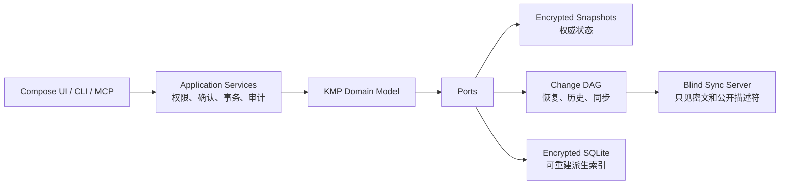

# Tagloom（织记）

Tagloom 是一个本地优先、端到端加密的个人知识系统。它以加密对象快照保存权威状态，用 Change DAG 承载恢复、历史和多设备同步，并通过对象类型（超级标签）、普通标签、属性继承、稳定 Block、双向链接与受控 Agent 接口组织知识。

> 当前状态：`core` 和 `app/shared` 保留跨平台领域模型、编辑器与 UI；文件系统、索引/搜索、同步三项能力已经分别抽成 `app:file-system`、`app:index`、`app:sync` 契约模块，各平台 `expect/actual` 工厂暂时直接 `TODO`。`app/desktopApp` 只保留窗口入口，不再包含 JVM 工作区、文件、SQLite 或 HTTP 实现；服务端盲同步实现独立留在 `server`。

完整产品与技术基线见 [Tagloom 产品与技术设计草案](./Tagloom_产品与技术设计草案.md)，参与开发前请先阅读 [AGENTS.md](./AGENTS.md)。

## 已实现能力

### 领域与内容模型

- Note、Tag、PropertyDef、SavedQuery、Block、Annotation 等稳定对象模型。
- 规范化 `RichText.runs`，支持单词或短语级粗体、斜体、删除线、链接、`code`、语义文字色、语义高亮色与独立加注锚点。
- 多父标签解析、稳定拓扑顺序、循环检测、属性继承和显式冲突。
- 对象级 Change DAG、多个 heads、确定性 LWW、三方合并与 Base/Local/Remote 冲突保留。
- 标准 Markdown 与 Tagloom 扩展 Markdown 导入导出，以及有损能力清单。

### 连续 Block 编辑器

- 工作区采用“左侧笔记导航 + 中央页面编辑器”：新建、过滤与切换始终可见；对象类型、描述、普通标签、属性和只读快照时间紧跟标题显示，不占用常驻右侧栏。
- 正文采用连续页面排版，不再把每个 Block 渲染成独立表单卡片；悬停或聚焦时才显示新增与拖动把手。
- 支持正文、三级标题、无序/有序列表、待办、引用、代码块与分割线，并可通过不抢占输入焦点的 `/` 菜单、左侧加号或 Markdown 行首快捷方式转换。
- Database 与其他结构化内容使用同一套 Block 创建心智：输入 `/database` 或从 Block 加号菜单选择“数据集”后在当前位置创建，不在侧栏提供独立创建页面；Block 内可直接修改名称、来源类型、视图、筛选和字段。
- `Enter` 拆分并延续 Block，`Backspace` 在行首合并或提升层级，`Tab` / `Shift+Tab` 调整嵌套，方向键可跨 Block 移动，`Ctrl/Cmd+S` 保存。
- 文本输入保留 Compose `TextFieldValue` 的光标、选区和 IME 组合态；闭合的粗体、斜体、删除线、行内 `code` Markdown 会转成结构化 Mark，多行 Markdown 可直接粘贴成 Block。
- 选区浮动工具栏支持粗体、斜体、删除线、行内 `code`、链接、文字颜色、高亮颜色与独立加注；颜色保存语义 token，不把平台色值写进权威快照。
- 内置 `Note` 是只能查看的根对象类型；自定义类型使用不带 `#` 的类型 chip，普通标签使用可搜索、可自由输入并跨笔记复用的 `#chip`。
- 属性定义可复用或按“名称 → 类型 → 固定/自由选项 → 创建位置”创建，并支持文本、URL、邮箱、数值、布尔、日期、日期时间、单选和多选值编辑。
- 编辑自动标记 dirty，并在停止输入 900 ms 后保存；保存过程中继续输入不会被旧保存结果误清为已保存。

### 加密、存储与恢复

- Argon2id 密码派生、HKDF 用途隔离、Workspace Master Key、Wrapping Key 与随机 DEK 的跨平台领域协议。
- XChaCha20-Poly1305 版本化信封、认证公开头、对象身份/revision 绑定和篡改拒绝规则。
- `app:file-system` 文件系统能力契约：逻辑路径、原子写入、目录落盘、加密读写、启动恢复和单写入者租约。
- `app:index` 索引与搜索能力契约：派生索引维护、全文/标签/属性/双链查询和从快照重建。
- `app:sync` 同步会话能力契约：密文变更交换、checkpoint 边界和冲突统计。

### 同步与外部入口边界

- AnySync 启发的对象 Change DAG、内容寻址密文、heads/inventory 差集同步。
- Change、Snapshot、Blob、Manifest 密文载荷和 Ed25519 作者签名。
- Ktor 自部署盲同步服务：服务端只验证公开完整性、设备身份、签名和 DAG 父关系，不持有工作区明文密钥。
- Agent/CLI/MCP 共用默认拒绝、Note allow-list、风险分级确认和审计契约。
- AI 上下文硬预算、附件原名默认排除，以及可重建 Block 向量和稳定 RRF 混合排序契约。

## 当前产品边界

代码“已实现”不等于入口“已可用”。当前边界如下：

| 能力 | 当前代码状态 | 当前 UI 或运行入口 |
| --- | --- | --- |
| Block/RichText/Markdown | `core` 与 `app/shared` 已实现 | 共享 Compose UI 可运行内存示例；不承诺桌面持久化入口 |
| 文件系统与加密读写 | `app:file-system` 仅契约 | JVM/Android/iOS 工厂均为 `TODO` |
| 索引与搜索 | `app:index` 仅契约 | JVM/Android/iOS 工厂均为 `TODO` |
| 同步 | `app:sync` 仅契约 | JVM/Android/iOS 工厂均为 `TODO` |
| 服务端盲同步 | `server` 独立 JVM 实现 | 可单独启动，客户端同步能力尚未接入 |
| Android | 共享 UI 与三项能力契约可编译 | 平台能力工厂为 `TODO` |
| iOS | 共享 UI 与三项能力契约可交叉编译 | 平台能力工厂为 `TODO`，需 macOS/Xcode 验证 |
| CLI/MCP | 命令、资源 URI、工具目录与权限契约已实现 | 未提供可执行 CLI/MCP Server |
| AI/向量 | 上下文、权限、端口与混合排序契约已实现 | 未接模型或向量数据库，不在 MVP UI 展示 |

## 架构



必须保持的数据边界：

- 已确认的加密对象快照是当前业务状态的唯一权威来源。
- Change DAG 是事务恢复、同步、历史、撤销和审计载体；确认 checkpoint 后可以压缩。
- SQLite、全文、双链和向量索引均为派生数据，可以删除并从权威快照重建。
- UI、CLI、MCP 和 Agent 不能直接写文件，所有业务写入都必须经过相同的应用服务与事务协调器。

## 仓库结构

```text
Tagloom/
├── app/
│   ├── shared/                 # commonMain Compose UI、编辑器状态与能力聚合
│   ├── file-system/            # 文件读写、加密、恢复和写租约能力契约
│   ├── index/                  # 索引与搜索能力契约
│   ├── sync/                   # 同步会话能力契约
│   ├── desktopApp/             # 仅 JVM Desktop 窗口入口与发行配置
│   ├── androidApp/             # Android 宿主
│   └── iosApp/                 # SwiftUI/iOS 宿主工程
├── core/                       # KMP 领域模型、协议、用例与 Port
├── server/                     # Ktor 盲同步服务
├── AGENTS.md                   # 仓库开发约束
└── Tagloom_产品与技术设计草案.md
```

Gradle 模块以 [`settings.gradle.kts`](./settings.gradle.kts) 为准：

```text
:app:androidApp
:app:desktopApp
:app:file-system
:app:index
:app:shared
:app:sync
:core
:server
```

## 开发环境

- JDK 21；生成的 JVM 字节码目标为 Java 11。
- Android SDK；Compile/Target/Min SDK 版本以 [`gradle/libs.versions.toml`](./gradle/libs.versions.toml) 为准。
- Windows 桌面发行包需要 WiX 工具链；iOS 宿主构建和模拟器测试需要 macOS 与 Xcode。
- 依赖与插件版本由 version catalog 统一管理，不在模块脚本中复制版本号。

## 运行入口

Windows PowerShell：

```powershell
# 运行桌面窗口入口（能力工厂当前为 TODO）
.\gradlew.bat :app:desktopApp:run

# Android Debug 包
.\gradlew.bat :app:androidApp:assembleDebug

# 生成桌面发行包
.\gradlew.bat :app:desktopApp:createDistributable
```

`createDistributable` 的免安装目录位于 `app/desktopApp/build/compose/binaries/main/app`。安装包任务是否可用取决于本机 WiX 工具链；开发验收优先运行该目录中的真实 EXE，而不是只看 Gradle 构建结果。

macOS/Linux 使用 `./gradlew`。iOS 应用需在 macOS 上打开 `app/iosApp/iosApp.xcodeproj`。

## 启动盲同步服务

服务端必须显式读取设备凭据文件，避免开放注册或默认口令启动。文件是 JSON 数组，每条记录包含随机工作区 ID、随机 Actor ID、Bearer Token 的 SHA-256 和设备 Ed25519 公钥：

```json
[
  {
    "workspaceId": "<random-workspace-id>",
    "actorId": "<random-device-id>",
    "tokenSha256": "<64-lowercase-hex-characters>",
    "signingPublicKeyHex": "<64-lowercase-hex-characters>"
  }
]
```

配置环境变量后运行：

```powershell
$env:TAGLOOM_SYNC_CREDENTIALS_FILE = '<credentials-json-path>'
$env:TAGLOOM_SYNC_DATA_DIR = '<ciphertext-data-directory>'
.\gradlew.bat :server:run
```

服务仅保存密文与公开同步描述符。生产部署仍必须在外层配置 TLS、凭据文件最小权限、备份、限流和监控。

## 验证

Windows PowerShell：

```powershell
# KMP 核心与共享编辑器
.\gradlew.bat :core:jvmTest :app:shared:jvmTest :app:shared:testAndroidHostTest

# 三项能力契约与服务端协议
.\gradlew.bat :app:file-system:jvmTest `
  :app:index:jvmTest `
  :app:sync:jvmTest `
  :server:test

# 桌面入口与 Android 宿主
.\gradlew.bat :app:desktopApp:compileKotlin :app:androidApp:testDebugUnitTest
.\gradlew.bat :app:androidApp:assembleDebug :app:desktopApp:createDistributable
```

macOS 还应运行：

```bash
./gradlew :core:iosSimulatorArm64Test :app:shared:iosSimulatorArm64Test
```

涉及加密、文件系统、恢复或发行包的改动不能只以编译成功作为完成依据；需要执行真实目录恢复、进程重启或打包应用启动验证。

本次重构验证重点是模块边界：三个能力模块的公共契约位于各自 `commonMain`，JVM/Android/iOS 工厂均为显式 `TODO`，桌面源码目录除 `main.kt` 外为空。服务端同步实现和协议测试继续独立于客户端能力模块。

## v0.2 / MVP 验收状态

当前切片不再宣称 Windows 桌面 MVP 已接通持久化。已确认的是 `core` 的跨平台领域协议、`app/shared` 的共享编辑器/UI，以及三个能力模块的契约；文件系统、索引/搜索、同步的实际平台实现留待后续按契约装配。Android/iOS/JVM 均通过同一组能力接口进入共享 App，不在 `shared` 中复制平台实现。

## 开发原则

- 公共领域逻辑优先进入 `core/commonMain`，平台能力通过三个 KMP 能力模块的契约隔离。
- Compose UI 不直接读写加密文件、SQLite 或同步协议。
- 所有工作区写入统一经过 `TransactionCoordinator`。
- 所有业务类、业务函数、关键属性和复杂流程按照 [AGENTS.md](./AGENTS.md) 编写中文 KDoc/Doc 注释。
- 不新增语义模糊的 `*Helper`，不在超过约 500 行的文件中继续堆叠职责。
- 不提交本机路径、账号、Token、密钥、Cookie、内网地址、环境文件和生成产物。

## 文档

- [产品与技术设计草案](./Tagloom_产品与技术设计草案.md)
- [仓库开发约束](./AGENTS.md)
- [Gradle 模块配置](./settings.gradle.kts)
- [依赖版本目录](./gradle/libs.versions.toml)
