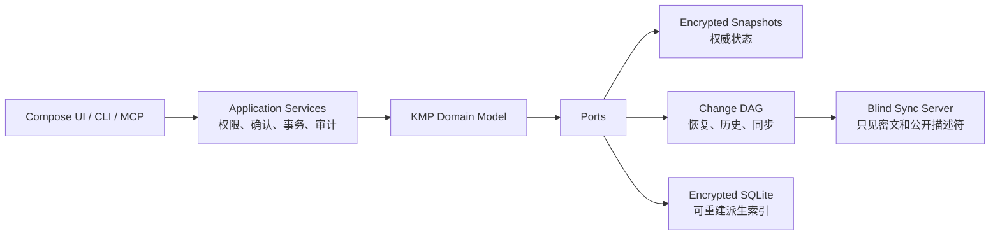

# Tagloom（织记）

Tagloom 是一个本地优先、端到端加密的个人知识系统。它以加密对象快照保存权威状态，用 Change DAG 承载恢复、历史和多设备同步，并通过对象类型（超级标签）、普通标签、属性继承、稳定 Block、双向链接与受控 Agent 接口组织知识。

> 当前状态：v0.2 Windows MVP 已接通桌面工作区创建/解锁、加密快照、事务恢复、加密索引、Block/RichText 编辑、Markdown、备份恢复与密钥维护，并通过桌面集成测试。其后的首版增量已加入 Tabs、Note 内 BaseTable，以及通过 `/database` 原位创建的 Database Block、独立 Database / View 加密快照、Table / Kanban / Gallery 受限展示与 Note revision 写回。Windows 分发包已构建并完成真实 EXE 启动和锁定欢迎页渲染检查。签名盲同步、CLI/MCP、AI 与向量能力目前停留在服务、适配器或共享契约层，没有在桌面 UI 中伪装成可用功能。

完整产品与技术基线见 [Tagloom 产品与技术设计草案](./Tagloom_产品与技术设计草案.md)，参与开发前请先阅读 [AGENTS.md](./AGENTS.md)。

## 已实现能力

### 领域与内容模型

- Note、Tag、PropertyDef、SavedQuery、Block、Annotation 等稳定对象模型。
- 规范化 `RichText.runs`，支持单词或短语级粗体、斜体、删除线、链接、`code`、语义文字色、语义高亮色与独立加注锚点。
- 多父标签解析、稳定拓扑顺序、循环检测、属性继承和显式冲突。
- 对象级 Change DAG、多个 heads、确定性 LWW、三方合并与 Base/Local/Remote 冲突保留。
- 标准 Markdown 与 Tagloom 扩展 Markdown 导入导出，以及有损能力清单；桌面端另支持 HTML、PDF 和 Word 文档导出。

### 连续 Block 编辑器

- 工作区采用“左侧笔记导航 + 中央页面编辑器”：新建、过滤与切换始终可见；对象类型、描述、普通标签、属性和只读快照时间紧跟标题显示，不占用常驻右侧栏。
- 正文采用连续页面排版，不再把每个 Block 渲染成独立表单卡片；悬停或聚焦时才显示新增与拖动把手。
- 支持正文、三级标题、无序/有序列表、待办、引用、代码块与分割线，并可通过不抢占输入焦点的 `/` 菜单、左侧加号或 Markdown 行首快捷方式转换。
- Database 与其他结构化内容使用同一套 Block 创建心智：输入 `/database` 或从 Block 加号菜单选择“数据集”后在当前位置创建，不在侧栏提供独立创建页面；Block 内可直接修改名称、来源类型、视图、筛选和字段。
- `Enter` 拆分并延续 Block，`Backspace` 在行首合并或提升层级，`Tab` / `Shift+Tab` 调整嵌套，方向键可跨 Block 移动，`Ctrl/Cmd+S` 保存。
- 文本输入保留 Compose `TextFieldValue` 的光标、选区和 IME 组合态；闭合的粗体、斜体、删除线、行内 `code` Markdown 会转成结构化 Mark，多行 Markdown 可直接粘贴成 Block。
- 选区浮动工具栏支持粗体、斜体、删除线、行内 `code`、链接、文字颜色、高亮颜色与独立加注；颜色保存语义 token，不把平台色值写进权威快照。
- 内置 `Note` 是只能查看的根对象类型；自定义类型使用不带 `#` 的类型 chip，普通标签使用可搜索、可自由输入并跨笔记复用的 `#chip`。
- 属性定义可复用或按“名称 → 类型 → 固定/自由选项 → 创建位置”创建，并支持文本、URL、邮箱、数值、布尔、日期、日期时间、单选和多选值编辑。
- 编辑自动标记 dirty，并在停止输入 900 ms 后保存；保存过程中继续输入不会被旧保存结果误清为已保存。

### 加密、存储与恢复

- Argon2id 密码派生、HKDF 用途隔离、Workspace Master Key、Wrapping Key 与随机 DEK 层级。
- XChaCha20-Poly1305 版本化信封、认证公开头、对象身份/revision 绑定和篡改拒绝。
- 加密 Manifest、Recovery Key、密码轮换、工作区创建/解锁/锁定领域服务。
- Recovery Key 只用于解锁仍然存在的 `manifest.enc` 与密文对象，不包含笔记数据；原工作区丢失时必须先从 `.tagloom-backup.zip` 恢复，不能仅凭恢复码重建内容。
- JVM 文件存储、原子事务协调、启动恢复、损坏文件隔离和加密备份协议。
- 加密 SQLite 派生索引，支持全文、标签、属性、双链查询及从权威快照重建。
- Workspace Master Key 全量轮换：重写权威密文、签发新 Recovery Key，并使旧密码和旧 Recovery Key 失效。
- 安全 Change Log checkpoint：验证快照、保留期、设备确认和冲突引用后，在同一事务中提交加密审计点并压缩旧 Change。

### 同步与外部入口边界

- AnySync 启发的对象 Change DAG、内容寻址密文、heads/inventory 差集同步。
- Change、Snapshot、Blob、Manifest 密文载荷和 Ed25519 作者签名。
- Ktor 自部署盲同步服务：服务端只验证公开完整性、设备身份、签名和 DAG 父关系，不持有工作区明文密钥。
- Agent/CLI/MCP 共用默认拒绝、Note allow-list、风险分级确认和审计契约。
- AI 上下文硬预算、附件原名默认排除，以及可重建 Block 向量和稳定 RRF 混合排序契约。

## 当前产品边界

代码“已实现”不等于入口“已可用”。当前边界如下：

| 能力 | 核心/适配器 | 当前 UI 或运行入口 |
| --- | --- | --- |
| Block/RichText/Markdown | 已实现 | 桌面端为连续 Block 编辑器；支持不抢焦点的 Slash 菜单、行首/行内 Markdown、编辑器内直接粘贴、跨块键盘操作、嵌套/移动、行内颜色与加注、对象类型/普通标签/可复用属性、自动保存，以及 Markdown/HTML/PDF/Word 导出 |
| 加密工作区与事务恢复 | 已实现并集成测试 | 桌面 UI 已支持创建、Recovery Key 确认、密码/Recovery Key 解锁、锁定、保存和 tombstone 删除 |
| SQLite 搜索与双链 | 已实现并集成测试 | 桌面 UI 已支持已确认全文搜索与 SavedQuery；标签、属性和双链查询由同一索引提供 |
| 备份与密钥维护 | 已实现并集成测试 | 桌面 UI 已支持密文备份/恢复、修改密码和 Workspace Master Key 全量轮换 |
| Change Log 压缩 | 已实现并集成测试 | 当前为会话维护服务，尚未提供普通用户按钮 |
| 签名 E2EE 同步 | 客户端传输、文件副本和服务端已实现 | 尚未接入桌面 UI；服务端可独立启动 |
| Android | 共享编辑器与领域模型可编译/测试 | 内存示例；无工作区、文件、索引和同步适配器 |
| iOS | `core` 可交叉编译 | 内存示例；需 macOS/Xcode 完成宿主编译和运行测试 |
| CLI/MCP | 命令、资源 URI、工具目录与权限契约已实现 | 未提供可执行 CLI/MCP Server |
| AI/向量 | 上下文、权限、端口与混合排序契约已实现 | 未接模型或向量数据库，不在 MVP UI 展示 |

## 架构



必须保持的数据边界：

- 已确认的加密对象快照是当前业务状态的唯一权威来源。
- Change DAG 是事务恢复、同步、历史、撤销和审计载体；确认 checkpoint 后可以压缩。
- SQLite、全文、双链和向量索引均为派生数据，可以删除并从权威快照重建。
- UI、CLI、MCP 和 Agent 不能直接写文件，所有业务写入都必须经过相同的应用服务与事务协调器。

## 仓库结构

```text
Tagloom/
├── app/
│   ├── shared/                 # commonMain Compose UI、编辑器状态与工作区平台契约
│   ├── desktopApp/             # JVM Desktop 工作区装配、文件网关与发行配置
│   ├── androidApp/             # Android 宿主
│   └── iosApp/                 # SwiftUI/iOS 宿主工程
├── core/                       # KMP 领域模型、协议、用例与 Port
├── adapters/
│   ├── crypto-libsodium/       # libsodium 加密、Argon2id、HKDF、Ed25519
│   ├── file-store-jvm/         # Manifest、快照、事务、恢复与文件副本
│   ├── index-sqlite-jvm/       # 加密 SQLite 派生索引
│   └── sync-http-jvm/          # Ktor HTTP 同步客户端与本地密文副本
├── server/                     # Ktor 盲同步服务
├── AGENTS.md                   # 仓库开发约束
└── Tagloom_产品与技术设计草案.md
```

Gradle 模块以 [`settings.gradle.kts`](./settings.gradle.kts) 为准：

```text
:app:androidApp
:app:desktopApp
:app:shared
:core
:adapters:crypto-libsodium
:adapters:file-store-jvm
:adapters:index-sqlite-jvm
:adapters:sync-http-jvm
:server
```

## 开发环境

- JDK 21；生成的 JVM 字节码目标为 Java 11。
- Android SDK；Compile/Target/Min SDK 版本以 [`gradle/libs.versions.toml`](./gradle/libs.versions.toml) 为准。
- Windows 桌面发行包需要 WiX 工具链；iOS 宿主构建和模拟器测试需要 macOS 与 Xcode。
- 依赖与插件版本由 version catalog 统一管理，不在模块脚本中复制版本号。

## 运行入口

Windows PowerShell：

```powershell
# 运行已接通加密工作区的桌面应用
.\gradlew.bat :app:desktopApp:run

# Android Debug 包
.\gradlew.bat :app:androidApp:assembleDebug

# 生成桌面发行包
.\gradlew.bat :app:desktopApp:createDistributable
```

`createDistributable` 的免安装目录位于 `app/desktopApp/build/compose/binaries/main/app`。安装包任务是否可用取决于本机 WiX 工具链；开发验收优先运行该目录中的真实 EXE，而不是只看 Gradle 构建结果。

macOS/Linux 使用 `./gradlew`。iOS 应用需在 macOS 上打开 `app/iosApp/iosApp.xcodeproj`。

## 启动盲同步服务

服务端必须显式读取设备凭据文件，避免开放注册或默认口令启动。文件是 JSON 数组，每条记录包含随机工作区 ID、随机 Actor ID、Bearer Token 的 SHA-256 和设备 Ed25519 公钥：

```json
[
  {
    "workspaceId": "<random-workspace-id>",
    "actorId": "<random-device-id>",
    "tokenSha256": "<64-lowercase-hex-characters>",
    "signingPublicKeyHex": "<64-lowercase-hex-characters>"
  }
]
```

配置环境变量后运行：

```powershell
$env:TAGLOOM_SYNC_CREDENTIALS_FILE = '<credentials-json-path>'
$env:TAGLOOM_SYNC_DATA_DIR = '<ciphertext-data-directory>'
.\gradlew.bat :server:run
```

服务仅保存密文与公开同步描述符。生产部署仍必须在外层配置 TLS、凭据文件最小权限、备份、限流和监控。

## 验证

Windows PowerShell：

```powershell
# KMP 核心与共享编辑器
.\gradlew.bat :core:jvmTest :app:shared:jvmTest :app:shared:testAndroidHostTest

# 加密、文件事务、索引、同步客户端和服务端
.\gradlew.bat :adapters:crypto-libsodium:jvmTest `
  :adapters:file-store-jvm:test `
  :adapters:index-sqlite-jvm:test `
  :adapters:sync-http-jvm:test `
  :server:test

# 桌面工作区、Android 宿主与 Windows 分发包
.\gradlew.bat :app:desktopApp:test :app:androidApp:testDebugUnitTest
.\gradlew.bat :app:androidApp:assembleDebug :app:desktopApp:createDistributable
```

macOS 还应运行：

```bash
./gradlew :core:iosSimulatorArm64Test :app:shared:iosSimulatorArm64Test
```

涉及加密、文件系统、恢复或发行包的改动不能只以编译成功作为完成依据；需要执行真实目录恢复、进程重启或打包应用启动验证。

本次 v0.2 验证还包括：

- 桌面集成链路覆盖“创建 → 确认 Recovery Key → 保存 → 锁定 → 密码/Recovery Key 解锁 → 搜索 → 备份 → 恢复”，并检查工作区与备份没有业务明文泄漏。
- 故障注入覆盖事务各阶段、损坏对象隔离、损坏加密 SQLite 自动重建、主密钥轮换中断和 Change checkpoint 压缩后重建。
- 当前 Windows 机器上的 10,000 Note / 100,000 Block 等价索引基准结果为：全量重建 2,458 ms，40 次查询 p95 为 4 ms。它是回归测试证据，不是对其他硬件的性能承诺。
- Windows `createDistributable` 成功，真实 EXE 已启动并确认 `Tagloom` 窗口可交互、未离屏，锁定欢迎页的创建、打开、备份恢复和 Recovery Key 入口均正常渲染。
- 内存工作区预览已在真实 Windows 窗口中验证连续输入：`Enter` 新建 Block、`# ` 转一级标题、标题后继续输入正文均落入独立 Block；IME 组合态下的 Enter 保留给输入法提交候选。

Compose Desktop 当前只向 Windows UI Automation 暴露绘制节点，因此上述真实包检查是启动与画面验收；完整业务序列由桌面应用服务集成测试覆盖，不把进程启动冒充黑盒按钮自动化。

## v0.2 / MVP 验收状态

首个 MVP 以 Windows 桌面发行包为验收对象，当前完成情况如下：

1. 工作区创建、一次性 Recovery Key 确认、密码/Recovery Key 解锁和锁定已接入桌面 UI。
2. 编辑器保存、删除和 SavedQuery 已统一接入加密快照、Change DAG 与 `TransactionCoordinator`。
3. 加密 SQLite 已支持全文、标签、属性、双链和删除后全量重建；桌面 UI 暴露全文与保存查询入口。
4. Block 移动/嵌套、tombstone、单词级样式、文字/高亮语义颜色、加注编辑/移除、只读 Note 根类型、普通标签、固定/自由选项、可复用属性 schema 和未知扩展保留已完成。
5. 编辑器内 Markdown 直接粘贴、Markdown/HTML/PDF/Word 导出、密文备份恢复、密码变更、主密钥轮换和 Change Log 安全压缩已完成。
6. 自动化故障恢复、明文泄漏扫描、索引规模基准、Windows 分发包构建和真实启动渲染检查已通过。

同步桌面入口、Android/iOS 功能对等、AI Provider、可执行 MCP 写入、向量数据库和完整样式系统不属于首个 MVP。当前编辑器已包含 Tabs、Note 内 BaseTable 和受限数据库视图，但仍未具备 Notion/Anytype 的列布局、多 Block 框选、拖动嵌套预览、复杂数据库能力与实时协作；这里的“连续 Block 编辑器”和“首版数据库视图”都不宣称完整产品对等。iOS 的 `core` KLIB 已在 Windows 交叉编译；共享 iOS 宿主仍需在 macOS/Xcode 环境完成最终编译和运行验证。

## 开发原则

- 公共领域逻辑优先进入 `core/commonMain`，平台能力通过 Port 与 Adapter 隔离。
- Compose UI 不直接读写加密文件、SQLite 或同步协议。
- 所有工作区写入统一经过 `TransactionCoordinator`。
- 所有业务类、业务函数、关键属性和复杂流程按照 [AGENTS.md](./AGENTS.md) 编写中文 KDoc/Doc 注释。
- 不新增语义模糊的 `*Helper`，不在超过约 500 行的文件中继续堆叠职责。
- 不提交本机路径、账号、Token、密钥、Cookie、内网地址、环境文件和生成产物。

## 文档

- [产品与技术设计草案](./Tagloom_产品与技术设计草案.md)
- [仓库开发约束](./AGENTS.md)
- [Gradle 模块配置](./settings.gradle.kts)
- [依赖版本目录](./gradle/libs.versions.toml)
