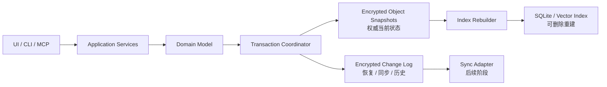

# Tagloom（织记）

> 一个以本地加密文件为真相源、以对象类型、普通标签和属性继承组织知识，并原生支持 AI Agent、MCP 与 CLI 的跨平台笔记系统。

## 1. 项目命名

### 推荐名称：Tagloom

**中文名：织记**

名称由两部分组成：

- `Tag`：同时代表定义对象结构的超级标签，以及用于轻量分类的普通标签。
- `Loom`：意为织机，象征通过标签、属性、双向链接和 AI 将分散知识编织成网络。

这个名称与产品定位比较一致：

- 不依赖文件夹整理。
- 对象类型承担结构和属性定义，普通标签承担轻量分类，两者在界面和数据语义上明确区分。
- 双向链接构成知识网络。
- AI Agent 可以在授权范围内读取、整理和连接知识。

### 备选名称

| 名称 | 含义 | 风格 |
|---|---|---|
| Lattica | 来自 lattice，强调知识网格与继承关系 | 技术感 |
| Ciphora | cipher + aura，强调加密与私人知识空间 | 隐私感 |
| ArborNote | arbor，树状继承和知识生长 | 自然、易理解 |
| MossNote | 苔藓式生长的本地知识网络 | 温和、个人化 |
| Nodara | node + data，强调节点化知识 | 平台感 |

> 正式发布前需要单独进行商标、域名、应用商店名称和开源仓库名称检索。

---

# 2. 产品定位

Tagloom 不是传统的 Markdown 文件管理器，也不是必须依赖远程数据库的云笔记。

它的核心定位是：

> 本地优先、端到端加密、基于对象和标签类型系统的个人知识平台。

核心差异：

1. 笔记以本地加密对象文件保存，解密后的业务载荷采用版本化 JSON。
2. 文件是真相源，索引均可删除并重建。
3. 用户主要通过对象类型、普通标签、属性和查询组织内容，而不是维护目录结构。
4. 对象类型可以继承，并附带属性、默认值、样式和模板；普通标签不携带 schema。
5. 笔记支持 Block 编辑，同时提供 Markdown 输入与导出。
6. 原生支持双向链接、语义搜索、AI Agent。
7. 通过 MCP 和 CLI 向外部 AI Agent 暴露受控能力。
8. 自部署后端同时提供同步服务和 AI 模型转发。

---

# 3. 核心设计原则

## 3.1 文件是真相源

笔记、标签、属性、配置和附件都以本地加密对象快照保存。加密对象快照是工作区当前状态的唯一权威来源。

Change Log 不与对象快照争夺权威性。它只承担以下职责：

- 原子提交和崩溃恢复。
- 多设备同步与幂等重放。
- 本地历史、审计和撤销。
- 生成并确认新快照后进行安全压缩。

读取当前状态时以已确认提交对应的对象快照为准；只有检测到未完成事务时，才使用 Change Log 完成提交或回滚。任何索引、缓存和远端同步副本都不得反向覆盖本地已确认快照，除非先生成一个可审计的新变更。

本地数据库或索引仅用于：

- 全文搜索。
- 标签和属性查询。
- 双向链接查询。
- 向量检索。
- 缓存和性能优化。

所有索引都必须可以从加密对象快照重新生成。Change Log 丢失可能影响历史、撤销和尚未同步的变更，但不得导致已经确认的当前快照无法读取。

## 3.2 对象类型与普通标签分离

Tagloom 将原“超级标签”解释为对象类型（Object Type）：它不是一个普通字符串，而是可继承、可携带属性 schema 和模板的结构化对象。界面统一使用“类型”称呼，协议层继续保留 `TagDefinition` 名称以兼容已有加密快照。

例如：

```text
Note
├── Project
│   ├── SoftwareProject
│   └── PersonalProject
├── Book
├── Person
├── Meeting
└── Idea
```

`Note` 是工作区内置根类型：始终存在、只读、不可重命名或删除。所有自定义对象类型最终继承 `Note`。新建笔记没有自定义类型时显示为 `Note`；用户可以选择 `Page`、`Task`、`Project` 等自定义类型，但不能移除底层的 `Note` 根身份。

普通标签只用于跨类型分类，例如 `#KMP`、`#设计`、`#灵感`。普通标签不继承、不携带属性或模板，也不参与对象类型冲突计算。它们通过内置的自由多选属性保存，以稳定选项 ID 作为值，并在工作区属性定义中持久化选项目录，支持输入创建和后续搜索复用。

## 3.3 Markdown 是输入和导出格式

内部真实数据采用 Block JSON，而不是纯 Markdown。

Markdown 用于：

- 快捷输入。
- 粘贴解析。
- 导入。
- 导出。
- 外部工具兼容。

复杂属性、标签继承、Block ID、嵌入块和视图信息不强制映射到标准 Markdown。

## 3.4 AI 必须经过权限层

AI Agent 不直接读取磁盘中的加密文件，而是调用应用提供的受控工具。

所有高风险操作需要：

- 明确权限。
- 操作预览。
- 用户确认。
- 审计记录。
- 可撤销或回滚。

---

# 4. 技术栈

## 4.1 客户端

```text
Kotlin Multiplatform
Compose Multiplatform
Kotlin Coroutines
Kotlin Serialization
Ktor Client
```

建议首发平台：

1. Windows、macOS、Linux 桌面端。
2. Android。
3. iOS。
4. Web 端后置。

## 4.2 后端

```text
Kotlin
Ktor Server
WebSocket / HTTP
PostgreSQL：保存账户、设备、同步游标、对象元数据和小型密文变更包
Blob Storage Adapter：默认使用服务端本地文件系统保存大体积密文附件，可选切换为 S3 兼容对象存储
```

服务端原则：

- 默认只保存密文。
- 不持有工作区解密密钥。
- 同步和 AI Gateway 分离。
- AI 请求只处理客户端明确发送的上下文。

## 4.3 本地索引

可采用：

```text
SQLite：全文、标签、属性、双链索引
本地向量索引：Block 级 embedding
```

数据库不是笔记的真实存储，只是可重建索引。

---

# 5. 本地目录结构

```text
workspace/
├── manifest.enc
├── config.enc
├── staging/
│   └── 01JTRANSACTION/
├── notes/
│   ├── 01JABC.note.enc
│   └── 01JABD.note.enc
├── tags/
│   ├── 01JTAG1.tag.enc
│   ├── 01JTAG2.tag.enc
│   └── 01JTAG3.tag.enc
├── properties/
│   ├── 01JPROP1.property.enc
│   └── 01JPROP2.property.enc
├── blobs/
│   └── 01JBLOB.blob.enc
├── changes/
│   ├── device-a-000001.change.enc
│   └── device-a-000002.change.enc
├── history/
│   └── conflicts/
│       └── 01JCONFLICT.conflict.enc
└── index/
    ├── local.sqlite
    └── vector.index
```

规则：

- 文件名只使用稳定 ID，不包含笔记标题。
- 用户创建的 Note、Tag、Property 和 Blob ID 必须是与名称无关的高熵不透明 ID。文档示例中的 `project`、`project-status` 等可读 ID 只用于讲解，不代表生产文件名。
- `notes`、`tags`、`properties` 和 `blobs` 中的已确认对象快照是当前状态的权威数据。
- `changes` 保存尚未压缩的事务、同步和历史记录；`history/conflicts` 保存需要用户查看或已经解决的冲突证据。
- `manifest.enc` 使用“公开认证头 + 加密载荷”的信封格式。KDF salt、KDF 参数、信封版本和被包装的主密钥包位于解锁所必需的公开头中，其余对象摘要和敏感配置位于密文载荷中。
- `staging` 只保存加密的未完成事务文件，正常提交或启动恢复完成后应被清理。
- `index` 可以被安全删除并重建。
- 所有敏感元数据都应加密。
- Blob 默认使用随机稳定 ID 命名。若需要工作区内去重，应使用工作区密钥派生的 HMAC 标识，不得直接暴露明文附件的 SHA-256。

---

# 6. 笔记模型

解密后的笔记 JSON 示例：

```json
{
  "schemaVersion": 1,
  "id": "01JABC",
  "type": "note",
  "title": "Tagloom 项目设计",
  "createdAt": "2026-07-13T10:00:00Z",
  "updatedAt": "2026-07-13T10:30:00Z",
  "directTagIds": ["note", "software-project"],
  "propertyValues": {
    "project-status": {
      "value": "active",
      "source": "user",
      "overridden": true
    }
  },
  "manualPropertyBindings": [],
  "propertyStyleOverrides": {},
  "blocks": [
    {
      "id": "block-1",
      "type": "heading",
      "parentId": null,
      "orderKey": "a1",
      "content": {
        "level": 1,
        "richText": {
          "runs": [
            {
              "text": "Tagloom",
              "marks": [],
              "annotationIds": []
            }
          ]
        }
      },
      "attributes": {}
    },
    {
      "id": "block-2",
      "type": "paragraph",
      "parentId": null,
      "orderKey": "a2",
      "content": {
        "richText": {
          "runs": [
            {
              "text": "一个本地优先的 ",
              "marks": [],
              "annotationIds": []
            },
            {
              "text": "knowledge system",
              "marks": [
                {
                  "type": "code",
                  "attributes": {}
                }
              ],
              "annotationIds": ["annotation-1"]
            },
            {
              "text": "。",
              "marks": [],
              "annotationIds": []
            }
          ]
        }
      },
      "attributes": {}
    }
  ],
  "annotations": {
    "annotation-1": {
      "id": "annotation-1",
      "kind": "note",
      "body": "这里指由对象、标签和链接共同组成的个人知识空间。",
      "createdAt": "2026-07-13T10:20:00Z",
      "updatedAt": "2026-07-13T10:20:00Z"
    }
  }
}
```

---

# 7. Block 模型

MVP 支持以下 Block：

```text
paragraph
heading
bulleted-list
numbered-list
todo
quote
code
divider
image
file
note-reference
```

每个 Block 必须拥有稳定 ID，以支持：

- 增量同步。
- Block 级双向链接。
- Block 级 embedding。
- 单块引用。
- 局部历史记录。
- AI 精确修改。

## 7.1 统一 Block 结构

Block 只采用一套外层结构，不再同时支持 `text`、`level` 顶层字段和 `content` 字段两种表示。不同 Block 类型只改变 `content` 的内部 schema：

```json
{
  "id": "block-2",
  "type": "paragraph",
  "parentId": null,
  "orderKey": "a1",
  "content": {
    "richText": {
      "runs": [
        {
          "text": "示例内容",
          "marks": [],
          "annotationIds": []
        }
      ]
    }
  },
  "attributes": {}
}
```

约束：

- `id` 是 Block 身份，在移动、重排和内容修改时保持不变。
- `parentId` 表示嵌套关系；顶层 Block 为 `null`。
- `orderKey` 只负责同一父节点下的稳定排序，不承载业务语义。
- `content` 使用按 `type` 区分的结构化联合类型，未知类型必须能够保留原始内容并以只读占位块显示。
- 删除 Block 时先生成 tombstone，达到保留期且所有已知设备确认后才能物理清理。

## 7.2 行内富文本、样式与加注

`paragraph`、`heading`、列表项、`todo`、`quote` 等文本 Block 使用 `RichText.runs` 表示行内内容。每个 `InlineRun` 包含文本、结构化 Mark 集合和加注引用。Mark 使用 `{ type, attributes }`，使 `link` 可以保存目标、`highlight` 可以保存语义色 token，同时让无参数的 `code` 保持统一结构。

MVP 支持以下行内 Mark：

```text
bold
italic
underline
strikethrough
code
highlight
link
```

其中：

- 单词或短语的代码样式使用 `code` Mark；多行代码仍使用独立 `code` Block。
- 一句话中的某个词可以通过 `annotationIds` 关联一个或多个加注。
- 加注是笔记快照内的独立对象，支持 `note`、`comment`、`definition` 等类型；删除正文锚点时，加注进入待清理状态而不是立即丢失。
- 相邻且 `marks`、`annotationIds` 完全相同的 Run 在保存前必须合并，空 Run 必须移除，保证序列化结果稳定。
- Mark 顺序不影响语义；保存前按 `type` 和规范化 attributes 的固定顺序排列，避免相同内容产生不同密文快照。
- Markdown 中的粗体、斜体、删除线、链接和行内代码可直接映射；加注等非标准能力导出时使用可选扩展语法或伴随元数据文件，并明确提示是否有损。

不为 InlineRun 分配长期稳定 ID。同步和历史的最小权威单元仍是 Block；并发修改同一 Block 时，对其规范化富文本执行三方合并。

---

# 8. 对象类型（超级标签）与普通标签

对象类型本身是独立加密对象。协议模型继续使用 `TagDefinition`，产品界面称为“类型”，避免与普通 `#标签` 混淆。

```json
{
  "id": "project",
  "name": "Project",
  "parentTagIds": ["note"],
  "propertyBindings": [
    {
      "propertyId": "project-status",
      "required": true,
      "defaultValue": "planned",
      "defaultPolicy": "snapshot",
      "readonly": false,
      "inheritable": true,
      "order": 10
    }
  ],
  "templateBlocks": []
}
```

## 8.1 两类标签的职责边界

| 概念 | 用户界面 | 结构能力 | 值语义 |
|---|---|---|---|
| 对象类型（超级标签） | `类型 · Project`，不使用 `#` 前缀 | 可继承属性、默认值、样式和模板 | 当前 Note 的结构身份 |
| 普通标签 | `#KMP`、`#设计` chip | 不继承、不携带 schema | 可搜索复用的轻量多选分类 |

一个 Note 在当前产品语义中只能应用一个自定义对象类型；内置根类型 `Note` 始终存在，因此协议字段 `directTagIds` 的规范形式为 `[Note]` 或 `[Note, appliedType]`。普通标签数量不影响对象类型继承图。

`directTagIds` 暂时保留列表形态，以兼容已有加密快照、对象类型的多父继承和未来协议迁移。旧快照若包含多个非根直接类型，读取时必须原样保留并提示用户选择一个应用类型；只有用户明确确认后才能写回规范形式，不能在加载、保存或切换界面时静默丢弃类型、属性值或历史引用。

## 8.2 直接类型与有效类型

```text
direct types：
笔记直接关联的根类型与唯一应用类型。

effective types：
直接对象类型加上全部父级类型。
```

例如：

```text
SoftwareProject → Project → Note
```

笔记只需直接关联 `SoftwareProject`，其有效标签为：

```text
SoftwareProject
Project
Note
```

## 8.3 对象类型继承规则

- 对象类型允许一个或多个父类型。
- 系统必须检测循环继承。
- 同一个属性通过 `propertyId` 判断是否相同。
- 同名但不同 ID 的属性视为不同属性。
- 子标签可以重载父标签的属性绑定。
- 多个同级对象类型对同一属性产生冲突时，必须显示冲突而不是静默覆盖。

“多个同级对象类型”只可能来自旧快照兼容、合并冲突或尚未确认的迁移状态。正常创建和编辑流程不得再产生多个非根直接类型。

## 8.4 标题下方的身份行

对象身份与普通标签共同放在标题正下方的一行，不使用右侧栏、卡片或传统表单标签：

1. 最左侧是层级展开图标，点击后在“仅显示应用类型”和“显示父级路径”之间切换。
2. 折叠时只显示应用类型，例如 `Project`；没有自定义类型时显示只读根类型 `Note`。
3. 展开时显示从根到应用类型的父级路径，例如 `Note › Page › Project`。多父类型必须使用稳定解析顺序展示，并允许在类型详情中查看完整父级关系。
4. 点击应用类型打开单选搜索菜单；选择新类型会替换旧类型，但不会删除旧类型曾写入的属性值，失去 schema 来源的值进入可恢复的未绑定值状态。
5. 普通标签紧随类型组，以中性 `#标签` chip 展示，支持搜索、自由创建和多选。

## 8.5 普通标签目录

普通标签使用一个内置 `multi-select` 属性保存。该属性采用 `free` 选项输入模式：

- 输入文本时实时搜索工作区已确认选项。
- 输入值与既有选项不重名时，可以创建新标签。
- 新标签先获得稳定随机选项 ID 并写入属性定义，再把该 ID 写入 Note 值。
- 工作区重新打开后，从已确认属性定义加载标签目录，因此同一标签可以继续搜索和复用。
- 删除 Note 上的标签只移除 Note 值，不自动删除工作区标签目录中的选项。

---

# 9. 属性系统

属性拆分为三层：

```text
PropertyDef
TagPropertyBinding
NotePropertyValue
```

## 9.1 PropertyDef

定义属性本身是什么。

```json
{
  "id": "project-status",
  "name": "状态",
  "type": "select",
  "optionInputMode": "fixed",
  "options": [
    {
      "id": "planned",
      "label": "计划中"
    },
    {
      "id": "active",
      "label": "进行中"
    },
    {
      "id": "done",
      "label": "已完成"
    }
  ],
  "defaultStyle": {
    "display": "badge",
    "icon": "circle"
  }
}
```

建议支持的属性类型：

```text
text
number
boolean
date
datetime
select
multi-select
url
email
relation
file
formula
```

`select` 与 `multi-select` 额外声明选项输入模式：

```text
fixed：只能选择属性定义中预先配置的选项，至少保留一个选项。
free：允许搜索既有选项，也允许输入新值；新值必须先持久化为同一属性的稳定选项，再写入 Note 值。
```

自由输入不是把显示文本直接写进 Note。Note 始终保存选项 ID，选项名称、颜色和排序仍由 `PropertyDefinition.options` 统一管理，避免重命名后出现重复标签或历史值失联。

## 9.2 TagPropertyBinding

定义某个标签如何使用属性。

```json
{
  "propertyId": "project-status",
  "required": true,
  "readonly": false,
  "inheritable": true,
  "defaultValue": "planned",
  "defaultPolicy": "snapshot",
  "styleOverride": {
    "display": "pill"
  }
}
```

## 9.3 NotePropertyValue

笔记只保存实际填写或覆盖后的值。

```json
{
  "project-status": {
    "value": "active",
    "source": "user",
    "sourceTagId": "project",
    "overridden": true,
    "updatedAt": "2026-07-13T10:30:00Z"
  }
}
```

## 9.4 系统时间与描述

- `createdAt`、`updatedAt` 来自 Note 加密对象快照头，是系统自动生成的只读元数据，不再复制成普通属性，避免出现双重权威状态。
- 新建 Note 时两者相同；每次 Note 快照确认后更新 `updatedAt`，`createdAt` 始终继承首个确认快照。
- 界面把创建与更新时间固定在编辑器视口右下角，以低强调文本展示，不占用标题下方身份与属性区域，也不提供编辑控件。
- “描述”是内置文本属性，使用普通属性写入与同步规则；界面在标题下方提供最多数行的轻量输入，不使用独立大卡片。

---

# 10. 笔记手动添加属性

笔记应该允许手动添加属性。

支持三种模式：

1. 添加仅属于当前笔记的私有属性。
2. 在当前笔记中复用已有的全局属性。
3. 创建属性并绑定到某个标签。

标题下的动态属性区采用无边框双列行：左列是属性名，右列是值编辑器。对象类型继承属性与当前笔记自定义属性使用同一布局，并通过弱化的来源说明区分，不建立右侧属性栏。

属性区按以下顺序渐进展示：

1. 描述。
2. 默认展开的对象类型属性与当前笔记属性。
3. “更多属性”折叠入口，容纳样式声明为折叠的属性。
4. `+ 添加属性` 入口。

新增属性使用锚定在入口附近的渐进式浮层，不使用模态对话框或右侧栏：先搜索已有属性或输入名称，再选择属性类型，最后选择“仅当前笔记”（默认）或“当前应用类型”。选择已有属性时直接建立当前笔记绑定；创建新属性时必须先确认属性定义，再建立目标绑定，仍遵守统一事务与故障恢复规则。

当同一个手动属性在多篇相同类型笔记中重复出现时，可以提示：

> 是否将该属性提升为标签属性？

---

# 11. 继承属性的计算

标签继承来的属性不需要复制到笔记文件。

渲染或查询时计算：

```text
1. 获取笔记的直接标签。
2. 解析全部父标签。
3. 收集所有 PropertyBinding。
4. 应用父标签定义。
5. 应用子标签重载。
6. 应用同级标签冲突规则。
7. 应用笔记级属性值。
8. 应用笔记级样式覆盖。
9. 得到最终有效属性集合。
```

属性优先级：

```text
Note 手动值
>
Note override
>
直接标签绑定
>
父标签绑定
>
PropertyDef 默认值
```

## 11.1 默认值策略

```text
dynamic
标签默认值变化后，未覆盖的笔记实时跟随。

snapshot
笔记首次关联标签时写入一次，后续不自动变化。

none
只提供属性定义，不产生默认值。
```

推荐：

| 属性 | 策略 |
|---|---|
| 类型、只读分类 | dynamic |
| 状态、优先级、评分 | snapshot |
| 创建时间、更新时间 | system |
| 普通输入字段 | none |

---

# 12. 属性样式

样式与属性值分离。

支持三级样式：

```text
PropertyDef.defaultStyle
TagPropertyBinding.styleOverride
Note.propertyStyleOverrides
```

MVP 可以先只实现前两级。

可配置项：

```text
icon
color
display
order
visible
showInCard
showInList
collapsed
dateFormat
numberFormat
optionStyle
relationDisplay
```

标题下动态属性区对样式字段作如下确定性解释：

- `visible = false`：隐藏于常规属性区，但值和绑定仍完整保留，可从管理入口恢复显示。
- `collapsed = true`：放入“更多属性”。
- 其他情况：默认在描述下方展开。
- `order`：在同一展示组内排序；相同时按属性稳定 ID 排序，保证跨平台结果一致。
- 未知属性类型：保留原始值并使用只读回退行展示，旧客户端保存时不得删除或重写其值。

示例：

```json
{
  "id": "priority",
  "name": "优先级",
  "type": "select",
  "options": [
    {
      "id": "urgent",
      "label": "紧急",
      "style": {
        "icon": "fire",
        "colorToken": "danger"
      }
    }
  ],
  "defaultStyle": {
    "display": "badge"
  }
}
```

建议保存语义色 token，而不是固定十六进制颜色，以适应亮色、暗色和无障碍主题。

---

# 13. 双向链接

链接应进入核心数据模型，而不是仅作为编辑器表现。

支持：

```text
Note → Note
Block → Note
Block → Block
Property relation → Note
Embed → Note / Block
```

索引记录：

```text
fromNoteId
fromBlockId
toNoteId
toBlockId
linkType
```

功能：

- 出链。
- 反向链接。
- 未链接提及。
- 嵌入引用。
- 关系属性。
- 图谱视图。

---

# 14. 查询系统

支持：

```text
标签查询
属性查询
全文查询
双链查询
语义查询
混合查询
```

示例：

```text
tag:Project
tag:Project status:active
tag:Book rating>=4
linkedTo:"Tagloom"
"增量同步" semantic:true
```

查询结果可以保存为视图：

```text
列表
表格
看板
日历
图谱
```

---

# 15. 向量搜索

向量数据库仅作为可重建搜索索引，不保存笔记真相。

建议按 Block 建立 embedding：

```json
{
  "embeddingId": "emb-001",
  "noteId": "01JABC",
  "blockId": "block-2",
  "contentHash": "sha256...",
  "model": "embedding-model-id"
}
```

Block 内容变化时，仅重建对应 Block 的向量。

推荐搜索流程：

```text
关键词检索
+ 标签过滤
+ 属性过滤
+ 向量召回
+ 双链相关度
= 混合排序
```

隐私原则：

- 优先在客户端生成 embedding。
- embedding 默认保存在本地。
- 远程生成 embedding 前需明确告知用户。
- 远端服务不得默认扫描整个工作区。

---

# 16. 同步架构

## 16.1 自部署设备同步

```text
客户端
↓ WebSocket / HTTP
Sync Server
↓
其他设备
```

服务器负责：

- 设备认证。
- 密文变更上传和下载。
- 密文附件同步。
- 版本向量或游标管理。
- 幂等去重。
- 可选快照存储。

服务器默认无法解密内容。

## 16.2 WebDAV 等文件同步

不要直接同步正在使用的索引数据库。

同步对象：

```text
encrypted change chunks
encrypted snapshots
encrypted blobs
encrypted manifests
```

推荐目录：

```text
remote/
└── workspace-id/
    ├── manifest.enc
    ├── changes/
    ├── snapshots/
    └── blobs/
```

WebDAV 更适合异步多设备同步和备份，不承诺低延迟实时协作。Tagloom 不以多人协作编辑为目标；自部署 Sync Server 也只承诺同一用户多设备之间的可靠同步，不承诺光标、选区和字符级实时协作。

## 16.3 增量变更

```json
{
  "changeId": "device-a-000002",
  "actorId": "device-a",
  "targetId": "01JABC",
  "baseClock": {
    "device-a": 1
  },
  "ops": [
    {
      "op": "update-block-text",
      "blockId": "block-2",
      "value": "新的内容"
    }
  ]
}
```

变更包必须：

- 加密。
- 签名或认证。
- 幂等。
- 可排序或可因果合并。
- 可重复拉取。
- 可生成快照。

每个变更额外记录：

```text
changeId
actorId
targetId
baseRevision
baseClock
hybridLogicalTime
operationType
payload
payloadHash
```

`hybridLogicalTime` 使用物理时间、逻辑计数器和 `actorId` 构成全序。它用于确定性排序，但因设备时钟可能错误，所有自动覆盖都必须保留被覆盖版本，不能把时间戳当成销毁旧内容的依据。

## 16.4 合并方案比较

| 方案 | 工作方式 | 优点 | 缺点 | Tagloom 结论 |
|---|---|---|---|---|
| 确定性 LWW | 同一字段或对象只保留排序更后的版本 | 实现简单、必然收敛 | 同一 Block 的并发编辑容易静默丢失 | 只用于简单标量字段和冲突后的临时胜者 |
| 三方合并 | 基于共同祖先比较 Base、Local、Remote | 能自动合并不重叠修改，冲突可解释、可恢复 | 重叠修改仍需保留冲突，需要保存共同祖先 | 作为 Block 内容的默认方案 |
| CRDT | 将内容建模为可交换、可收敛的细粒度操作 | 离线并发和实时协作体验最好，通常无需人工技术冲突 | 算法、元数据、调试、迁移和历史压缩复杂 | MVP 不采用，保留未来替换空间 |

Tagloom 采用混合策略：

```text
标量字段
→ 基于因果顺序和 Hybrid Logical Clock 的确定性 LWW

不同 Block
→ 按 Block ID 独立合并

同一 Block 的富文本
→ 对规范化 RichText 执行三方合并

Block 顺序
→ 稳定 Block ID + orderKey 合并

无法自动合并的重叠修改
→ 确定临时胜者 + 永久保留冲突记录 + 用户后续解决
```

这样既避免为了非协作产品引入完整 CRDT，又为将来替换某一种 Block 的合并器保留 `BlockMergeStrategy` 接口。Change Log 必须保存 `baseRevision`，否则无法可靠执行三方合并。

## 16.5 删除与更新竞争规则

删除必须表示为带版本的 tombstone，不得在同步确认前直接物理删除。

当删除和更新作用于同一对象或 Block 时，按以下顺序决定：

1. 若两者存在因果关系，因果上更晚的操作生效。
2. 若两者并发，比较 `hybridLogicalTime`，时间排序更后的操作生效。
3. 若时间仍相同，`update` 优先于 `delete`，避免无法确认的内容丢失。
4. 同类型操作仍相同则以 `actorId` 作为最终确定性排序，只用于保证所有设备收敛。
5. 无论谁生效，另一侧内容都进入加密历史或冲突记录，并可由用户恢复。

较晚的更新覆盖 tombstone 时，系统视为恢复对象；较晚的删除生效时，对象进入回收站。物理清理必须同时满足保留期结束、所有已知设备确认以及不存在未解决冲突。

## 16.6 冲突展示、保留与恢复

Tagloom 参考 Git 的三方合并思路，但不直接向普通用户展示冲突标记。

- 非重叠修改自动合并，不显示冲突。
- 重叠修改生成 `ConflictRecord`，保存 Base、Local、Remote、临时胜者、相关 Change ID 和创建时间。
- 当前笔记显示非阻塞提示，例如“此笔记有 1 处来自另一设备的修改待确认”。
- 冲突查看器提供“保留当前版本”“使用另一版本”“同时保留”“手动编辑”四种操作。
- “同时保留”默认将两个版本并列为相邻 Block，避免把冲突标记写入正文。
- 解决冲突会产生新的普通 Change；原冲突记录标记为 `resolved`，但在历史保留期内继续可查。
- 历史面板支持按对象、Block、设备和时间恢复；恢复本身也是新的 Change，不重写历史。

Git 会在竞争修改无法自动合并时要求用户决定最终内容，参见 [GitHub 官方冲突说明](https://docs.github.com/en/pull-requests/collaborating-with-pull-requests/addressing-merge-conflicts/about-merge-conflicts)。Tagloom 借鉴其 Base/Local/Remote 模型，但通过临时胜者和冲突副本保证同步不会被阻塞。

## 16.7 Anytype 为什么通常没有用户可见冲突

Anytype 使用 AnySync。其官方协议说明将同步对象组织为 Conflict-free Replicated Data DAG，并通过 CRDT 在各设备本地合并变更，使副本在没有中心化内容真相源的情况下自动收敛。因此用户通常不会看到类似 Git 的“合并冲突”流程，参见 [AnySync Protocol Overview](https://tech.anytype.io/any-sync/overview) 和 [Anytype 官方文档](https://doc.anytype.io/anytype-docs)。

这并不表示并发修改不存在，而是冲突被数据类型的确定性规则自动解释了。CRDT 保证技术上的最终收敛，不保证自动结果一定符合用户的语义意图。Anytype 同时面向共享空间和协作，承担这部分复杂度是合理的；Tagloom 当前只做单用户多设备同步，优先选择更容易审计、测试和恢复的三方合并方案。

---

# 17. 加密设计

## 17.1 威胁模型与安全边界

加密设计主要防御：

- 设备磁盘、备份介质或远端同步存储被复制。
- 同步服务器、对象存储管理员或网络中间人读取正文和敏感元数据。
- 被撤销设备继续伪造新变更。
- 单个文件被篡改、截断、替换或与其他对象调包。
- 应用日志、崩溃报告和临时文件意外泄露正文或密钥。

MVP 不承诺防御：

- 工作区已解锁时，操作系统、恶意驱动、调试器或同权限恶意进程读取内存。
- 用户主动授权发送给远程 AI 的明文内容被模型供应商处理。
- 文件数量、密文长度、同步时间、访问频率以及随机工作区/设备标识等流量侧信道。MVP 不实现全量填充、ORAM 或流量混淆，但不得额外暴露标题、标签名、属性名和原始文件名。
- 攻击者同时回滚整个本地工作区、全部备份和所有外部锚点。离线系统可以通过哈希链检测局部回滚，但没有外部可信锚点时无法可靠检测完整工作区回滚。

## 17.2 密钥层次

采用信封加密，而不是直接使用用户密码加密每个对象：

```text
用户密码
↓ KDF
Key Encryption Key
↓ 解密 manifest 中的主密钥包
Workspace Master Key
↓ HKDF 按用途派生
Snapshot Wrapping Key / Blob Wrapping Key / Change Wrapping Key / Audit Wrapping Key
↓ 包装每次写入随机生成的 Data Encryption Key
Object Snapshot / Blob / Change / Audit Record
```

规则：

- 用户密码使用 Argon2id 派生 256 位 KEK，遵循 [RFC 9106](https://www.rfc-editor.org/rfc/rfc9106.html)。每个工作区使用至少 16 字节随机 salt。
- KDF 参数与格式版本写入 manifest。参数按设备能力校准到约 500–1000ms 的解锁时间；首个桌面实现以 64 MiB 内存、3 次迭代、并行度 1 作为测试基线，发布前必须在目标平台基准测试后冻结。
- 更换密码只重新派生 KEK 并重新包装 Workspace Master Key，不重新加密全部对象。
- 每次写入对象、附件或变更包时生成独立随机 256 位 DEK；DEK 由对应用途的 Wrapping Key 包装。
- Workspace Master Key 轮换时优先重新包装各对象 DEK；只有算法升级或密钥疑似泄露时才重加密正文。
- 不同用途的 Wrapping Key 必须通过带固定域分离字符串的 HKDF-SHA-256 派生，禁止复用。

## 17.3 文件加密包格式

默认算法套件建议为：

```text
KDF: Argon2id
Key derivation: HKDF-SHA-256
AEAD: XChaCha20-Poly1305
Key size: 256 bit
Nonce size: 192 bit, 每次加密随机生成
```

若某个平台无法提供经过审计的 XChaCha20-Poly1305 实现，可以通过版本化 `cipherSuite` 增加 AES-256-GCM 适配器，但同一文件必须明确记录所用算法，不得根据运行平台隐式猜测。

加密文件使用版本化二进制信封，逻辑字段如下：

```json
{
  "magic": "TAGLOOM",
  "envelopeVersion": 1,
  "cipherSuite": "XCHACHA20_POLY1305",
  "objectType": "note-snapshot",
  "objectId": "01JABC",
  "keyId": "workspace-key-1",
  "revision": "device-a:42",
  "wrappedDataKey": "...",
  "wrapNonce": "...",
  "payloadNonce": "...",
  "ciphertext": "..."
}
```

实际落盘可以采用紧凑二进制编码，以上 JSON 仅说明字段语义。`magic`、版本、算法、对象类型、对象 ID、工作区 ID、revision 和密文长度必须作为 AEAD Associated Data 参与认证，防止文件调包和头部篡改。标题、标签名、正文、属性值、原始文件名和 MIME 等敏感元数据只出现在密文中。

## 17.4 Blob、写入和临时文件

- Blob 默认使用随机稳定 ID，明文哈希只保存在密文元数据中。
- 如需工作区内去重，使用专用 `BlobIdKey` 计算 HMAC-SHA-256；禁止以明文 SHA-256 直接命名，避免已知内容探测和跨工作区关联。
- 写入流程固定为“创建同目录临时文件 → 写入完整信封 → flush/fsync → 原子替换 → fsync 目录 → 标记事务已提交”。
- 临时文件必须使用随机名称并保持加密，任何阶段都不得把明文 JSON 或附件写入工作区临时目录。
- 启动时扫描未完成事务：能够验证完整 AEAD 和事务记录时完成提交，否则隔离临时文件并回滚到上一已确认快照。

## 17.5 完整性、历史与回滚检测

- 每个快照记录 `revision`、`previousSnapshotHash` 和产生它的 `changeId`。
- Change Log 使用带认证的哈希链；删除、重排或插入历史记录应能在本地被检测。
- manifest 保存最近一次已确认事务和各对象最新 revision 的认证摘要，用于发现局部回滚或文件集合不一致。
- 远端同步启用后，可把工作区确认点提交给另一台已授权设备或自部署服务作为外部锚点，以检测整个本地工作区回滚。
- 历史压缩必须先写入新快照、验证可解密、记录压缩边界，并确认所有目标同步端已接收；之后才删除边界之前的 Change。

## 17.6 密钥恢复、设备授权和轮换

- 创建工作区时生成高熵 Recovery Key，用于独立包装 Workspace Master Key；Recovery Key 默认只展示一次，并支持导出到用户选择的离线介质。
- 没有密码、Recovery Key 或已授权设备时无法恢复内容，产品必须在创建工作区时明确告知这一点。
- 操作系统钥匙串只能保存由系统安全能力保护的解锁材料或短期会话密钥，不保存用户密码；用户可关闭自动解锁。
- 每台设备拥有独立签名密钥和设备 ID。同步变更必须签名，被撤销设备的新变更拒绝接收，但撤销前的合法历史继续可验证。
- 密码变更、设备撤销、Workspace Master Key 轮换和算法迁移是四种不同操作，必须分别建模和测试。
- 密钥轮换中断时，旧新 `keyId` 可以在短期内并存；每个文件信封通过 `keyId` 选择正确密钥，完成全量验证后才能删除旧密钥。

## 17.7 明文生命周期与日志

- 解密只发生在受控存储服务中，领域层接收所需对象，不向 UI、索引和 Agent 暴露主密钥或 DEK。
- 可变字节缓冲区使用后尽力清零；JVM、Kotlin/Native 和不可变字符串无法保证彻底清除，文档和 UI 不得声称“内存零残留”。
- 日志、异常、遥测和崩溃报告不得包含密码、密钥、标题、正文、属性值、原始文件名、完整查询词或远程 AI 上下文。
- 锁定工作区时取消后台解密任务、关闭索引连接、清除会话密钥引用，并使 MCP、CLI 和 Agent 入口立即失效。

最低安全要求：

- 使用成熟 AEAD 算法。
- 每次加密使用独立 nonce，绝不把对象 ID 或时间戳直接当 nonce。
- 加密元数据和正文。
- 文件名不泄露标题。
- 支持密钥轮换。
- 支持设备撤销。
- 内存中的明文尽量缩短生命周期。
- 不自行发明密码算法。
- 所有算法实现必须通过已知答案测试、篡改测试、截断测试、错误密钥测试、nonce 唯一性测试和跨平台兼容测试。

---

# 18. AI Agent

Agent 应通过工具层工作，不直接访问加密文件。

可用工具：

```text
search_notes
query_notes
get_note
get_block
get_backlinks
get_tags
get_tag_schema
suggest_tags
suggest_properties
create_note
update_note
add_tag
export_note
```

权限建议：

```text
read_notes
search_notes
suggest_changes
write_notes
delete_notes
export_notes
call_remote_ai
```

默认策略：

- 读取当前笔记和用户授权范围。
- 修改以建议或 diff 形式展示。
- 写入需要用户确认。
- 批量修改、删除、导出和远程发送需要二次确认。
- 所有工具调用写入本地审计日志。

---

# 19. MCP 与 CLI

## 19.1 CLI

```bash
tagloom search "Kotlin Multiplatform"

tagloom query \
  --tag Project \
  --where "status = active"

tagloom get 01JABC --format markdown

tagloom backlinks 01JABC

tagloom create \
  --title "新的想法" \
  --tag Idea \
  --content "..."
```

CLI 应调用同一个共享核心，不绕过权限、加密和审计系统。

## 19.2 MCP Server

支持：

```text
stdio
Streamable HTTP
```

MCP Tools：

```text
search_notes
get_note
query_notes
get_backlinks
create_note
update_note
add_tag_to_note
export_note
```

MCP Resources：

```text
note://01JABC
tag://project
workspace://schema
query://saved/project-active
```

默认安全策略：

- 默认只读。
- 写入工具可单独启用。
- 删除工具默认不暴露。
- 本地 MCP 仅在工作区已解锁时可访问。
- 每个外部 Agent 使用独立 token 和 scope。
- 返回内容应支持脱敏和数量限制。

---

# 20. 后端 AI Gateway

后端除了同步，还可以提供 AI 请求转发。

职责：

```text
模型路由
供应商适配
API Key 托管
调用配额
请求日志
用量统计
限流
重试
流式响应
embedding 转发
```

隐私边界：

```text
本地搜索
↓
本地构建候选上下文
↓
用户查看或授权
↓
只发送必要 Block
↓
AI Gateway
↓
模型供应商
```

后端不得自动持有工作区解密密钥。

部署时可以提供不同隐私模式：

```text
Local Only
仅本地模型，不发送远端。

Self-hosted AI
发送到用户自部署模型。

Gateway
发送到自部署 AI Gateway，再转发供应商。

Direct Provider
客户端直接调用模型供应商。
```

---

# 21. MVP 路线

## 阶段一：桌面端安全垂直切片

- 首个可验收平台为 Windows 桌面端，公共领域模型和用例继续放在 KMP `commonMain`。
- 工作区创建、Recovery Key 备份、锁定和解锁。
- 版本化加密信封、对象快照权威模型、原子写入和崩溃恢复。
- 最小 Note、对象类型、普通标签、Property 模型和只读默认 Note 根类型。
- 标签继承、稳定拓扑顺序和循环检测；复杂继承 UI 后置。
- `paragraph`、`heading`、`todo` Block 与基础行内 Mark、单词级 `code`、加注。
- 描述、文本、固定/自由单选与多选、日期等基础属性；公式、复杂样式和自动提升后置。
- Markdown 输入和导出，并提示无法无损映射的能力。
- 手动加密备份、恢复和损坏文件隔离。

## 阶段二：索引和查询

- SQLite 可重建索引。
- 全文搜索。
- 标签查询。
- 属性查询。
- 双链查询。
- 保存查询。
- 阶段一和阶段二共同构成首个对外 MVP。

## 阶段三：同步

- Change Log。
- 本地快照。
- WebDAV 增量同步。
- 自部署同步服务。
- 多设备冲突处理。
- 附件同步。

## 阶段四：AI

- 当前笔记总结。
- 自动标签建议。
- 属性提取建议。
- 相关笔记发现。
- 本地上下文构建。
- AI Gateway。

## 阶段五：MCP 和 CLI

- 只读 CLI。
- 只读 MCP。
- 写入确认。
- 权限 scope。
- 审计和回滚。

## 阶段六：向量搜索

- Block 级 embedding。
- 本地向量索引。
- 混合搜索。
- RAG 上下文构建。

---

# 22. 推荐模块划分

```text
app/
├── shared/
├── desktopApp/
├── androidApp/
└── iosApp/

core/
└── src/
    ├── commonMain/
    │   ├── domain/
    │   ├── application/
    │   └── ports/
    ├── jvmMain/
    │   └── adapters/
    ├── androidMain/
    │   └── adapters/
    └── iosMain/
        └── adapters/

server/

tools/                 # 后续按需增加
├── cli/
└── mcp-server/
```

项目早期采用模块化单体。`tag-engine`、`property-engine`、`block-engine`、`file-store`、`crypto` 等先作为 `core` 内职责清晰的 package 和接口存在，不立即拆成十多个 Gradle 模块。

只有满足以下任一条件时才拆分独立模块：

- 需要隔离 JVM、Android 或 Apple 平台依赖。
- 需要被 CLI、MCP、服务端等多个入口独立复用。
- 编译时间、依赖方向或测试边界已经无法通过 package 约束维持。
- 模块拥有明确公共 API，且内部实现可以独立替换。

核心依赖方向：

```text
UI
↓
Application Services
↓
Domain
↓
Ports
↓
File Store / Crypto / Index / Network Adapters
```

Domain 层不能直接依赖 Compose、SQLite、Ktor 或具体 AI SDK。

---

# 23. Codex 开发方式

不要一次要求 Codex 完成整个应用。

建议先提交设计文档和约束，再按模块实现。

示例任务：

```text
实现 TagResolver：

- 输入 directTagIds。
- 输出 effectiveTagIds。
- 支持多父标签。
- 所有标签默认继承 Note。
- 检测直接和间接循环。
- 返回稳定的拓扑顺序。
- 不依赖数据库。
- 为菱形继承和循环继承编写单元测试。
```

```text
实现 EffectivePropertyResolver：

- 从有效标签中收集 PropertyBinding。
- 子标签可以重载父标签。
- 笔记 override 优先级最高。
- 同级冲突必须返回 Conflict，不得静默覆盖。
- 支持 dynamic、snapshot、none 默认值策略。
- 不修改原始 Note 或 Tag。
```

```text
实现 EncryptedJsonFileStore：

- 文件名使用对象 ID。
- 支持原子写入。
- 写入前创建临时文件。
- 加密认证失败时返回明确错误。
- 不在日志中输出密钥、标题或正文。
- 提供损坏文件恢复测试。
```

---

# 24. 一句话架构

> Tagloom 使用 Kotlin Multiplatform 和 Compose 构建跨平台客户端，以本地加密对象快照作为当前状态的唯一权威来源，以可重建索引提供全文、标签、属性、双链和向量搜索，通过 Ktor 自部署服务提供密文同步与 AI 转发，并使用 MCP 与 CLI 向外部 AI Agent 暴露受权限控制的知识工具。

---

# 25. 非目标

以下能力不属于首个 MVP，部分能力甚至不属于产品长期目标。明确非目标用于防止技术预留不断扩大首发范围。

## 25.1 MVP 非目标

- 不提供多人实时协作、在线光标、选区同步和评论通知。
- 不发布 Web 客户端，不要求 Android、iOS 与桌面端同时达到功能对等。
- 不提供自部署 Sync Server、WebDAV 自动同步和跨设备自动合并；只要求模型为后续同步保留稳定 ID、revision 和 Change Log。
- 不提供远程 AI Gateway、自动 RAG、向量搜索和模型供应商账户托管。
- 不提供写入型 MCP、批量 Agent 自动修改和无人确认的后台整理。
- 不实现公式属性、Rollup、复杂数据库视图、插件市场和完整自动化平台。
- 不追求所有 Block、属性和加注都能与标准 Markdown 无损往返。
- 不以文件夹作为主要组织模型，也不把每篇笔记暴露为可直接编辑的明文 Markdown 文件。

## 25.2 长期非目标

- 服务端不得成为笔记明文的权威存储，不默认持有 Workspace Master Key。
- 不采用必须联网才能创建、读取或编辑笔记的云优先架构。
- 不允许 AI、CLI、MCP 或插件绕过应用服务直接修改加密文件。
- 不承诺在工作区已经解锁且操作系统被同权限恶意程序控制时仍能保护内存明文。
- 不通过静默丢弃并发版本来制造“从不冲突”的体验。
- 不自行设计未经公开分析的密码算法或自定义 AEAD 模式。

---

# 26. 权威数据模型与提交协议

## 26.1 数据角色



数据角色必须保持单向：

- **对象快照**：当前业务状态的唯一权威来源。
- **Change Log**：描述如何到达当前状态，承担恢复、同步、历史和审计；不能绕过应用服务直接成为查询主库。
- **manifest**：记录工作区格式、密钥包、最近已确认事务和对象 revision 摘要，是确认哪些快照已提交的权威入口。
- **索引**：对象快照的派生结果；删除后功能降级但数据不丢失。
- **远端副本**：密文传输和备份介质，不具有覆盖本地状态的特殊权限。

## 26.2 通用对象快照

Note、Tag、PropertyDef、SavedQuery 等对象采用共同信封内的逻辑头：

```json
{
  "schemaVersion": 1,
  "objectId": "01JABC",
  "objectType": "note",
  "revision": {
    "actorId": "device-a",
    "sequence": 42
  },
  "lastChangeId": "device-a-000042",
  "previousSnapshotHash": "sha256...",
  "createdAt": "2026-07-13T10:00:00Z",
  "updatedAt": "2026-07-13T10:30:00Z",
  "deleted": false,
  "payload": {}
}
```

不变量：

- `objectId` 创建后永不改变，标题和名称不得作为身份。
- 同一对象的 revision 必须单调前进，不允许原地覆盖却保持 revision 不变。
- `previousSnapshotHash` 指向上一已确认快照，用于检测局部历史断裂。
- 删除只把 `deleted` 设为 `true` 并保留必要 tombstone 信息；物理删除由保留策略执行。
- 未识别的 `schemaVersion` 不得被旧客户端重写；旧客户端进入只读兼容模式并保留原始密文文件。
- 领域模型不得持有 Compose、SQLite、Ktor、具体加密库或文件路径类型。

## 26.3 单写者与事务边界

同一工作区在单个设备上只允许一个写入协调器。多个窗口、CLI、MCP 和 Agent 必须通过同一应用服务提交命令，不能各自写文件。

一次业务操作可以修改多个对象，例如“创建属性并绑定标签再写入笔记”。这些修改共享一个 `transactionId`，要么全部确认，要么恢复到上一确认状态。

提交步骤：

1. **校验**：在内存中执行权限、schema、继承循环、引用完整性和业务规则校验。
2. **准备变更**：生成包含 Base revision、操作列表、目标 revision 和预期快照哈希的加密 Change。
3. **写入暂存**：在工作区同一文件系统的加密 staging 目录写入全部新快照和恢复所需信息。
4. **持久化准备状态**：flush/fsync 暂存文件与 `prepared` 事务记录。
5. **发布快照**：逐个原子替换对象文件。读取服务在事务完成前继续使用内存中的上一确认状态。
6. **确认事务**：最后原子更新 manifest 的 `lastCommittedTransactionId` 和 revision 摘要，再写入 `committed` 标记。
7. **更新派生状态**：事务确认后异步更新 SQLite、双链和向量索引；索引失败不回滚已确认业务快照。
8. **清理**：确认所有新快照可解密且摘要一致后删除 staging；历史压缩在单独事务中执行。

启动恢复：

- 存在 `prepared` 且 manifest 未确认时，若全部暂存快照完整并通过 AEAD、schema 和哈希校验，则完成发布并确认事务。
- 任何新快照不完整时，使用 staging 中的上一版本或 Change 恢复到 manifest 记录的确认状态。
- 无法自动确认或回滚时进入只读安全模式，隔离可疑文件并生成恢复报告，不继续写入。

## 26.4 Change Log 压缩

压缩边界称为 `checkpoint`，包含工作区确认事务 ID、对象 revision 摘要和快照哈希根。

只有同时满足以下条件才能删除 checkpoint 之前的 Change：

- checkpoint 覆盖的全部对象快照已写入并验证可解密。
- 本地撤销保留期已结束，或相关 Change 已归档到用户启用的历史备份。
- 启用同步时，所有仍有效的已知设备都确认收到 checkpoint 或已被明确撤销。
- 未解决冲突没有引用待删除的 Base、Local 或 Remote 版本。

---

# 27. 架构决策记录

## ADR-001：加密对象快照是权威状态

**状态**：Accepted

**背景**：系统同时需要可审计历史、增量同步、崩溃恢复和简单可靠的本地读取。如果对象快照与事件日志都能独立解释当前状态，会产生双重真相源。

**决定**：已确认的加密对象快照是当前状态的唯一权威来源；Change Log 只负责事务恢复、同步、历史、审计和撤销，并允许在 checkpoint 后压缩。

**权衡**：读取、备份和迁移更直观，但跨对象原子事务需要 manifest、staging 和恢复协议；这比完整 Event Sourcing 更适合个人知识库。

**未采用方案**：

- 完整 Event Sourcing：历史能力强，但投影、迁移和长期事件兼容成本过高。
- SQLite 作为主库：事务简单，但削弱文件可恢复性和“索引可删除”的核心承诺。

## ADR-002：Block 使用统一结构和行内 RichText

**状态**：Accepted

**背景**：正文需要 Block 级身份，同时支持单词级样式、行内代码、链接和加注。若把每种样式拆成 Block，会破坏编辑体验；若同时保留两套 Block JSON，会使迁移和同步歧义化。

**决定**：所有 Block 使用 `id/type/parentId/orderKey/content/attributes` 外层结构。文本类 Block 的 `content` 使用规范化 `RichText.runs`；InlineRun 包含 `text`、`marks` 和 `annotationIds`。同步最小权威单元仍是 Block。

**权衡**：序列化稳定、跨平台容易实现，能满足单词级样式；但同一 Block 的并发编辑需要富文本三方合并，Markdown 也不一定无损。

**未采用方案**：

- 纯 Markdown 真相源：无法可靠保存 Block ID、加注和结构化属性。
- 字符级 CRDT：协作能力强，但当前产品不做实时协作，复杂度不成比例。

## ADR-003：采用 LWW 与三方合并的混合同步

**状态**：Accepted

**背景**：产品需要预留离线多设备同步，但不提供多人实时协作。单纯对象级 LWW 会静默丢失同一 Block 的编辑，完整 CRDT 又会显著增加实现和迁移成本。

**决定**：标量字段使用基于因果顺序和 Hybrid Logical Clock 的确定性 LWW；不同 Block 独立合并；同一 Block 富文本使用 Base/Local/Remote 三方合并；无法自动合并时选择临时胜者并保留加密冲突记录。

**权衡**：大多数个人多设备冲突可自动处理，并且保留 Git 式可解释性；重叠修改仍需要用户确认，不能宣传为“绝无冲突”。

**未采用方案**：

- 全对象 LWW：简单但可能无提示丢失整段内容。
- CRDT：Anytype 等协作产品采用该方向，但对 Tagloom 首期需求过度设计。

## ADR-004：文件使用版本化信封加密

**状态**：Accepted

**背景**：需要支持换密码、主密钥轮换、算法迁移、设备撤销和单文件篡改检测，不能让用户密码直接成为长期数据密钥。

**决定**：Argon2id 派生 KEK；KEK 包装 Workspace Master Key；HKDF 派生用途隔离的 Wrapping Key；每次写入随机生成 DEK，并使用版本化 AEAD 信封保存密文。首选 XChaCha20-Poly1305，算法通过 `cipherSuite` 显式版本化。

**权衡**：换密码和密钥轮换成本可控，文件自描述且可迁移；代价是信封、密钥注册表和中断恢复逻辑更复杂。

**未采用方案**：

- 密码直接加密对象：密码变更昂贵且容易误用。
- 单一 Workspace Key 直接加密所有文件：用途隔离和轮换能力不足。

## ADR-005：索引是可重建派生数据

**状态**：Accepted

**背景**：全文、标签、属性和双链查询适合 SQLite，但本地数据库损坏不应等价于笔记丢失。

**决定**：SQLite 和向量索引只消费已确认快照，不参与业务提交。索引记录其覆盖的 checkpoint；落后或损坏时从快照增量补齐或全量重建。

**权衡**：数据恢复边界清晰，但首次重建和大工作区启动需要进度、取消和降级体验。

## ADR-006：桌面优先的模块化单体

**状态**：Accepted

**背景**：当前项目和团队规模尚不需要十多个 Gradle 模块，但领域逻辑必须保持 KMP 可复用并隔离平台能力。

**决定**：首期维持 `app/shared`、`core`、`server` 等少量模块，在 `core` 内按 domain、application、ports、adapters 分包。Windows 桌面端先形成完整垂直切片，Android 和 iOS 后续复用公共核心。

**权衡**：构建和重构成本较低，边界主要依靠代码规范和测试维护；当平台依赖或复用边界稳定后再拆模块。

## ADR-007：所有外部入口复用应用服务和权限层

**状态**：Accepted

**背景**：CLI、MCP、AI Agent 和 UI 如果各自写文件，会绕过锁定状态、事务、权限和审计规则。

**决定**：所有入口调用同一组 Application Services。工作区锁定后，读取和写入能力立即失效；写入、导出、远程发送和删除按照风险等级执行预览、确认和审计。

**权衡**：安全语义一致且便于测试，但无头 CLI 和本地 MCP 需要明确的解锁会话与授权生命周期。

## ADR-008：对象类型与普通标签采用不同语义

**状态**：Accepted

**背景**：原设计把“标签”同时用于 Anytype 式对象类型和普通关键词分类，导致 `Note`、`Project` 与 `#KMP` 在界面上难以区分，也让自由输入标签意外获得继承和属性 schema 能力。

**决定**：`TagDefinition` 只表示对象类型（超级标签），产品界面使用不带 `#` 的“类型”称呼；内置 `Note` 是只读根类型，每篇 Note 最多再应用一个自定义对象类型。普通 `#标签` 由一个采用 `free` 模式的内置 `multi-select` 属性承载。自由创建的选项先确认到 `PropertyDefinition.options`，再写入 Note 值。创建和更新时间直接展示 Note 快照头，不建模为可编辑属性。身份、普通标签、描述与动态属性都在标题下方的正文列内渐进展示，时间固定在编辑器视口右下角，不使用常驻右侧属性栏。

**权衡**：单一应用类型使页面身份、模板和属性来源更可预测，同时仍允许类型定义多父继承；协议层暂时保留 `TagDefinition` 命名和 `directTagIds` 列表，以便无损读取旧快照。旧数据的多个直接类型需要一次显式确认，增加了迁移提示，但不会静默丢失类型或属性值。类型定义、属性定义与 Note 值仍分安全提交；系统先确认选项目录，再修改 Note，因此中断最多留下未被引用的可复用选项，不会产生引用不存在选项的 Note。

**未采用方案**：

- 所有标签都是超级标签：交互简单，但普通分类会无谓进入继承图并扩大冲突面。
- 一篇 Note 同时应用多个超级标签：组合灵活，但模板、必填约束和同级属性来源难以在主编辑流程中预测；改由单一应用类型加多父继承表达结构组合。
- Note 直接保存自由标签文本：实现快，但重命名、去重、颜色和跨笔记搜索缺少稳定身份。
- 创建时间和更新时间建模为普通属性：可复用属性 UI，但会与快照头形成两套可能不一致的事实。

---

# 28. 非功能约束

以下指标是 MVP 设计预算，不是未经测量的市场承诺。发布前必须在约定参考设备上建立自动化基准并记录结果。

## 28.1 参考工作负载

```text
10,000 篇笔记
100,000 个 Block
20,000 个标签和属性定义/绑定
5 GB 加密附件
单篇笔记最多 2,000 个 Block
单个附件默认上限 500 MB
```

## 28.2 性能目标

- 输入编辑保持流畅，普通文本输入不得等待磁盘 fsync 或索引更新。
- 普通笔记打开时间 p95 小于 200ms，不含首次工作区解锁。
- 已解锁状态下，普通对象提交并完成持久化确认 p95 小于 300ms。
- 在参考工作负载下，全文搜索首屏 p95 小于 300ms。
- 100,000 Block 的全量索引重建目标小于 10 分钟，并显示进度、失败项和取消入口。
- Argon2id 解锁时间目标为 500–1000ms；低内存平台可以选择版本化的较低参数配置，但不得无提示降级。
- 桌面端空闲内存和大笔记峰值必须建立基准；发现回归超过最近稳定基线 20% 时阻止发布。

## 28.3 可靠性目标

- 已向用户显示“保存完成”的本地变更 RPO 为 0；进程崩溃后必须恢复到该确认点或给出明确损坏报告。
- 索引损坏、缺失或版本过旧不得阻止读取、编辑和导出权威快照。
- 单个对象损坏不得导致整个工作区拒绝打开；系统进入降级模式并隔离损坏对象。
- 备份恢复 RTO 目标小于 30 分钟，不含大附件实际复制时间。
- 每个 schema 迁移都必须先创建可验证备份，并提供失败回滚路径。

## 28.4 安全与隐私目标

- 锁定状态下，除非用户授权公开元数据，否则标题、正文、标签名、属性值、附件原名和查询历史在磁盘上均不可见。
- 所有网络通信使用 TLS；同步载荷和远端备份在 TLS 之外仍保持端到端密文。
- 远程 AI 调用必须展示发送范围和目标供应商；默认不发送整个工作区。
- 安全日志只记录对象 ID、操作类型、结果和脱敏错误码，不记录正文和密钥材料。
- 密码、Recovery Key、设备密钥和工作区密钥不得进入崩溃报告、遥测或普通日志。

## 28.5 兼容性与可维护性

- 文件信封、对象 schema、Change schema 和索引 schema 分别版本化，不共用一个模糊版本号。
- 新客户端必须读取当前版本和上一稳定版本；破坏性迁移必须经过显式备份与确认。
- 领域解析器、合并器、加密信封和恢复协议均提供与 UI 无关的公共测试向量。
- 平台适配器通过契约测试验证原子替换、fsync 语义、随机数来源和密钥存储行为。
- 未知 Block、属性和 Mark 必须保留原始数据，避免旧客户端保存时造成降级丢失。

---

# 29. 故障模式与恢复

| 故障 | 预期行为 | 恢复与验证 |
|---|---|---|
| 密码错误 | 不区分“密码错误”和“密钥包损坏”的外部细节，不执行任何写入 | 允许重试或使用 Recovery Key；记录脱敏错误码 |
| manifest 损坏 | 不猜测最新事务，不继续写入 | 从经过认证的备份 manifest 或 Change checkpoint 恢复；否则只读导出可验证对象 |
| 单个快照 AEAD 失败 | 隔离该对象，其他对象继续可用 | 尝试上一历史版本或备份；生成包含对象 ID 的恢复报告，不输出正文 |
| 提交中断或进程崩溃 | 启动时识别 `prepared` 事务 | 新快照全部有效则完成提交，否则恢复上一确认状态；测试每个中断点 |
| 磁盘空间不足 | 当前操作失败，不显示保存成功，不破坏旧快照 | 清理未确认 staging，保留旧状态并提示所需空间 |
| SQLite/向量索引损坏 | 搜索和视图临时降级，编辑仍可用 | 删除派生索引并从确认快照重建，比较 checkpoint 和对象数量 |
| 设备时间严重漂移 | 继续保留因果顺序，标记时间异常 | 冲突排序结果可复核；不因墙钟时间直接销毁旧版本 |
| 重复或乱序同步 Change | 不重复应用，不要求网络按序到达 | 按 `changeId` 幂等去重，根据 Base/Clock 缓存或拉取缺失前驱 |
| 同一 Block 并发修改 | 非重叠内容自动三方合并，重叠内容不静默丢失 | 创建 ConflictRecord，用户选择当前、远端、同时保留或手动编辑 |
| 删除与更新并发 | 因果更晚者优先；并发时按 HLC，完全相同时更新优先 | tombstone 和被覆盖版本都保留到确认及保留期结束 |
| 密钥轮换中断 | 旧新 `keyId` 并存，不删除仍被引用的旧密钥 | 扫描全部信封并验证可解密后恢复或继续轮换 |
| 被撤销设备上传变更 | 拒绝撤销点之后的签名，不污染当前状态 | 保留安全审计记录，允许管理员检查设备与 Change ID |
| 远端服务不可用 | 本地读取和编辑不受影响，待同步队列增长 | 指数退避重试，展示最后成功同步时间，不阻塞退出 |
| 远端返回篡改密文 | AEAD 或签名验证失败，不进入对象快照 | 隔离载荷并告警，继续保留本地确认状态 |
| 未知 schema/Block | 以只读占位形式保留，不自动降级写回 | 提示升级客户端，导出时携带原始扩展数据 |
| Markdown 导出有损 | 导出前给出能力差异摘要 | 用户选择标准 Markdown、扩展 Markdown 或伴随元数据包 |
| 工作区锁定时调用 MCP/AI | 立即拒绝，不复用过期会话 | 返回稳定错误码，审计只记录入口和拒绝原因 |
| 密码和 Recovery Key 均丢失 | 不提供后门或服务端找回 | 明确告知数据不可恢复，引导使用仍授权设备重新包装主密钥 |

---

# 30. MVP 验收标准

MVP 由“阶段一：桌面端安全垂直切片”和“阶段二：索引和查询”组成。验收以 Windows 桌面发行包的真实运行结果为准，不能只以单元测试或 Gradle 构建成功作为完成依据。

## 30.1 工作区与密钥

- 用户可以创建工作区、设置密码、确认 Recovery Key、锁定、解锁和关闭工作区。
- 更换密码后全部既有对象仍可读取，且不发生全工作区正文重加密。
- 错误密码、错误 Recovery Key、损坏密钥包均不会修改工作区文件。
- 锁定后 UI 正文、全文索引连接、CLI/MCP/Agent 会话和后台解密任务全部失效。

## 30.2 权威快照和事务

- Note、Tag、PropertyDef 使用统一的版本化对象快照头，revision 和上一快照哈希可验证。
- 单对象和多对象操作都经过 Transaction Coordinator，不存在 UI 或测试代码直接写快照文件。
- 在提交协议每个步骤模拟进程终止后，重启结果只能是完整新状态或完整旧状态，不能出现部分业务提交。
- 删除整个 `index` 目录后，可以仅依赖加密快照恢复全部当前笔记、标签、属性和双链。
- Change Log 压缩前后得到的当前快照和索引查询结果一致。

## 30.3 编辑器与富文本

- 支持 `paragraph`、`heading`、`todo` Block 的创建、编辑、移动、嵌套和删除。
- Block 移动、重排和编辑后稳定 ID 不变；删除后先形成 tombstone。
- 用户可以对一句话中的单词或短语设置粗体、斜体、删除线、高亮、链接和 `code` 样式。
- 用户可以为选中文字添加、编辑、查看和移除加注；移除锚点不会在未确认前静默销毁加注正文。
- 保存后相邻等价 InlineRun 被规范化合并，跨平台反序列化得到相同语义。
- 未知 Block 或 Mark 在旧版本客户端中不会因打开并保存笔记而丢失。

## 30.4 标签和属性

- 默认 `Note` 根类型始终存在且只能查看，不能重命名、删除或解除根身份。
- 每篇 Note 最多应用一个非根对象类型；切换类型不删除旧属性值，旧快照包含多个类型时必须显式确认后才规范化。
- 对象类型在界面中不使用 `#` 前缀；普通标签使用 `#` chip，并可搜索、输入创建和跨笔记复用。
- TagResolver 支持多父标签、稳定拓扑顺序、菱形继承以及直接和间接循环检测。
- EffectivePropertyResolver 支持父级绑定、子级重载、笔记值优先、同级冲突显式返回。
- MVP 至少支持文本、固定/自由单选与多选、日期属性，以及 `dynamic`、`snapshot`、`none` 默认值策略。
- 自由创建的选项获得稳定 ID 并写入同一属性定义；重新打开工作区后仍可搜索选择。
- 创建时间和更新时间来自 Note 快照头，固定在编辑器视口右下角且不能通过属性编辑器覆盖；描述使用内置文本属性。
- 类型身份、普通标签、描述和动态属性位于标题下方同一正文列；属性支持默认展开、更多属性和隐藏三种位置，并可通过渐进式浮层添加到当前笔记或当前应用类型。
- 相同输入在不同平台和不同遍历顺序下产生相同有效标签、属性和冲突结果。

## 30.5 Markdown 与查询

- 支持基础 Markdown 导入、粘贴解析和标准 Markdown 导出。
- 行内代码、粗体、斜体、删除线和链接能够往返；加注等扩展能力导出前明确显示是否有损。
- SQLite 索引可以从零重建，并支持全文、标签、属性和双链查询。
- 查询只返回已确认快照，不得读到 prepared 但未 committed 的事务状态。
- 达到第 28 节参考工作负载下的搜索和重建性能目标，或在发布说明中记录实测差距和明确降级方案。

## 30.6 加密、恢复与发布验证

- 密钥派生、信封加解密和 HKDF 域分离具有固定跨平台测试向量。
- 篡改头部、密文、nonce、wrapped DEK、对象 ID 或 revision 时解密必须失败。
- 工作区目录、临时文件、日志和崩溃报告中检索不到测试笔记标题、正文、属性值和附件原名明文。
- Blob 使用随机 ID 或工作区 HMAC ID，不以明文 SHA-256 直接命名。
- 对 manifest 损坏、对象损坏、磁盘满、索引损坏、密钥轮换中断分别完成可重复的故障注入测试。
- 生成 Windows 桌面发行包并真实启动，完成“创建工作区 → 编辑 → 保存 → 退出 → 重启 → 解锁 → 搜索 → 导出 → 恢复备份”的端到端验收。
- MVP 未包含的同步、AI、MCP 写入和向量能力在 UI 中不得以可用功能出现；预留接口不等于已实现能力。
