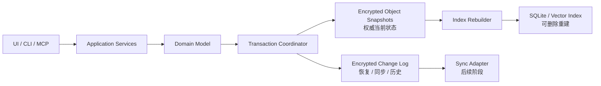

# Tagloom（织记）

> 一个以本地加密文件为真相源、以对象类型、普通标签和属性继承组织知识，并原生支持 AI Agent、MCP 与 CLI 的跨平台笔记系统。

## 1. 项目命名

### 推荐名称：Tagloom

**中文名：织记**

名称由两部分组成：

- `Tag`：强调以笔记类型定义结构、以普通标签轻量分类。
- `Loom`：意为织机，象征通过标签、属性、双向链接和 AI 将分散知识编织成网络。

这个名称与产品定位比较一致：

- 不依赖文件夹整理。
- 对象类型承担结构和属性定义，普通标签承担轻量分类，两者在界面和数据语义上明确区分。
- 双向链接构成知识网络。
- AI Agent 可以在授权范围内读取、整理和连接知识。

### 备选名称

| 名称 | 含义 | 风格 |
|---|---|---|
| Lattica | 来自 lattice，强调知识网格与继承关系 | 技术感 |
| Ciphora | cipher + aura，强调加密与私人知识空间 | 隐私感 |
| ArborNote | arbor，树状继承和知识生长 | 自然、易理解 |
| MossNote | 苔藓式生长的本地知识网络 | 温和、个人化 |
| Nodara | node + data，强调节点化知识 | 平台感 |

> 正式发布前需要单独进行商标、域名、应用商店名称和开源仓库名称检索。

---

# 2. 产品定位

Tagloom 不是传统的 Markdown 文件管理器，也不是必须依赖远程数据库的云笔记。

它的核心定位是：

> 本地优先、端到端加密、基于对象和标签类型系统的个人知识平台。

核心差异：

1. 笔记以本地加密对象文件保存，解密后的业务载荷采用版本化 JSON。
2. 文件是真相源，索引均可删除并重建。
3. 用户主要通过对象类型、普通标签、属性和查询组织内容，而不是维护目录结构。
4. 对象类型可以继承，并附带属性、默认值、样式和模板；普通标签不携带 schema。
5. 笔记支持 Block 编辑，同时提供 Markdown 输入与导出。
6. 原生支持双向链接、语义搜索、AI Agent。
7. 通过 MCP 和 CLI 向外部 AI Agent 暴露受控能力。
8. 自部署后端同时提供同步服务和 AI 模型转发。

---

# 3. 核心设计原则

## 3.1 文件是真相源

笔记、标签、属性、配置和附件都以本地加密对象快照保存。加密对象快照是工作区当前状态的唯一权威来源。

Change Log 不与对象快照争夺权威性。它只承担以下职责：

- 原子提交和崩溃恢复。
- 多设备同步与幂等重放。
- 本地历史、审计和撤销。
- 生成并确认新快照后进行安全压缩。

读取当前状态时以已确认提交对应的对象快照为准；只有检测到未完成事务时，才使用 Change Log 完成提交或回滚。任何索引、缓存和远端同步副本都不得反向覆盖本地已确认快照，除非先生成一个可审计的新变更。

本地数据库或索引仅用于：

- 全文搜索。
- 标签和属性查询。
- 双向链接查询。
- 向量检索。
- 缓存和性能优化。

所有索引都必须可以从加密对象快照重新生成。Change Log 丢失可能影响历史、撤销和尚未同步的变更，但不得导致已经确认的当前快照无法读取。

## 3.2 笔记类型与普通标签分离

笔记类型（Note Type）定义笔记的结构，可继承并携带属性 schema 和模板。界面统一使用“笔记类型”，在笔记和继承设置等上下文明确的位置简称“类型”，父子关系使用“父类型／子类型”；普通标签只负责分类。协议层继续保留 `TagDefinition` 名称以兼容已有加密快照。

例如：

```text
Note
├── Project
│   ├── SoftwareProject
│   └── PersonalProject
├── Book
├── Person
├── Meeting
└── Idea
```

`Note` 是工作区内置根类型：始终存在、只读、不可重命名或删除。所有自定义对象类型最终继承 `Note`。新建笔记没有自定义类型时显示为 `Note`；用户可以选择 `Page`、`Task`、`Project` 等自定义类型，但不能移除底层的 `Note` 根身份。

根 `Note` 只提供描述和普通标签，不默认绑定“状态、日期”。这两个属性可由自定义类型或当前笔记显式添加。旧工作区仅通过 schema 事务移除根类型中未定制的旧默认绑定，保留属性定义、已有值及显式绑定。

普通标签只用于跨类型分类，例如 `#KMP`、`#设计`、`#灵感`。普通标签不继承、不携带属性或模板，也不参与对象类型冲突计算。它们通过内置的自由多选属性保存，以稳定选项 ID 作为值，并在工作区属性定义中持久化选项目录，支持输入创建和后续搜索复用。

## 3.3 Markdown 是输入和导出格式

内部真实数据采用 Block JSON，而不是纯 Markdown。

Markdown 用于：

- 快捷输入。
- 粘贴解析。
- 导入。
- 导出。
- 外部工具兼容。

复杂属性、标签继承、Block ID、嵌入块和视图信息不强制映射到标准 Markdown。

## 3.4 AI 必须经过权限层

AI Agent 不直接读取磁盘中的加密文件，而是调用应用提供的受控工具。

所有高风险操作需要：

- 明确权限。
- 操作预览。
- 用户确认。
- 审计记录。
- 可撤销或回滚。

---

# 4. 技术栈

## 4.1 客户端

```text
Kotlin Multiplatform
Compose Multiplatform
Kotlin Coroutines
Kotlin Serialization
Ktor Client
```

建议首发平台：

1. Windows、macOS、Linux 桌面端。
2. Android。
3. iOS。
4. Web 端后置。

## 4.2 后端

```text
Kotlin
Ktor Server
WebSocket / HTTP
PostgreSQL：保存账户、设备、同步游标、对象元数据和小型密文变更包
Blob Storage Adapter：默认使用服务端本地文件系统保存大体积密文附件，可选切换为 S3 兼容对象存储
```

服务端原则：

- 默认只保存密文。
- 不持有工作区解密密钥。
- 同步和 AI Gateway 分离。
- AI 请求只处理客户端明确发送的上下文。

## 4.3 本地索引

可采用：

```text
SQLite：全文、标签、属性、双链索引
本地向量索引：Block 级 embedding
```

数据库不是笔记的真实存储，只是可重建索引。

---

# 5. 本地目录结构

```text
workspace/
├── manifest.enc
├── config.enc
├── staging/
│   └── 01JTRANSACTION/
├── notes/
│   ├── 01JABC.note.enc
│   └── 01JABD.note.enc
├── tags/
│   ├── 01JTAG1.tag.enc
│   ├── 01JTAG2.tag.enc
│   └── 01JTAG3.tag.enc
├── properties/
│   ├── 01JPROP1.property.enc
│   └── 01JPROP2.property.enc
├── blobs/
│   └── 01JBLOB.blob.enc
├── changes/
│   ├── device-a-000001.change.enc
│   └── device-a-000002.change.enc
├── history/
│   └── conflicts/
│       └── 01JCONFLICT.conflict.enc
└── index/
    ├── local.sqlite
    └── vector.index
```

规则：

- 文件名只使用稳定 ID，不包含笔记标题。
- 用户创建的 Note、Tag、Property 和 Blob ID 必须是与名称无关的高熵不透明 ID。文档示例中的 `project`、`project-status` 等可读 ID 只用于讲解，不代表生产文件名。
- `notes`、`tags`、`properties` 和 `blobs` 中的已确认对象快照是当前状态的权威数据。
- `changes` 保存尚未压缩的事务、同步和历史记录；`history/conflicts` 保存需要用户查看或已经解决的冲突证据。
- `manifest.enc` 使用“公开认证头 + 加密载荷”的信封格式。KDF salt、KDF 参数、信封版本和被包装的主密钥包位于解锁所必需的公开头中，其余对象摘要和敏感配置位于密文载荷中。
- `staging` 只保存加密的未完成事务文件，正常提交或启动恢复完成后应被清理。
- `index` 可以被安全删除并重建。
- 所有敏感元数据都应加密。
- Blob 默认使用随机稳定 ID 命名。若需要工作区内去重，应使用工作区密钥派生的 HMAC 标识，不得直接暴露明文附件的 SHA-256。

---

# 6. 笔记模型

解密后的笔记 JSON 示例：

```json
{
  "schemaVersion": 1,
  "id": "01JABC",
  "type": "note",
  "title": "Tagloom 项目设计",
  "createdAt": "2026-07-13T10:00:00Z",
  "updatedAt": "2026-07-13T10:30:00Z",
  "directTagIds": ["note", "software-project"],
  "propertyValues": {
    "project-status": {
      "value": "active",
      "source": "user",
      "overridden": true
    }
  },
  "manualPropertyBindings": [],
  "propertyStyleOverrides": {},
  "blocks": [
    {
      "id": "block-1",
      "type": "heading",
      "parentId": null,
      "orderKey": "a1",
      "content": {
        "level": 1,
        "richText": {
          "runs": [
            {
              "text": "Tagloom",
              "marks": [],
              "annotationIds": []
            }
          ]
        }
      },
      "attributes": {}
    },
    {
      "id": "block-2",
      "type": "paragraph",
      "parentId": null,
      "orderKey": "a2",
      "content": {
        "richText": {
          "runs": [
            {
              "text": "一个本地优先的 ",
              "marks": [],
              "annotationIds": []
            },
            {
              "text": "knowledge system",
              "marks": [
                {
                  "type": "code",
                  "attributes": {}
                }
              ],
              "annotationIds": ["annotation-1"]
            },
            {
              "text": "。",
              "marks": [],
              "annotationIds": []
            }
          ]
        }
      },
      "attributes": {}
    }
  ],
  "annotations": {
    "annotation-1": {
      "id": "annotation-1",
      "kind": "note",
      "body": "这里指由对象、标签和链接共同组成的个人知识空间。",
      "createdAt": "2026-07-13T10:20:00Z",
      "updatedAt": "2026-07-13T10:20:00Z"
    }
  }
}
```

---

# 7. Block 模型

MVP 支持以下 Block：

```text
paragraph
heading
bulleted-list
numbered-list
todo
quote
code
divider
image
file
note-reference
```

每个 Block 必须拥有稳定 ID，以支持：

- 增量同步。
- Block 级双向链接。
- Block 级 embedding。
- 单块引用。
- 局部历史记录。
- AI 精确修改。

## 7.1 统一 Block 结构

Block 只采用一套外层结构，不再同时支持 `text`、`level` 顶层字段和 `content` 字段两种表示。不同 Block 类型只改变 `content` 的内部 schema：

```json
{
  "id": "block-2",
  "type": "paragraph",
  "parentId": null,
  "orderKey": "a1",
  "content": {
    "richText": {
      "runs": [
        {
          "text": "示例内容",
          "marks": [],
          "annotationIds": []
        }
      ]
    }
  },
  "attributes": {}
}
```

约束：

- `id` 是 Block 身份，在移动、重排和内容修改时保持不变。
- `parentId` 表示嵌套关系；顶层 Block 为 `null`。
- `orderKey` 只负责同一父节点下的稳定排序，不承载业务语义。
- `content` 使用按 `type` 区分的结构化联合类型，未知类型必须能够保留原始内容并以只读占位块显示。
- 删除 Block 时先生成 tombstone，达到保留期且所有已知设备确认后才能物理清理。

## 7.2 行内富文本、样式与加注

`paragraph`、`heading`、列表项、`todo`、`quote` 等文本 Block 使用 `RichText.runs` 表示行内内容。每个 `InlineRun` 包含文本、结构化 Mark 集合和加注引用。Mark 使用 `{ type, attributes }`，使 `link` 可以保存目标、`highlight` 可以保存语义色 token，同时让无参数的 `code` 保持统一结构。

MVP 支持以下行内 Mark：

```text
bold
italic
underline
strikethrough
code
highlight
link
```

其中：

- 单词或短语的代码样式使用 `code` Mark；多行代码仍使用独立 `code` Block。
- 一句话中的某个词可以通过 `annotationIds` 关联一个或多个加注。
- 加注是笔记快照内的独立对象，支持 `note`、`comment`、`definition` 等类型；删除正文锚点时，加注进入待清理状态而不是立即丢失。
- 相邻且 `marks`、`annotationIds` 完全相同的 Run 在保存前必须合并，空 Run 必须移除，保证序列化结果稳定。
- Mark 顺序不影响语义；保存前按 `type` 和规范化 attributes 的固定顺序排列，避免相同内容产生不同密文快照。
- Markdown 中的粗体、斜体、删除线、链接和行内代码可直接映射；加注等非标准能力导出时使用可选扩展语法或伴随元数据文件，并明确提示是否有损。

不为 InlineRun 分配长期稳定 ID。同步和历史的最小权威单元仍是 Block；并发修改同一 Block 时，对其规范化富文本执行三方合并。

### 7.2.1 正文阅读栏与代码 Block

- 连续正文支持鼠标正反向跨 Block 选区、Shift 点击／方向键延伸和 Ctrl/Cmd+A；段落、标题、列表、待办及代码共用原文偏移。表格、数据库、附件和页签边界隔开独立正文流，不跨入隐藏内容。选区支持复制、剪切、删除、输入替换及富文本格式；代码块只参与文本操作。跨块替换保留两端未选正文、Mark、加注及未选子块，被移除块保留 tombstone，继续经原有事务保存。
- 剪贴板只包含用户选中的正文，提供纯文本、HTML 和版本化的私有正文片段。纯文本保留列表标记与相对缩进，HTML 表达标题、列表、引用、代码和常见行内样式；片段不携带源笔记／Block 身份、属性、附件、加注身份或加注正文。粘贴时分配新 Block 身份，保留片段内父子层级、Mark、待办状态和代码语言；完整列表从中段复制时可通过首项 `attributes.numbered-list-start` 保留起始编号，其余同级项继续自动递增。单块局部选区按行内文字插入，代码与附件说明不因粘贴改变自身块类型。剪切仅在系统写入成功后删除；`Ctrl/Cmd+Shift+V` 显式仅粘贴纯文本。
- 文字选区采用主题主色的柔和背景，按完整行高连续绘制；选中范围内临时覆盖行内代码、高亮和加注底色，保留原文字体及未选区样式。选区、绘制颜色和鼠标锚点只存在于 UI 会话，不进入权威快照。

- 页面标题、属性和正文共用居中的阅读栏，正文最大宽度为 760 dp；窄屏缩小两侧留白，文本本身仍按正常阅读方向排列。
- Block 左侧仅保留六点手柄，手柄在真实布局内提供桌面 32 dp、触摸平台 48 dp 命中区，支持悬停、键盘焦点和点击菜单；原新增入口迁入“在下方插入”。拖动按同级实际位置判断落点，父块与其子树一起移动，提供抬起预览、插入线、边缘滚动和约 220 ms 落位动画。拖动过程只保存临时 UI 状态，松手后一次确认顺序，Esc 或指针取消恢复原位置；稳定 ID、父边、正文与既有保存协议不变。
- 多行代码使用独立的浅底色容器、等宽字体和顶部工具栏，参考 Anytype 的语言选择、复制及自动换行交互；深色主题使用对应的高对比语法配色。
- 语言保存在 `CodeBlockContent.language`，换行偏好保存在 Block 的 `attributes.codeWrap`，缺省为自动换行。修改均复用现有编辑命令和加密快照保存流程，复制只复制代码原文。
- 语法高亮由共享 UI 层的 SyntaxMP 0.3.0 tokenizer 本地生成，覆盖其 39 种内置语言；不把高亮色或分词结果写入权威快照。未知语言保留原始标识并按纯文本编辑，Markdown 导入导出保留语言信息。
- 分词在后台执行；输入法、光标和选区使用未修改的原文偏移，过期分词结果不得应用到新文本。高亮依赖只进入 `app/shared`，不进入领域模块。

### 7.2.2 笔记内查找

- 笔记页头使用单一的 18 dp 线性放大镜图标按钮打开或重新聚焦当前笔记查找，也支持 Ctrl/Cmd+F；桌面按钮为 36 dp，触摸平台保留 48 dp 目标，打开后显示淡青绿色背景；尺寸不随鼠标或键盘导航切换而变化。悬停或长按显示原生提示“在笔记中查找 · Ctrl/Cmd+F”，图标提供“查找”无障碍名称。搜索当前笔记的实时草稿，标题、描述、正文、代码、附件说明、页签标题和正文表格的列名及文本/标量单元格参与匹配；Database 投影中的其他笔记不属于当前笔记正文。
- 默认执行不区分大小写的字面量查找，可切换大小写匹配；显示当前位置与总数，支持上一处/下一处、Enter/Shift+Enter、F3/Shift+F3 循环跳转及 Esc 关闭。
- 结果按正文结构排序，跳转时滚动到匹配文本并打开其所属页签。长标题、页签和表格单元格支持字符级横向定位；查找期间展开长描述，关闭后恢复三行显示。查找工具栏以紧凑浮层呈现在放大镜图标下方，右边缘与图标对齐，覆盖正文而不占据正文布局空间；滚动时限制在编辑器视口内，支持继续输入与实时编辑后重算，窄屏分两行显示输入与导航操作。
- 查找浮层沿用已确认的 Stitch 设计：正常字号下桌面为 480 × 52 dp、6 dp 圆角和轻柔阴影，距离图标底部 8 dp；输入区域内包含放大镜与 `Aa`，其后依次为匹配计数、细分隔线和 32 dp 上一处／下一处／关闭按钮。窄屏与触摸交互保留 48 dp 目标，字号放大时允许工具栏增高。浅色主题用柔和浅黄标记全部匹配，当前匹配使用更鲜明的琥珀色与内描边；深色主题使用对应的可读配色，高亮不改变原文字符、字体度量或换行。
- 查找状态和高亮只属于共享 UI 会话，不调用派生索引，不产生笔记修改或持久化样式。关闭时清除查找词、匹配与高亮，并恢复此前有效的文本输入焦点与正文或代码选区；字段已删除则回退宿主。大小写偏好保留到当前笔记会话结束，切换笔记或锁定工作区后清除整个查找会话。更多菜单中的“搜索整个工作区”打开已确认内容查询浮层，保存查询继续使用原有入口。

## 7.3 BaseTable 正文表格 Block（首版已实现）

BaseTable 是 Note 内的叶子 Block，用于在单篇 Note 正文中维护结构化行列，属于 Block / RichText 编辑体系的一部分。它不是数据库，也不是第 14 节 Database 的 Table View 展示：行、列、单元格均不代表 Note 或 PropertyDefinition。首版协议、确定性规范化、校验、编辑命令、网格编辑展示、未知类型只读降级、单元格级三方合并和 Markdown 管道表格直接粘贴已经实现；带类型推断的 CSV / TSV / GFM 导入预览与跨 Note 转换仍是后续能力。

协议结构沿用统一 `id / type / parentId / orderKey / content / attributes` 外壳（示例 ID 仅用于讲解，不代表生产 ID 形态）：

```json
{
  "id": "block-9",
  "type": "base-table",
  "parentId": null,
  "orderKey": "a9",
  "content": {
    "title": {
      "richText": { "runs": [] }
    },
    "columns": [
      { "columnId": "col-1", "orderKey": "a1", "type": "text", "options": [] }
    ],
    "rows": [
      {
        "rowId": "row-1",
        "orderKey": "a1",
        "cells": {
          "col-1": { "richText": { "runs": [] } }
        }
      }
    ]
  },
  "attributes": {}
}
```

约束：

- `type` 为 `base-table`，是叶子 Block，没有子 Block；`rows`、`columns`、`cells` 全部在 `content` 内权威保存，属于 Note 快照内容树的一部分，绝不是 `Note.blocks` 的子 Block，也绝不镜像到 `Note.propertyValues` 或 PropertyDefinition，避免产生第二份权威数据。
- 行与列使用稳定、不透明、内容无关的 RowId / ColumnId（不由标题、序号或单元格文本派生）；表内 `orderKey` 只负责行 / 列排序，与 Block 外层 `orderKey` 分离，不承载业务语义。
- 文本单元格使用规范化 `RichText.runs`，遵守第 7.2 节的 Run 合并与 Mark 排序规则；空单元格可省略，保证序列化结果稳定。
- 首版单元格类型为 `text`、`number`（按规范十进制文本保存）、`boolean`、`date`、`datetime`；列类型与列级选项是局部配置，只存在于本表格 `content`，不得成为工作区属性，也不进入属性索引。
- BaseTable 可位于 Note 顶层，也可作为 `tab` 的子 Block（见第 7.4 节）；行、列、单元格不是 `tab` 的子 Block。
- 不支持单元格内嵌 Block、跨行 / 跨列合并、跨 Note 关系与自动同步。公式形式的 `=` 文本按普通文本处理，不执行求值；公式能力后续如需引入，必须单独 ADR 评估，不得以字符串求值方式进入 MVP。

编辑与一致性（首版实现与后续边界）：

- 所有编辑（增删行 / 列、改单元格、改列类型）都经 Note 应用服务，携带 `expectedRevision` 并通过 TransactionCoordinator 提交，产生新的 Note 快照事务；不存在绕过 Note 的“表格行写入”。
- 同一 Note 内移动 BaseTable（含跨 tab 移动）保留 Block ID、RowId、ColumnId；跨 Note 首版只复制内容并重写 Block / Row / Column / 局部选项 ID，不保留任何引用关系。
- 正文中的多行 Markdown 粘贴直接识别带表头和分隔行的管道表格，复用共享 Markdown 解析和 Note 编辑流程。表头成为列名，数据单元格保留已支持的行内 RichText；所有列均为文本，不执行类型推断或公式求值，因此不弹出类型推断预览。每次粘贴通过注入的 ID 工厂生成新的不透明行列 ID，粘贴点前后正文保留，末尾表格后提供继续输入的段落。
- 管道表格允许省略边缘管道、使用转义管道和留空单元格；分隔行必须与表头列数一致，短数据行补空。列数超出的候选表格保留为文本，避免当前粘贴入口静默丢失单元格。代码围栏内不识别表格；对齐标记可识别，但当前 BaseTable 不保存列对齐显示偏好。
- CSV / TSV 和需要列类型推断的表格导入仍按“有损内容导入导出”处理：导入前提供类型推断预览，并提示稳定 ID、本地列类型与列选项、引用关系会在往返中丢失；导出同样提示有损。
- “从 Database 固化为正文表格”仅是一次性、显式的静态复制：结果为当前投影的快照副本，不保留与 Database / View / 属性的任何连接，后续变化不影响该表格。
- “从正文表格创建数据集”必须先显示预览：会为每一行创建一个新的 Note 并创建所需属性；原表格保持独立，不会与数据集自动同步。

删除、合并与前向兼容（首版已实现）：

- 删除 BaseTable 即删除外层 Block，先生成 Block tombstone；行、列采用内部 tombstone 语义，删除列时保留其单元格数据用于恢复与冲突解释，达到保留期且同步确认后才能物理清理。
- 已按 RowId / ColumnId / Cell 粒度实现 `BaseTableThreeWayMerge`：同一文本单元格复用 RichText 三方合并（见第 16 节），不同单元格独立组合，无法解释的同单元格重叠修改进入既有 Block 冲突证据；行列 tombstone 保留另一侧更新后的可恢复内容。
- 未知 BaseTable schema 或未知列类型原样保留并以只读网格展示，旧客户端不得因无法解析而丢失内容。

## 7.4 Tabs 容器 Block（首版已实现）

Tab 是 Note 内的结构化 Block，不是独立的 workspace/tab 实体。首版已实现协议校验、规范化、会话活动页签、显式默认页签、添加、改名、移动、解包删除与级联 tombstone。结构如下：

```text
tabs          容器 Block，直接活动子节点仅可为 tab
└── tab       页签 Block，parent 必为 tabs，标题使用 RichText
    ├── paragraph
    ├── base-table
    └── ...    普通 Block 均为 tab 的子节点
```

约束：

- `tabs` 容器 Block 的直接活动子节点仅可为 `tab`；`tab` 的 `parentId` 必须指向 `tabs`。
- 普通 Block（包括 BaseTable，见第 7.3 节）是 `tab` 的子节点；BaseTable 的行、列、单元格不是 `tab` 的子 Block。跨 Tab 移动只更新 `parentId` 与 `orderKey`，不改变稳定 Block ID，也不复制内容。
- `tab` 标题使用规范化 `RichText`，遵守第 7.2 节的 Run 合并与 Mark 排序规则。
- 当前活动 Tab 是 UI 会话状态，不持久化；只有用户显式设置的 `defaultTabId` 可以持久化到 Note。
- 删除 `tab` 时默认执行“解包保留内容”：只移除 `tab` 块本身，其子 Block 提升为 `tabs` 所在层级（通常为 Note 顶层）并重新生成 `orderKey`；若 `tabs` 已无 `tab` 子节点，则 `tabs` 容器一并删除。只有用户明确选择“连同内容删除”时才级联生成子 Block 的 tombstone。
- 首版“添加到 Tab”只支持在同一 Note 内移动 Block；跨 Note 的复用后续通过 note-reference / view-reference 引用实现（view-reference 指 Database View，见第 14.2 节），移动 / 复用不得隐式复制内容，也不允许一个 Block 拥有多个 parent。用户显式把表格复制为副本时允许复制，但必须重新生成 Block / Row / Column / 局部选项 ID，不能与源表格共享身份。

---

# 8. 笔记类型与普通标签

笔记类型本身是独立加密对象。协议模型继续使用 `TagDefinition`，产品界面称为“笔记类型”，与普通 `#标签` 区分。

```json
{
  "id": "project",
  "name": "Project",
  "iconKey": "folder",
  "parentTagIds": ["note"],
  "propertyBindings": [
    {
      "propertyId": "project-status",
      "required": true,
      "defaultValue": "planned",
      "defaultPolicy": "snapshot",
      "readonly": false,
      "inheritable": true,
      "order": 10
    }
  ],
  "templateBlocks": []
}
```

## 8.1 两类标签的职责边界

| 概念 | 用户界面 | 结构能力 | 值语义 |
|---|---|---|---|
| 笔记类型 | 直接显示 `Project` 等名称，不使用 `#` 前缀 | 可继承属性、默认值、样式和模板 | 当前 Note 的结构身份 |
| 普通标签 | `#KMP`、`#设计` chip | 不继承、不携带 schema | 可搜索复用的轻量多选分类 |

一个 Note 在当前产品语义中只能应用一个自定义对象类型；内置根类型 `Note` 始终存在，因此协议字段 `directTagIds` 的规范形式为 `[Note]` 或 `[Note, appliedType]`。普通标签数量不影响对象类型继承图。

`directTagIds` 暂时保留列表形态，以兼容已有加密快照、对象类型的多父继承和未来协议迁移。旧快照若包含多个非根直接类型，读取时必须原样保留并提示用户选择一个应用类型；只有用户明确确认后才能写回规范形式，不能在加载、保存或切换界面时静默丢弃类型、属性值或历史引用。

## 8.2 直接类型与有效类型

```text
direct types：
笔记直接关联的根类型与唯一应用类型。

effective types：
直接对象类型加上全部父级类型。
```

例如：

```text
SoftwareProject → Project → Note
```

笔记只需直接关联 `SoftwareProject`，其有效标签为：

```text
SoftwareProject
Project
Note
```

## 8.3 对象类型继承规则

- 对象类型允许一个或多个父类型。
- 系统必须检测循环继承。
- 同一个属性通过 `propertyId` 判断是否相同。
- 同名但不同 ID 的属性视为不同属性。
- 子标签可以重载父标签的属性绑定。
- 多个同级对象类型对同一属性产生冲突时，必须显示冲突而不是静默覆盖。

同级属性冲突也可能来自单个笔记类型的多个父级。正常创建和编辑笔记时不得产生多个非根直接类型，但笔记类型定义允许多父继承。

笔记类型维护页自动列出允许继承的父级与祖先属性，并显示绑定来源；属性名称、字段类型和选项目录仍由工作区属性定义管理。可在本级覆盖默认值、默认策略和约束，单选／多选只选择既有选项。未修改的继承项不写入本级绑定，修改后标记“已覆盖”，“恢复继承”只清除本级覆盖并重新解析父级。多父冲突必须先明确选择一个来源作为本级覆盖，再继续编辑；未解决时不可保存。调整父级即时刷新继承列表，已有本级草稿保持保留，父级定义不会被子级维护修改。

## 8.4 标题下方的身份行

对象身份与普通标签共同放在标题正下方的一行，不使用右侧栏、卡片或传统表单标签：

1. 最左侧是层级展开图标，点击后在“仅显示应用类型”和“显示父级路径”之间切换。
2. 折叠时只显示应用类型，例如 `Project`；没有自定义类型时显示只读根类型 `Note`。
3. 展开时显示从根到应用类型的父级路径，例如 `Note › Page › Project`。多父类型必须使用稳定解析顺序展示，并允许在类型详情中查看完整父级关系。
4. 点击应用类型打开单选搜索菜单；选择新类型会替换旧类型，但不会删除旧类型曾写入的属性值，失去 schema 来源的值进入可恢复的未绑定值状态。
5. 普通标签紧随类型组，以中性 `#标签` chip 展示，支持搜索、自由创建和多选。

## 8.5 普通标签目录

普通标签使用一个内置 `multi-select` 属性保存。该属性采用 `free` 选项输入模式：

- 输入文本时实时搜索工作区已确认选项。
- 输入值与既有选项不重名时，可以创建新标签。
- 新标签先获得稳定随机选项 ID 并写入属性定义，再把该 ID 写入 Note 值。
- 工作区重新打开后，从已确认属性定义加载标签目录，因此同一标签可以继续搜索和复用。
- 删除 Note 上的标签只移除 Note 值，不自动删除工作区标签目录中的选项。

---

## 8.6 链接笔记与快捷引用（已实现）

“链接”继承根 `Note`，专属属性仅有必填 URL 和可空的级联单选分组；标题、描述、普通标签与正文沿用 Note。`/link` 在原位聚焦网址，回车经统一事务创建链接 Note 并插入通用笔记引用，分组无需填写。标题初始为完整网址，客户端静默获取网页元数据并仅回填自动字段；失败时保留网址标题和空描述，可直接编辑，不显示失败、重试或引用列表页脚，晚到响应不能覆盖用户输入。

引用保存目标 Note ID 与展示设置，不复制网页数据。主体打开链接笔记，独立外链动作打开网页；反链由稳定引用派生，移除引用保留目标，重复规范化 URL 默认复用。本方案替代独立网页数据 `bookmark` Block，提示仍为独立 `callout` 设计。详见[链接笔记、快捷录入与级联分组设计](docs/link-note-design.md)，Windows 原生主流程已验收，Android 主机测试和 Debug 构建通过，Android/iOS 设备交互尚未验收。

级联分组扩展共享 select 目录：稳定选项 ID、可空父 ID 和默认关闭的层级模式，值保存单个 ID 或无值。父项选择和子项展开分别响应，查询区分本级与包含后代，不另建一套标签体系。层级目录或自动字段来源首次写入会将工作区最低读取格式提升至 v2；旧 v1 客户端拒绝打开，普通旧工作区不会因安装新版自动升级。

# 9. 属性系统

属性拆分为三层：

```text
PropertyDef
TagPropertyBinding
NotePropertyValue
```

## 9.1 PropertyDef

定义属性本身是什么。

```json
{
  "id": "project-status",
  "name": "状态",
  "type": "select",
  "optionInputMode": "fixed",
  "options": [
    {
      "id": "planned",
      "label": "计划中"
    },
    {
      "id": "active",
      "label": "进行中"
    },
    {
      "id": "done",
      "label": "已完成"
    }
  ],
  "defaultStyle": {
    "display": "badge",
    "icon": "circle"
  }
}
```

建议支持的属性类型：

```text
text
number
boolean
date
datetime
select
multi-select
url
email
relation
file
formula
```

`select` 与 `multi-select` 额外声明选项输入模式：

```text
fixed：只能选择属性定义中预先配置的选项，至少保留一个选项。
free：允许搜索既有选项，也允许输入新值；新值必须先持久化为同一属性的稳定选项，再写入 Note 值。
```

自由输入不是把显示文本直接写进 Note。Note 始终保存选项 ID，选项名称、颜色和排序仍由 `PropertyDefinition.options` 统一管理，避免重命名后出现重复标签或历史值失联。

## 9.2 TagPropertyBinding

定义某个标签如何使用属性。

```json
{
  "propertyId": "project-status",
  "required": true,
  "readonly": false,
  "inheritable": true,
  "defaultValue": "planned",
  "defaultPolicy": "snapshot",
  "styleOverride": {
    "display": "pill"
  }
}
```

## 9.3 NotePropertyValue

笔记只保存实际填写或覆盖后的值。

```json
{
  "project-status": {
    "value": "active",
    "source": "user",
    "sourceTagId": "project",
    "overridden": true,
    "updatedAt": "2026-07-13T10:30:00Z"
  }
}
```

## 9.4 系统时间与描述

- `createdAt`、`updatedAt` 来自 Note 加密对象快照头，是系统自动生成的只读元数据，不再复制成普通属性，避免出现双重权威状态。
- 新建 Note 时两者相同；每次 Note 快照确认后更新 `updatedAt`，`createdAt` 始终继承首个确认快照。
- 界面把创建与更新时间固定在编辑器视口右下角，以低强调文本展示，不占用标题下方身份与属性区域，也不提供编辑控件。
- “描述”是内置文本属性，使用普通属性写入与同步规则；界面在标题下方提供最多数行的轻量输入，不使用独立大卡片。

---

# 10. 笔记手动添加属性

笔记应该允许手动添加属性。

支持三种模式：

1. 添加仅属于当前笔记的私有属性。
2. 在当前笔记中复用已有的全局属性。
3. 创建属性并绑定到某个标签。

标题下的动态属性区采用无边框双列行：左列是属性名，右列是值编辑器。对象类型继承属性与当前笔记自定义属性使用同一布局，并通过弱化的来源说明区分，不建立右侧属性栏。

属性区按以下顺序渐进展示：

1. 描述。
2. 默认展开的对象类型属性与当前笔记属性。
3. “更多属性”折叠入口，容纳样式声明为折叠的属性。
4. `+ 添加属性` 入口。

新增属性使用锚定在入口附近的渐进式浮层，不使用模态对话框或右侧栏：先搜索已有属性或输入名称，再选择属性类型，最后选择“仅当前笔记”（默认）或“当前应用类型”。选择已有属性时直接建立当前笔记绑定；创建新属性时必须先确认属性定义，再建立目标绑定，仍遵守统一事务与故障恢复规则。

当同一个手动属性在多篇相同类型笔记中重复出现时，可以提示：

> 是否将该属性提升为标签属性？

---

# 11. 继承属性的计算

标签继承来的属性不需要复制到笔记文件。

渲染或查询时计算：

```text
1. 获取笔记的直接标签。
2. 解析全部父标签。
3. 收集所有 PropertyBinding。
4. 应用父标签定义。
5. 应用子标签重载。
6. 应用同级标签冲突规则。
7. 应用笔记级属性值。
8. 应用笔记级样式覆盖。
9. 得到最终有效属性集合。
```

属性优先级：

```text
Note 手动值
>
Note override
>
直接标签绑定
>
父标签绑定
>
PropertyDef 默认值
```

## 11.1 默认值策略

```text
dynamic
标签默认值变化后，未覆盖的笔记实时跟随。

snapshot
笔记首次关联标签时写入一次，后续不自动变化。

none
只提供属性定义，不产生默认值。
```

推荐：

| 属性 | 策略 |
|---|---|
| 类型、只读分类 | dynamic |
| 状态、优先级、评分 | snapshot |
| 创建时间、更新时间 | system |
| 普通输入字段 | none |

---

# 12. 属性样式

样式与属性值分离。

支持三级样式：

```text
PropertyDef.defaultStyle
TagPropertyBinding.styleOverride
Note.propertyStyleOverrides
```

MVP 可以先只实现前两级。

可配置项：

```text
icon
color
display
order
visible
showInCard
showInList
collapsed
dateFormat
numberFormat
optionStyle
relationDisplay
```

标题下动态属性区对样式字段作如下确定性解释：

- `visible = false`：隐藏于常规属性区，但值和绑定仍完整保留，可从管理入口恢复显示。
- `collapsed = true`：放入“更多属性”。
- 其他情况：默认在描述下方展开。
- `order`：在同一展示组内排序；相同时按属性稳定 ID 排序，保证跨平台结果一致。
- 未知属性类型：保留原始值并使用只读回退行展示，旧客户端保存时不得删除或重写其值。

示例：

```json
{
  "id": "priority",
  "name": "优先级",
  "type": "select",
  "options": [
    {
      "id": "urgent",
      "label": "紧急",
      "style": {
        "icon": "fire",
        "colorToken": "danger"
      }
    }
  ],
  "defaultStyle": {
    "display": "badge"
  }
}
```

建议保存语义色 token，而不是固定十六进制颜色，以适应亮色、暗色和无障碍主题。

---

# 13. 双向链接

链接应进入核心数据模型，而不是仅作为编辑器表现。

支持：

```text
Note → Note
Block → Note
Block → Block
Property relation → Note
Embed → Note / Block
```

索引记录：

```text
fromNoteId
fromBlockId
toNoteId
toBlockId
linkType
```

功能：

- 出链。
- 反向链接。
- 未链接提及。
- 嵌入引用。
- 关系属性。
- 图谱视图。

---

# 14. 数据库、视图与查询（首版协议与受限视图已实现）

查询能力覆盖标签、属性、全文、双链、语义与混合查询；查询与数据库视图的筛选、排序统一由第 14.4 节的 QuerySpec 表达。

> DatabaseDefinition / ViewDefinition 加密快照、原子创建、QuerySpec 类型化 AST、DatasetProjection、Table / Kanban / Gallery 受限展示、视图创建切换、按 `creationTypeId` 新建 Note 与 Note expectedRevision 单元格写回已经实现。Database 不再作为侧栏一级页面创建；用户在 Note 编辑器输入 `/database`，原位创建一个 `database` 引用 Block，并在 Block 内修改名称、来源类型和视图。当前 UI 只开放全文筛选和字段显隐；复杂谓词编辑器、多排序器、看板拖动和删除级联仍未实现。BaseTable 正文表格是 Note 内容 Block，定义见第 7.3 节，不属于本节 Database/View 体系。

## 14.1 DatasetProjection：Database Table View 的派生展示

Database Table View 是 `ViewDefinition.presentation.kind = table` 时对多个 Note 的派生展示（DatasetProjection），不是新的权威对象类型，也不是物理表：

- 行 = Note 对象。
- 列 = FieldRef（系统字段 / 对象类型）/ PropertyDefinition。
- 单元格 = Note 字段或 `Note.propertyValues` 中对应属性的值。

约束：

- 投影结果、分组、统计和展示索引均可从已确认快照重建；删除投影索引不影响任何权威数据。
- 写单元格没有独立数据路径：必须经过 Note 应用服务，并以当前 revision 校验后产生新的 Note 快照事务；不存在绕过 Note 的“数据库行写入”。
- Database Table View 不是 BaseTable（第 7.3 节）：不能引用 BaseTableColumnId，不复用 BaseTable 的 `content`、局部列类型 / 局部选项或编辑命令；Table / Kanban / Gallery 只属于 Database View，不适用于 BaseTable。
- 不引入“BaseTable/Collection/Set”等同义实体；一个 Note 只因属性值出现在投影中，不因出现在投影中而改变身份。

## 14.2 权威配置对象：DatabaseDefinition 与 ViewDefinition

已新增两类权威配置对象，均使用第 26 节的版本化快照头。

`DatabaseDefinition`（数据集）只保存稳定数据集身份与来源约束，示例字段（示例 ID 仅用于讲解，不代表生产 ID 形态）：

```json
{
  "id": "01JDB01",
  "name": "项目库",
  "sourceTypeId": "project",
  "includeDescendants": true,
  "creationTypeId": "project",
  "defaultViewId": "01JVIEW1"
}
```

- `sourceTypeId`：单一来源对象类型；`includeDescendants` 表示是否包含其全部后代类型。
- `creationTypeId`：在该数据集中新建对象时使用的对象类型（通常等于当前类型）。
- `defaultViewId`：打开数据集时默认展示的 View。

`ViewDefinition`（视图）独立存在，不内嵌于 Database，示例字段：

```json
{
  "id": "01JVIEW1",
  "databaseId": "01JDB01",
  "name": "进行中",
  "orderKey": "a1",
  "query": {},
  "presentation": { "kind": "table", "fields": [] }
}
```

- View 单向指向 Database（`databaseId`）；Database 不保存 `viewIds` 反向列表，避免双向引用产生不一致。
- `query` 是 QuerySpec；`presentation` 只描述展示方式（Table / Kanban / Gallery 与列配置），不承载查询语义。
- Database/View 不保存 Note、属性 schema、查询结果或权限；这些仍由对应权威对象与统一权限层提供。
- “创建 Database + 首个 View”“删除默认 View 后调整 `defaultViewId`”等跨对象操作必须在一个 TransactionCoordinator 事务内确认，不能出现 Database 已确认而 View 缺失的中间状态。
- Note 正文中的 `database` Block 只保存 `{ databaseId }` 稳定引用，不复制 Database/View 配置和投影行；Block 删除先 tombstone 引用，Database/View 对象仍按独立对象的历史与删除策略处理。
- `/database` 创建时先原子确认 Database + 首个 View，再把发起命令的原始 Block 绑定为 `database` 引用；完成时必须按原始 Note ID 与 Block ID 定位，不能依赖用户是否仍停留在该笔记。
- 新增对象类型之前，必须先具备 manifest / `objectType` 未知值安全拒绝与只读兼容策略；不能假定旧客户端可以解析新对象类型。

## 14.3 SavedQuery 与 QuerySpec 的复用边界

- SavedQuery 只保存可复用的 QuerySpec，不携带布局或展示信息。
- View 与 SavedQuery 共用 QuerySpec 值对象；MVP 中 View 不直接引用 SavedQuery，创建 View 时复制 QuerySpec，避免视图与保存查询之间的隐式耦合与删除联动。
- 后续若需“从 SavedQuery 派生视图”，应在 QuerySpec 与视图语义稳定后单独评估显式引用，不得借此引入新的同义实体。

## 14.4 QuerySpec：版本化、类型化 AST

QuerySpec 是版本化、类型化的查询 AST，使用稳定 ID 而非显示名引用字段：

```text
QuerySpec
├── FilterExpr
│   ├── True / All / Any / Not
│   ├── FullText
│   └── Predicate
├── FieldRef（系统字段 / 对象类型 / 属性）
└── SortSpec
```

MVP 谓词集合：

```text
eq / ne / isEmpty / isNotEmpty
文本：contains
数字 / 日期：gt / gte / lt / lte
单选：in / notIn
多选：containsAny / containsAll
类型：isExact / isDescendantOf
```

约束：

- 用户界面只能显示当前对象类型的有效属性；`dynamic` / `snapshot` 默认值、属性继承与同级冲突必须采用与 EffectivePropertyResolver 一致的语义，不得在 UI 与领域层出现两套解释。
- 类型或属性定义变动时，允许先把对应结构索引整体标记为落后并重建；索引只能消费已确认快照，落后期间 UI 必须提示查询结果可能不完整。

## 14.5 多视图交互（首版实现与进阶规划）

UI 术语与入口边界：

- “正文表格”指 BaseTable Block（第 7.3 节），只从 Note 编辑器的“插入 Block”菜单进入；其工具栏使用行 / 列 / 单元格语义（添加行、添加列、调整等），不得出现“新建数据集 / 添加视图 / 转为看板 / 按类型建表”等数据库入口。
- “数据集视图”指正文中的 Database Block，通过 `/database` 或 Block 手柄的“在下方插入”菜单原位创建；“表格视图”仅指 Database 的 Table View。Table View 工具栏显示来源类型、视图切换、筛选、排序与属性列配置，侧栏不再提供独立 Database 导航或创建入口。
- 界面必须可读地提示边界：正文表格标注“只属于当前 Note，不会创建属性，也不会生成新的 Note”；数据集视图标注“编辑单元格会更新对应 Note 的属性”。
- 删除正文表格中的一行只删除文档内容，不删除 Note；Database 不提供“删除行”，只能通过调整筛选、更改对象类型或删除 Note 表达。
- 筛选只属于 Database View，不适用于 BaseTable；BaseTable 可提供表格内的局部派生排序 / 过滤（只影响当前展示），不复用 QuerySpec，也不持久化结果。

交互规则：

- 顶部按“类型”选择数据集（默认 `Note`），并在 Table / Kanban / Gallery 之间切换；筛选、排序、分组、属性列与搜索都作用于当前投影。
- 新建操作始终自动携带当前数据集的 `creationTypeId`（通常等于当前类型）。
- 当前属性筛选值默认不回写；只有用户显式选择“应用当前筛选值”时，才把筛选值写入新建对象的对应属性。
- Table：标题列固定；其余列按 View 的排序与列配置展示。
- Kanban：仅支持按可写单选属性分组；跨列拖动等于更新该 Note 的对应属性值，列内顺序按 View 排序，MVP 不提供手动卡片排序。
- Gallery：仅提供有限封面与字段展示，不做自由画布。
- 切换类型时，不适用于新类型的筛选必须保留并给出“修复 / 移除”选择，不可静默丢失。
- UI 降级必须明确：工作区锁定（读取与写入立即失效）、索引落后（提示可能不完整并可重建）、空结果、删除 / 冲突（tombstone 与冲突提示）、不可写来源（继承或只读属性值等）分别给出对应状态，不得伪装成正常结果。
- 首版不复制 Notion/Anytype 的 UI，也不支持公式 / Rollup、无限嵌套筛选、自由画布和复杂自动化。

## 14.6 删除边界与权限说明

- 删除 View 不影响任何 Note。
- 删除 Database 在同一事务中 tombstone 其全部 View；不影响 Note、对象类型或属性定义。
- 不提供模糊的“从 Database 删除行”操作：用户应明确为“更改对象类型”或“删除 Note”。
- 过滤器不是权限边界：投影结果 = 授权可读的 Note ∩ 来源类型集合 ∩ 筛选条件。当前单用户 MVP 下该约束不产生实际差异，但必须在外部入口（CLI / MCP / Agent）开放前落实，避免把视图筛选当作访问控制。

---

# 15. 向量搜索

向量数据库仅作为可重建搜索索引，不保存笔记真相。

建议按 Block 建立 embedding：

```json
{
  "embeddingId": "emb-001",
  "noteId": "01JABC",
  "blockId": "block-2",
  "contentHash": "sha256...",
  "model": "embedding-model-id"
}
```

Block 内容变化时，仅重建对应 Block 的向量。

推荐搜索流程：

```text
关键词检索
+ 标签过滤
+ 属性过滤
+ 向量召回
+ 双链相关度
= 混合排序
```

隐私原则：

- 优先在客户端生成 embedding。
- embedding 默认保存在本地。
- 远程生成 embedding 前需明确告知用户。
- 远端服务不得默认扫描整个工作区。

---

# 16. 同步架构

## 16.1 自部署设备同步

```text
客户端
↓ WebSocket / HTTP
Sync Server
↓
其他设备
```

服务器负责：

- 设备认证。
- 密文变更上传和下载。
- 密文附件同步。
- 版本向量或游标管理。
- 幂等去重。
- 可选快照存储。

服务器默认无法解密内容。

### 16.1.1 服务端设备接入与凭据管理

服务端设备登记以工作区为隔离边界。部署者通过 `TAGLOOM_SYNC_BOOTSTRAP_TOKEN_SHA256` 配置独立引导凭据的 SHA-256；该凭据只能创建新工作区的首台设备。未配置时关闭首次登记入口。现有已授权设备可登记同工作区新设备、读取设备公钥目录、更新设备访问凭据及撤销设备；本阶段不引入多人角色。

客户端使用安全随机数生成至少 32 字节访问 Token，登记请求只提交摘要和 Ed25519 公钥。服务端不生成或返回工作区主密钥、设备私钥或正文。新设备取得工作区解密能力仍须由客户端的授权传递或 Recovery Key 流程完成，设备登记成功不代表已经取得明文。

| 接口 | 授权 | 语义 |
| --- | --- | --- |
| `PUT /v1/workspaces/{workspaceId}` | 独立引导 Bearer Token | 登记首台设备；相同请求可重试，已有工作区禁止覆盖 |
| `PUT /v1/workspaces/{workspaceId}/devices/{actorId}` | 当前工作区活动设备 | 登记新设备；相同登记幂等，已撤销身份不可复用 |
| `GET /v1/workspaces/{workspaceId}/devices?limit=50&cursor=...` | 当前工作区活动设备 | 分页返回设备身份、公钥、登记及撤销时间，不返回 Token 或摘要 |
| `PUT /v1/workspaces/{workspaceId}/devices/{actorId}/credentials` | 当前工作区活动设备 | 以原摘要为前置条件替换访问 Token 摘要，禁止覆盖并发更新；公钥不随 Token 轮换改变 |
| `DELETE /v1/workspaces/{workspaceId}/devices/{actorId}` | 当前工作区活动设备 | 持久化撤销，保留历史公钥；没有恢复副本时不能撤销最后一台活动设备 |
| `PUT /v1/workspaces/{workspaceId}/recovery-snapshot` | 当前工作区活动设备 | 流式上传完整密文备份，以版本前置条件发布恢复确认点 |
| `GET /v1/workspaces/{workspaceId}/recovery-snapshot` | 当前工作区活动设备 | 下载已确认的完整密文备份，返回摘要和版本 |
| `PUT /v1/recoveries/{recoveryId}/devices/{actorId}` | Recovery Key 用途隔离的 Bearer Token | 定位原工作区，登记新设备并返回可下载副本描述 |

设备状态独立存放于服务端数据目录，经单进程写入租约、同步落盘和同目录原子替换发布。只有落盘成功才返回管理成功；持久化结果不确定时停止当前登记服务，重启后从磁盘重新恢复。原 `TAGLOOM_SYNC_CREDENTIALS_FILE` 只在首次建立登记库时导入，后续启动以登记库为准，禁止旧文件复活已撤销 Token。格式损坏或未知版本必须拒绝启动，不回退为空库。

撤销阻止该设备后续认证，并阻止其他设备代传该作者尚未被服务端接受的新载荷；已经入库的历史密文允许幂等重传和下载。Token 更新只替换认证材料，不改变 Actor 身份或历史签名公钥。生产部署需在反向代理为登记和认证接口设置请求速率与并发限制；管理接口另限制请求体和分页规模。接口延续 `/v1`，错误保留稳定 `code` 并增加 Problem Details 字段；旧同步请求与成功响应保持兼容。

详细管理接口契约见 [服务端设备管理 OpenAPI](./server/openapi-device-management.yaml)。验收必须覆盖真实 HTTP 登记、两设备密文交换、Token 更新、撤销、跨工作区拒绝、服务端重启和旧凭据迁移。

### 16.1.2 Recovery Key 服务器恢复与客户端入口

首次使用先选择本地模式或服务器模式，每种模式均提供“全新创建”和对应来源的恢复入口；密文备份导入继续保留。服务器恢复只需要服务器 HTTPS 地址与原 Recovery Key，新设备可独立设置本机 PIN，不依赖旧设备在线。恢复保留工作区、笔记、类型、属性、附件等对象 ID，成功认证全部权威密文后才登记本机入口并重建派生索引。

从 256 位 Recovery Key 通过现有 HKDF-SHA-256、空 salt，分别以 `tagloom/server-recovery/lookup/v1` 和 `tagloom/server-recovery/auth/v1` 派生 32 字节定位符及认证 Token，编码为小写十六进制。服务器只持久化定位符与 Token 文本的 SHA-256，不接收 Recovery Key、Workspace Master Key 或设备签名私钥。定位与认证材料使用不同用途，不能用于解密。

恢复副本复用完整加密 ZIP 备份：包含已确认 manifest 及其引用的权威密文，不包含索引、本机凭据或 staging。服务端先校验大小、摘要并同步落盘不可变归档，再原子发布版本及恢复身份；过期版本不得覆盖。默认上限 512 MiB，可通过 `TAGLOOM_SYNC_MAX_RECOVERY_BYTES` 调整，失败和中断不得替换已有可恢复副本。

客户端提供可随时切换的本地模式和服务器模式。两种模式均支持新建；本地恢复通过选择既有工作区文件夹并输入 Recovery Key，服务器恢复通过服务器地址和 Recovery Key，在应用私有目录创建独立本地副本，无需选择恢复目录。服务器新建在用户确认保存 Recovery Key 后创建本地权威工作区并首次上传；网络失败保留本地创建结果，明确提示连接未完成并支持重试。

设置中的模式切换作用于当前设备的当前本地副本，不改变工作区身份、恢复密钥或笔记位置。本地模式停止上传并保留服务器既有副本与受保护的连接配置；切回服务器模式先确认当前完整副本，再启用自动更新。旧版本手动上传配置默认维持本地模式，避免升级后未经选择就上传。服务器模式在解锁会话中检查已确认 manifest 版本，合并短时间连续写入并自动上传；网络失败保留本地写入并延后重试，冲突、失效凭据或主密钥轮换则暂停自动上传，要求用户处理。锁定或切换本地模式会取消在途传输，临时文件保持密文且及时清理。

初次上传须在本机用 Recovery Key 认证当前工作区；后续更新使用设备凭据。缺少原本机服务器配置时，优先通过恢复证明加入已有服务器工作区，并认证远端 manifest、核对两端权威对象目录；内容不一致时保留两端并报告冲突，不把获取到的最新版本当作覆盖许可。服务器没有该恢复身份时，才使用部署者访问码首次登记。设备凭据及签名 seed 通过设备保护器加密保存在本机私有配置，不随备份上传。主密钥轮换后须提供新 Recovery Key 重新发布副本，旧恢复身份只有在新副本确认后失效；这期间旧副本仍可用旧密钥恢复。版本冲突要求保留当前本地数据，并从服务器恢复为独立副本核对，不自动覆盖远端。

本小节定义最初的密文恢复副本与设备接入基线；后续已由第 16.8 节与 ADR-016/017 扩展为客户端双向密文快照同步与局部冲突恢复。新产生的本地修改仍须成功发布后才能供其他设备拉取或恢复；生产入口只接受 HTTPS，测试可显式注入仅回环 HTTP 的适配器。

## 16.2 WebDAV 等文件同步

不要直接同步正在使用的索引数据库。

同步对象：

```text
encrypted change chunks
encrypted snapshots
encrypted blobs
encrypted manifests
```

推荐目录：

```text
remote/
└── workspace-id/
    ├── manifest.enc
    ├── changes/
    ├── snapshots/
    └── blobs/
```

WebDAV 更适合异步多设备同步和备份，不承诺低延迟实时协作。Tagloom 不以多人协作编辑为目标；自部署 Sync Server 也只承诺同一用户多设备之间的可靠同步，不承诺光标、选区和字符级实时协作。

## 16.3 增量变更

```json
{
  "changeId": "device-a-000002",
  "actorId": "device-a",
  "targetId": "01JABC",
  "baseClock": {
    "device-a": 1
  },
  "ops": [
    {
      "op": "update-block-text",
      "blockId": "block-2",
      "value": "新的内容"
    }
  ]
}
```

变更包必须：

- 加密。
- 签名或认证。
- 幂等。
- 可排序或可因果合并。
- 可重复拉取。
- 可生成快照。

每个变更额外记录：

```text
changeId
actorId
targetId
baseRevision
baseClock
hybridLogicalTime
operationType
payload
payloadHash
```

`hybridLogicalTime` 使用物理时间、逻辑计数器和 `actorId` 构成全序。它用于确定性排序，但因设备时钟可能错误，所有自动覆盖都必须保留被覆盖版本，不能把时间戳当成销毁旧内容的依据。

## 16.4 合并方案比较

| 方案 | 工作方式 | 优点 | 缺点 | Tagloom 结论 |
|---|---|---|---|---|
| 确定性 LWW | 同一字段或对象只保留排序更后的版本 | 实现简单、必然收敛 | 同一 Block 的并发编辑容易静默丢失 | 只用于简单标量字段和冲突后的临时胜者 |
| 三方合并 | 基于共同祖先比较 Base、Local、Remote | 能自动合并不重叠修改，冲突可解释、可恢复 | 重叠修改仍需保留冲突，需要保存共同祖先 | 作为 Block 内容的默认方案 |
| CRDT | 将内容建模为可交换、可收敛的细粒度操作 | 离线并发和实时协作体验最好，通常无需人工技术冲突 | 算法、元数据、调试、迁移和历史压缩复杂 | MVP 不采用，保留未来替换空间 |

Tagloom 采用混合策略：

```text
标量字段
→ 基于因果顺序和 Hybrid Logical Clock 的确定性 LWW

不同 Block
→ 按 Block ID 独立合并

同一 Block 的富文本
→ 对规范化 RichText 执行三方合并

Block 顺序
→ 稳定 Block ID + orderKey 合并

无法自动合并的重叠修改
→ 确定临时胜者 + 永久保留冲突记录 + 用户后续解决
```

这样既避免为了非协作产品引入完整 CRDT，又为将来替换某一种 Block 的合并器保留 `BlockMergeStrategy` 接口。Change Log 必须保存 `baseRevision`，否则无法可靠执行三方合并。

## 16.5 删除与更新竞争规则

删除必须表示为带版本的 tombstone，不得在同步确认前直接物理删除。

当删除和更新作用于同一对象或 Block 时，按以下顺序决定：

1. 若两者存在因果关系，因果上更晚的操作生效。
2. 若两者并发，比较 `hybridLogicalTime`，时间排序更后的操作生效。
3. 若时间仍相同，`update` 优先于 `delete`，避免无法确认的内容丢失。
4. 同类型操作仍相同则以 `actorId` 作为最终确定性排序，只用于保证所有设备收敛。
5. 无论谁生效，另一侧内容都进入加密历史或冲突记录，并可由用户恢复。

较晚的更新覆盖 tombstone 时，系统视为恢复对象；较晚的删除生效时，对象进入回收站。物理清理必须同时满足保留期结束、所有已知设备确认以及不存在未解决冲突。

## 16.6 冲突展示、保留与恢复

Tagloom 参考 Git 的三方合并思路，但不直接向普通用户展示冲突标记。

- 非重叠修改自动合并，不显示冲突。
- 重叠修改生成 `ConflictRecord`，保存 Base、Local、Remote、临时胜者、相关 Change ID 和创建时间。
- 当前笔记显示非阻塞提示，例如“此笔记有 1 处来自另一设备的修改待确认”。
- 冲突查看器提供“保留当前版本”“使用另一版本”“同时保留”“手动编辑”四种操作。
- “同时保留”默认将两个版本并列为相邻 Block，避免把冲突标记写入正文。
- 解决冲突会产生新的普通 Change；原冲突记录标记为 `resolved`，但在历史保留期内继续可查。
- 历史面板支持按对象、Block、设备和时间恢复；恢复本身也是新的 Change，不重写历史。

Git 会在竞争修改无法自动合并时要求用户决定最终内容，参见 [GitHub 官方冲突说明](https://docs.github.com/en/pull-requests/collaborating-with-pull-requests/addressing-merge-conflicts/about-merge-conflicts)。Tagloom 借鉴其 Base/Local/Remote 模型，但通过临时胜者和冲突副本保证同步不会被阻塞。

## 16.7 Anytype 为什么通常没有用户可见冲突

Anytype 使用 AnySync。其官方协议说明将同步对象组织为 Conflict-free Replicated Data DAG，并通过 CRDT 在各设备本地合并变更，使副本在没有中心化内容真相源的情况下自动收敛。因此用户通常不会看到类似 Git 的“合并冲突”流程，参见 [AnySync Protocol Overview](https://tech.anytype.io/any-sync/overview) 和 [Anytype 官方文档](https://doc.anytype.io/anytype-docs)。

这并不表示并发修改不存在，而是冲突被数据类型的确定性规则自动解释了。CRDT 保证技术上的最终收敛，不保证自动结果一定符合用户的语义意图。Anytype 同时面向共享空间和协作，承担这部分复杂度是合理的；Tagloom 当前只做单用户多设备同步，优先选择更容易审计、测试和恢复的三方合并方案。

---

## 16.8 双向快照同步实施

客户端服务器模式在已解锁会话中自动读取远端确认点，下载并认证完整密文归档，以对象 Change DAG 判断因果；Note 使用真实共同祖先执行三方合并，类型与属性等目录对象按字段和稳定集合身份组合独立修改。无法自动处理的差异保留完整双版本。快照、导入 Change、新 Merge Change 和冲突历史经同一 TransactionCoordinator 确认，本机 manifest 的 PIN 和解锁槽不由远端替换。设置页提供版本查看和按当前 revision 逐字段或 Block 恢复；无基线、旧历史及整体约束冲突保留整版本恢复，恢复结果继续同步。

发布使用刚合并确认点的 CAS 版本，竞争后重新下载合并，不能盲目推进版本覆盖。备份、同步下载与恢复刚分配的随机密文临时归档统一规范化其自身真实路径以兼容 Android 默认缓存别名，用户备份目标及工作区内部仍严格拒绝符号链接。此阶段传输完整密文确认点，已完成 Windows 桌面与实体 Android 对自部署 HTTPS 服务的跨设备现场验收，不宣称已完成按 artifact 差集的增量应用或 WebDAV。有效设备确认与 checkpoint 协议落地前，已连接服务器的工作区保留合并所需 Change。完整决策、失败模式与实际验收边界见 [ADR-016 与双向同步设计](docs/workspace-sync-design.md)。

# 17. 加密设计

## 17.1 威胁模型与安全边界

加密设计主要防御：

- 设备磁盘、备份介质或远端同步存储被复制。
- 同步服务器、对象存储管理员或网络中间人读取正文和敏感元数据。
- 被撤销设备继续伪造新变更。
- 单个文件被篡改、截断、替换或与其他对象调包。
- 应用日志、崩溃报告和临时文件意外泄露正文或密钥。

MVP 不承诺防御：

- 工作区已解锁时，操作系统、恶意驱动、调试器或同权限恶意进程读取内存。
- 用户主动授权发送给远程 AI 的明文内容被模型供应商处理。
- 文件数量、密文长度、同步时间、访问频率以及随机工作区/设备标识等流量侧信道。MVP 不实现全量填充、ORAM 或流量混淆，但不得额外暴露标题、标签名、属性名和原始文件名。
- 攻击者同时回滚整个本地工作区、全部备份和所有外部锚点。离线系统可以通过哈希链检测局部回滚，但没有外部可信锚点时无法可靠检测完整工作区回滚。

## 17.2 密钥层次

采用信封加密，而不是直接使用用户密码加密每个对象：

```text
本机高熵解锁材料
↓ KDF
Key Encryption Key
↓ 解密 manifest 中的主密钥包
Workspace Master Key
↓ HKDF 按用途派生
Snapshot Wrapping Key / Blob Wrapping Key / Change Wrapping Key / Audit Wrapping Key
↓ 包装每次写入随机生成的 Data Encryption Key
Object Snapshot / Blob / Change / Audit Record
```

规则：

- 工作区密码槽使用随机生成且不向用户展示的本机高熵解锁材料，经 Argon2id 派生 256 位 KEK，遵循 [RFC 9106](https://www.rfc-editor.org/rfc/rfc9106.html)。每个工作区使用至少 16 字节随机 salt。
- KDF 参数与格式版本写入 manifest。参数按设备能力校准到约 500–1000ms 的解锁时间；首个桌面实现以 64 MiB 内存、3 次迭代、并行度 1 作为测试基线，发布前必须在目标平台基准测试后冻结。
- 本机 PIN 是可选的，只用于加密本机访问登记中的高熵解锁材料，不直接写入工作区 manifest，也不直接包装 Workspace Master Key。启用 PIN 时使用独立随机 salt、Argon2id 和 AEAD；用户可设置 6 至 12 位数字 PIN。
- 未启用 PIN 时，Windows MVP 使用当前 Windows 用户帐户的 DPAPI 保护同一份本机高熵解锁材料；不得因“自动打开”而明文保存材料。
- 启用、停用或更换 PIN 只重加密本机访问登记，不重新包装 Workspace Master Key，不重新加密任何对象。
- 解锁后的工作区通过侧栏底部“设置”进入独立页面；窄屏提供常驻设置入口。PIN 管理、密文备份和主密钥轮换集中在设置页，笔记右上角菜单提供笔记、工作区查询与锁定操作。设置入口、页标题、返回按钮及 PIN、锁定、备份、密钥操作行使用本地原生线性矢量图标；已有文字承担说明，装饰性图标不重复无障碍朗读。返回编辑器保留当前笔记和未保存草稿，安全操作继续复用既有认证和事务流程。
- 每次写入对象、附件或变更包时生成独立随机 256 位 DEK；DEK 由对应用途的 Wrapping Key 包装。
- Workspace Master Key 轮换时优先重新包装各对象 DEK；只有算法升级或密钥疑似泄露时才重加密正文。
- 不同用途的 Wrapping Key 必须通过带固定域分离字符串的 HKDF-SHA-256 派生，禁止复用。

## 17.3 文件加密包格式

默认算法套件建议为：

```text
KDF: Argon2id
Key derivation: HKDF-SHA-256
AEAD: XChaCha20-Poly1305
Key size: 256 bit
Nonce size: 192 bit, 每次加密随机生成
```

若某个平台无法提供经过审计的 XChaCha20-Poly1305 实现，可以通过版本化 `cipherSuite` 增加 AES-256-GCM 适配器，但同一文件必须明确记录所用算法，不得根据运行平台隐式猜测。

加密文件使用版本化二进制信封，逻辑字段如下：

```json
{
  "magic": "TAGLOOM",
  "envelopeVersion": 1,
  "cipherSuite": "XCHACHA20_POLY1305",
  "objectType": "note-snapshot",
  "objectId": "01JABC",
  "keyId": "workspace-key-1",
  "revision": "device-a:42",
  "wrappedDataKey": "...",
  "wrapNonce": "...",
  "payloadNonce": "...",
  "ciphertext": "..."
}
```

实际落盘可以采用紧凑二进制编码，以上 JSON 仅说明字段语义。`magic`、版本、算法、对象类型、对象 ID、工作区 ID、revision 和密文长度必须作为 AEAD Associated Data 参与认证，防止文件调包和头部篡改。标题、标签名、正文、属性值、原始文件名和 MIME 等敏感元数据只出现在密文中。

## 17.4 Blob、写入和临时文件

- Blob 默认使用随机稳定 ID，明文哈希只保存在密文元数据中。
- 如需工作区内去重，使用专用 `BlobIdKey` 计算 HMAC-SHA-256；禁止以明文 SHA-256 直接命名，避免已知内容探测和跨工作区关联。
- 写入流程固定为“创建同目录临时文件 → 写入完整信封 → flush/fsync → 原子替换 → fsync 目录 → 标记事务已提交”。
- 临时文件必须使用随机名称并保持加密，任何阶段都不得把明文 JSON 或附件写入工作区临时目录。
- 启动时扫描未完成事务：能够验证完整 AEAD 和事务记录时完成提交，否则隔离临时文件并回滚到上一已确认快照。

## 17.5 完整性、历史与回滚检测

- 每个快照记录 `revision`、`previousSnapshotHash` 和产生它的 `changeId`。
- Change Log 使用带认证的哈希链；删除、重排或插入历史记录应能在本地被检测。
- manifest 保存最近一次已确认事务和各对象最新 revision 的认证摘要，用于发现局部回滚或文件集合不一致。
- 远端同步启用后，可把工作区确认点提交给另一台已授权设备或自部署服务作为外部锚点，以检测整个本地工作区回滚。
- 历史压缩必须先写入新快照、验证可解密、记录压缩边界，并确认所有目标同步端已接收；之后才删除边界之前的 Change。

## 17.6 密钥恢复、设备授权和轮换

- 创建工作区时生成高熵 Recovery Key，用于独立包装 Workspace Master Key；Recovery Key 默认只展示一次，并支持导出到用户选择的离线介质。
- 每台桌面设备创建或重新连接工作区时生成独立高熵解锁材料。本机访问登记只保存该材料的 Windows DPAPI 保护数据，或 PIN 加密密文及必要 KDF 参数，以及最近工作区定位信息；不得保存 PIN、Recovery Key 或 Workspace Master Key。
- 应用启动时优先定位最近登记工作区：未启用 PIN 时由当前 Windows 用户自动打开；启用 PIN 时才要求输入 PIN。目录选择和 Recovery Key 输入仅用于首建、切换到未登记工作区、备份恢复或本机访问登记丢失后的重新连接。
- Recovery Key 成功认证后可以替换活动本机解锁材料，并由用户选择是否启用 PIN；这不是 Recovery Key 的常规展示入口，也不会重加密对象正文。
- 没有可用本机访问登记、Recovery Key 或已授权设备时无法恢复内容，产品必须在创建工作区时明确告知这一点。PIN 是当前设备的可选便利保护层，不能替代独立离线保存的 Recovery Key。
- 操作系统钥匙串只能保存由系统安全能力保护的解锁材料或短期会话密钥；当前 Windows MVP 的无 PIN 本机访问登记必须使用 DPAPI 并限制为当前用户可访问，后续接入系统钥匙串时不得改变上述恢复语义。
- 每台设备拥有独立签名密钥和设备 ID。同步变更必须签名，被撤销设备的新变更拒绝接收，但撤销前的合法历史继续可验证。
- PIN 变更、本机解锁材料重建、设备撤销、Workspace Master Key 轮换和算法迁移是五种不同操作，必须分别建模和测试。
- 密钥轮换中断时，旧新 `keyId` 可以在短期内并存；每个文件信封通过 `keyId` 选择正确密钥，完成全量验证后才能删除旧密钥。

## 17.7 明文生命周期与日志

- 解密只发生在受控存储服务中，领域层接收所需对象，不向 UI、索引和 Agent 暴露主密钥或 DEK。
- 可变字节缓冲区使用后尽力清零；JVM、Kotlin/Native 和不可变字符串无法保证彻底清除，文档和 UI 不得声称“内存零残留”。
- 日志、异常、遥测和崩溃报告不得包含密码、密钥、标题、正文、属性值、原始文件名、完整查询词或远程 AI 上下文。
- 锁定工作区时取消后台解密任务、关闭索引连接、清除会话密钥引用，并使 MCP、CLI 和 Agent 入口立即失效。

最低安全要求：

- 使用成熟 AEAD 算法。
- 每次加密使用独立 nonce，绝不把对象 ID 或时间戳直接当 nonce。
- 加密元数据和正文。
- 文件名不泄露标题。
- 支持密钥轮换。
- 支持设备撤销。
- 内存中的明文尽量缩短生命周期。
- 不自行发明密码算法。
- 所有算法实现必须通过已知答案测试、篡改测试、截断测试、错误密钥测试、nonce 唯一性测试和跨平台兼容测试。

---

# 18. AI Agent

Agent 应通过工具层工作，不直接访问加密文件。

可用工具：

```text
search_notes
query_notes
get_note
get_block
get_backlinks
get_tags
get_tag_schema
suggest_tags
suggest_properties
create_note
update_note
add_tag
export_note
```

权限建议：

```text
read_notes
search_notes
suggest_changes
write_notes
delete_notes
export_notes
call_remote_ai
```

默认策略：

- 读取当前笔记和用户授权范围。
- 修改以建议或 diff 形式展示。
- 写入需要用户确认。
- 批量修改、删除、导出和远程发送需要二次确认。
- 所有工具调用写入本地审计日志。

## 18.1 单一 Tagloom Agent Harness（待评审设计）

首版做 Tagloom 自有的一个 Agent Harness，统一模型流、工具循环、取消、预算、来源与修改提案。编辑器右侧的“Tagloom Agent”支持 `@` 引用指定笔记及显式开启的全部笔记检索；问答与编辑是同一执行器的工具许可模式。设置维护 API 连接、模型和运行偏好。外部 Codex、Pi、OpenCode 等继续使用自己的执行器，通过现有 CLI / MCP 访问统一业务工具。

工作区存储、检索范围与模型运行位置独立。全库搜索在本机执行，不默认上传整库。远程调用前审阅问题、历史和必要摘录并确认冻结载荷；运行期间新增搜索结果与正文也按批预览确认。外部程序取得授权数据后的用途不能由 Tagloom 承诺受控。

当前 API、CLI 与 stdio MCP 已有受控入口，笔记读取与全文查询可复用；`AiCompletionPort` 仍是单次完整文本端口。模型适配器、可取消流式工具循环、Agent UI 和 API/模型配置仍需实现，向量检索和 AI Gateway 不作为首版依赖。对话仅保留于本次解锁；持久历史另行设计加密快照与恢复边界。

详细界面、交互状态、模块归属及验收依据见 [Agent 功能、UI 与交互设计](docs/agent-design.md)。本节和 ADR-014 为待评审提议，不改变已实现功能的事实边界。

---

# 19. MCP 与 CLI

## 19.0 本机外部入口运行边界

本机 API、CLI、stdio MCP 和内置 Agent 共用 `AgentWorkspaceSession` 与统一工具目录。桌面进程持有已解锁工作区的唯一会话和写入租约；本机 API 仅绑定回环地址。CLI 与 MCP 是 API 客户端，不重新打开目录，不取得主密钥。部署的 `server` 仍只处理密文，不提供笔记明文 API。

`app:automation` 是 JVM 外部协议适配器与可执行 CLI/MCP 模块，生产代码只依赖 `core` 的会话端口。真实笔记读写、schema 解析、索引查询和加密审计由现有客户端工作区应用服务提供，桌面入口负责装配生命周期。API 通过显式环境配置启用，未配置时不监听端口。

API 使用 `/v1`、Bearer 认证、分页集合和 `application/problem+json` 稳定错误。工具调用提交到 `/v1/calls`；只读调用立即返回，写入、导出或删除返回待确认调用。持有者凭独立 owner token 审阅 `/v1/approvals`，完成对应单次或二次确认；普通 Agent token 无权批准。确认绑定原始参数、工作区会话、目标 revision 和有效期，重复提交不得再次写入。锁定、切换工作区或撤销权限后，旧 token、待确认请求和旧会话立即失效。

外部请求的目标 ID、条目数和风险由服务端根据参数推导，不能由调用方自行声明。搜索和双链结果在分页之前与授权 Note 范围取交集；受限 token 不能通过查询、资源 URI 或 schema 读取越权笔记。修改和删除必须携带读取时的 revision，确认前后发生的变更返回冲突，禁止静默覆盖。

成功写入的审计记录与 Note 快照、Change 和 manifest 在同一加密事务确认；读取、拒绝、取消与失败写入独立加密审计记录。审计只保留不透明 principal、请求和目标 ID、工具名、结果及 UTC 时间，不保存参数、正文或凭据。类型与属性建议只计算本地 schema 候选和有效默认值，不调用远程模型。

本轮可执行 MCP 使用官方 Kotlin SDK 的 stdio 传输，工具提供 JSON Schema、风险 annotations 和结构化结果；资源支持 `note://<id>`、`tag://<id>`、`workspace://schema`、`query://saved/<id>`。Streamable HTTP、远程 AI Provider 和公开网络访问保留为后续功能。

## 19.1 CLI

```bash
tagloom search "Kotlin Multiplatform"

tagloom query \
  --tag '<typeId>' \
  --where '<propertyId> = "option-active"'

tagloom get '<noteId>'

tagloom backlinks '<noteId>'

tagloom create \
  --title "新的想法" \
  --tag '<typeId>' \
  --content "..."

tagloom approve '<callId>'
tagloom export '<noteId>' --revision '<actorId:sequence>' --mode extended
```

CLI 调用本机 API 的同一个共享业务入口，不绕过权限、加密和审计系统。类型及属性使用稳定 ID；写入返回待审批提案，持有者从独立终端审阅并确认，导出和删除要求二次确认。运行配置与完整工具目录见 [本机外部入口使用说明](./docs/local-automation.md)。

## 19.2 MCP Server

已提供 stdio；Streamable HTTP 为后续传输：

```text
stdio
Streamable HTTP（未实现）
```

MCP Tools：

```text
search_notes
get_note
query_notes
get_backlinks
create_note
update_note
add_tag_to_note
export_note
```

MCP Resources：

```text
note://01JABC
tag://project
workspace://schema
query://saved/project-active
```

默认安全策略：

- 默认只读。
- 写入工具可单独启用。
- 删除工具默认不暴露。
- 本地 MCP 仅在工作区已解锁时可访问。
- 每个外部 Agent 使用独立 token 和 scope。
- 返回内容应支持脱敏和数量限制。

---

# 20. 后端 AI Gateway

后端除了同步，还可以提供 AI 请求转发。

职责：

```text
模型路由
供应商适配
API Key 托管
调用配额
请求日志
用量统计
限流
重试
流式响应
embedding 转发
```

隐私边界：

```text
本地搜索
↓
本地构建候选上下文
↓
用户查看或授权
↓
只发送必要 Block
↓
AI Gateway
↓
模型供应商
```

后端不得自动持有工作区解密密钥。

部署时可以提供不同隐私模式：

```text
Local Only
仅本地模型，不发送远端。

Self-hosted AI
发送到用户自部署模型。

Gateway
发送到自部署 AI Gateway，再转发供应商。

Direct Provider
客户端直接调用模型供应商。
```

---

# 21. MVP 路线

## 阶段一：桌面端安全垂直切片

- 首个可验收平台为 Windows 桌面端，公共领域模型和用例继续放在 KMP `commonMain`。
- 工作区创建、Recovery Key 备份、锁定和解锁。
- 版本化加密信封、对象快照权威模型、原子写入和崩溃恢复。
- 最小 Note、对象类型、普通标签、Property 模型和只读默认 Note 根类型。
- 标签继承、稳定拓扑顺序和循环检测；复杂继承 UI 后置。
- `paragraph`、`heading`、`todo` Block 与基础行内 Mark、单词级 `code`、加注。
- 描述、文本、固定/自由单选与多选、日期等基础属性；公式、复杂样式和自动提升后置。
- Markdown 输入和导出，并提示无法无损映射的能力。
- 手动加密备份、恢复和损坏文件隔离。

## 阶段二：索引和查询

- SQLite 可重建索引。
- 全文搜索。
- 标签查询。
- 属性查询。
- 双链查询。
- 保存查询。
- 阶段一和阶段二共同构成首个对外 MVP。

## 阶段三：同步

- Change Log。
- 本地快照。
- WebDAV 增量同步。
- 自部署同步服务。
- 多设备冲突处理。
- 附件同步。

## 阶段四：AI

- 当前笔记总结。
- 自动标签建议。
- 属性提取建议。
- 相关笔记发现。
- 本地上下文构建。
- AI Gateway。

## 阶段五：MCP 和 CLI

- 只读 CLI。
- 只读 MCP。
- 写入确认。
- 权限 scope。
- 审计和回滚。

## 阶段六：向量搜索

- Block 级 embedding。
- 本地向量索引。
- 混合搜索。
- RAG 上下文构建。

## 阶段七：BaseTable、数据库视图与 Tabs（首版已实现，继续迭代）

BaseTable、数据库视图与 Tabs 的首版协议、编辑状态、持久化和受限 UI 已按相互独立的路线实现；它们仍不改变阶段一与阶段二构成的 v0.2 首个对外 MVP 边界。以下清单同时记录已完成内核与仍需继续补齐的产品能力：

BaseTable 独立路线（不依赖 Database）：

```text
1. BaseTable 内容模型：rows / columns / cells 的 schema 与确定性规范化。
2. 校验与局部列类型规则（text / number / boolean / date / datetime）。
3. BaseTableMergeStrategy：按 RowId / ColumnId / Cell 三方合并，文本单元格复用 RichText 合并。
4. BaseTable 应用服务：编辑命令、expectedRevision 与 TransactionCoordinator 提交。
5. 最小网格 UI：插入菜单、行 / 列 / 单元格编辑、CSV / TSV / GFM 有损导入导出预览。
```

当前已完成 1 至 4，以及第 5 项中的插入、行列与单元格编辑、未知类型只读展示和 Markdown 管道表格直接粘贴；带类型推断或有损确认的 CSV / TSV / GFM 导入导出预览后续实现。

Database 路线（不依赖 BaseTable）：

```text
1. 协议兼容：manifest / objectType 未知值安全拒绝与只读兼容策略。
2. QuerySpec：版本化类型化 AST、FilterExpr / FieldRef / SortSpec 与 MVP 谓词。
3. 有效类型 / 属性索引：消费已确认快照，结构变动时标记落后并重建。
4. Database / View 快照：DatabaseDefinition / ViewDefinition 与跨对象事务。
5. Table 视图（DatasetProjection）。
6. Kanban / Gallery 受限视图。
```

当前已完成 QuerySpec 核心、Database / View 加密快照与原子创建、Database 引用 Block、`/database` 原位创建、DatasetProjection、Table / Kanban / Gallery 受限展示、全文筛选、字段显隐、视图创建切换、按 `creationTypeId` 新建 Note 与 Note revision 写回；复杂谓词 UI、多排序器、看板拖动和删除级联后续实现。

Tabs 独立路线（不依赖 Database 与 BaseTable）：

```text
1. tabs 容器 Block 与 tab 子 Block 的结构校验、规范化与删除语义。
2. 同 Note 内 Block 移动、默认 Tab 与最小页签编辑界面。
```

当前两项均已完成首版实现；跨 Note 引用、拖动预览与更复杂的嵌套布局后续实现。

每个阶段都必须维持“对象快照是唯一权威来源、索引可重建、写入经 TransactionCoordinator”的既有约束；BaseTable 细节见第 7.3 节，数据库视图交互见第 14 节。

---

# 22. 推荐模块划分

```text
app/
├── shared/
├── file-system/          # 文件读写、原子替换、目录落盘、加密、恢复和写租约能力契约
├── index/                # 索引与搜索能力契约
├── sync/                 # 同步会话能力契约
├── desktopApp/
├── androidApp/
└── iosApp/

core/
└── src/
    └── commonMain/        # 领域模型、协议、用例与可复用 Port

server/

tools/                 # 后续按需增加
├── cli/
└── mcp-server/
```

项目采用模块化单体。领域规则继续放在 `core`；文件系统、索引/搜索、同步分别作为三个 KMP 能力模块，在 `commonMain` 定义稳定契约，在 `jvmAndroidMain` 复用 JVM/Android 运行时，在平台源集提供 `expect/actual` 装配与差异实现。共享层实际工厂负责把三项能力和工作区网关交给共享 UI；`desktopApp` 只保留 JVM 窗口入口，Android 入口只管理宿主生命周期与系统交互。iOS actual 仍待实现。

JVM/Android 共用三个能力模块中的运行时逻辑：`app:file-system` 负责加密工作区文件、事务 staging、原子替换、目录元数据持久化、崩溃恢复和写入租约；`app:index` 负责从已确认快照维护加密 SQLite 索引并提供全文、标签、属性和双链查询；`app:sync` 负责 Change DAG 与密文 artifact 的 HTTP/本地副本交换。同步仍须显式配置 Token、设备身份和服务端地址。共享 UI 始终只调用能力接口。

Android 实施采用 `jvmAndroidMain` 复用文件事务、密码学绑定和工作区流程，平台差异通过工厂注入：Android 使用应用私有目录、`Os.fsync`、Android Keystore 和 SQLCipher；JVM 继续使用原有目录持久化、DPAPI 和加密 JDBC。SQLite schema、参数化查询和索引事务共用代码；两个驱动的派生数据库不跨设备复制，只从同格式的权威快照重建。HTTP 使用 Ktor，Android 与 JVM 共用协议和认证处理。Android 外部文档 URI 只用于密文备份导入导出，不作为权威工作区目录，不能假定文档提供者支持文件锁、原子替换或目录持久化。

桌面宿主默认启用 JVM 的操作系统代理读取，在所有开发用 JavaExec（包括 Hot Reload）及发行包 JVM 参数中配置 `java.net.useSystemProxies=true`，主入口在装配网络能力之前补齐未显式设置的默认值。Hot Reload 的 JVM 参数独立于发行包，不能仅依靠主入口设置开关，否则 JDK 在入口执行前初始化代理选择器时会保留旧行为。网页元数据请求使用 `HttpURLConnection`，服务器同步与恢复使用 Ktor CIO，两者均按目标地址查询同一默认 `ProxySelector`，不在业务代码中保存代理地址或端口。桌面选择器保证 localhost、其子域名及回环 IP 直连，避免本机 API 经过外部代理；其他地址及失败回调交给系统选择器处理，沿用系统的代理及绕过规则。已经初始化代理选择器的旧桌面进程需要重启才能启用该默认行为；Android 继续由平台提供代理选择器。

Android 私有路径在可信 Context 边界解析系统目录别名，之后仍拒绝工作区下的符号链接。登记临时文件先设置应用 UID 权限，再完成文件与目录 fsync，禁止非原子回退。SQLCipher 事务内部禁止挂起以保持线程绑定。Activity 重建通过 ViewModel 保留能力容器、共享 `TagloomAppState` 与操作作用域，草稿和待确认 Recovery Key 不进入 SavedState；宿主结束后等待在途业务退出再销毁会话。

Android 新增依赖包括 SQLCipher Community（BSD 风格许可证，Android AAR 提供原生加密 SQLite，增加数 MB/ABI，最终以 APK 为准；替代方案为不支持加密的系统 SQLite）、Ktor client/CIO（Apache-2.0，KMP 网络层，复用现有 Ktor 版本；替代方案为各端独立 HTTP 实现）、NIO desugaring（GPLv2 with Classpath Exception，API 24 的 Java API 兼容代码，增加 DEX；替代方案为抬高最低系统版本）。密码学继续使用已有 libsodium KMP 绑定及相同版本化信封；其维护与审计边界不因增加 Android 而改变。原生依赖须通过真实设备运行和 16 KB 页大小检查后确认可交付。

只有满足以下任一条件时才拆分独立模块：

- 需要隔离 JVM、Android 或 Apple 平台依赖。
- 需要被 CLI、MCP、服务端等多个入口独立复用。
- 编译时间、依赖方向或测试边界已经无法通过 package 约束维持。
- 模块拥有明确公共 API，且内部实现可以独立替换。

核心依赖方向：

```text
UI
↓
Application Services
↓
Domain
↓
Ports
↓
app:file-system / app:index / app:sync
```

Domain 层不能直接依赖 Compose、SQLite、Ktor 或具体 AI SDK。

---

# 23. Codex 开发方式

不要一次要求 Codex 完成整个应用。

建议先提交设计文档和约束，再按模块实现。

示例任务：

```text
实现 TagResolver：

- 输入 directTagIds。
- 输出 effectiveTagIds。
- 支持多父标签。
- 所有标签默认继承 Note。
- 检测直接和间接循环。
- 返回稳定的拓扑顺序。
- 不依赖数据库。
- 为菱形继承和循环继承编写单元测试。
```

```text
实现 EffectivePropertyResolver：

- 从有效标签中收集 PropertyBinding。
- 子标签可以重载父标签。
- 笔记 override 优先级最高。
- 同级冲突必须返回 Conflict，不得静默覆盖。
- 支持 dynamic、snapshot、none 默认值策略。
- 不修改原始 Note 或 Tag。
```

```text
实现 EncryptedJsonFileStore：

- 文件名使用对象 ID。
- 支持原子写入。
- 写入前创建临时文件。
- 加密认证失败时返回明确错误。
- 不在日志中输出密钥、标题或正文。
- 提供损坏文件恢复测试。
```

---

# 24. 一句话架构

> Tagloom 使用 Kotlin Multiplatform 和 Compose 构建跨平台客户端，以本地加密对象快照作为当前状态的唯一权威来源，以可重建索引提供全文、标签、属性、双链和向量搜索，通过 Ktor 自部署服务提供密文同步与 AI 转发，并使用 MCP 与 CLI 向外部 AI Agent 暴露受权限控制的知识工具。

---

# 25. 非目标

以下能力不属于首个 MVP，部分能力甚至不属于产品长期目标。明确非目标用于防止技术预留不断扩大首发范围。

## 25.1 MVP 非目标

- 不提供多人实时协作、在线光标、选区同步和评论通知。
- 不发布 Web 客户端，不要求 Android、iOS 与桌面端同时达到功能对等。
- 不提供自部署 Sync Server、WebDAV 自动同步和跨设备自动合并；只要求模型为后续同步保留稳定 ID、revision 和 Change Log。
- 不提供远程 AI Gateway、自动 RAG、向量搜索和模型供应商账户托管。
- 不提供写入型 MCP、批量 Agent 自动修改和无人确认的后台整理。
- 不实现公式属性、Rollup、复杂数据库视图（不限嵌套筛选、自由布局、自动化等）、插件市场和完整自动化平台；BaseTable 单元格公式中的 `=` 文本仍按普通文本处理（见第 7.3 节）。Table / Kanban / Gallery、Tabs 与 BaseTable 的首版受限切片已实现，但不属于 v0.2 首个对外 MVP 的验收承诺。
- 不追求所有 Block、属性和加注都能与标准 Markdown 无损往返。
- 不以文件夹作为主要组织模型，也不把每篇笔记暴露为可直接编辑的明文 Markdown 文件。

## 25.2 长期非目标

- 服务端不得成为笔记明文的权威存储，不默认持有 Workspace Master Key。
- 不采用必须联网才能创建、读取或编辑笔记的云优先架构。
- 不允许 AI、CLI、MCP 或插件绕过应用服务直接修改加密文件。
- 不承诺在工作区已经解锁且操作系统被同权限恶意程序控制时仍能保护内存明文。
- 不通过静默丢弃并发版本来制造“从不冲突”的体验。
- 不自行设计未经公开分析的密码算法或自定义 AEAD 模式。

---

# 26. 权威数据模型与提交协议

## 26.1 数据角色



数据角色必须保持单向：

- **对象快照**：当前业务状态的唯一权威来源。
- **Change Log**：描述如何到达当前状态，承担恢复、同步、历史和审计；不能绕过应用服务直接成为查询主库。
- **manifest**：记录工作区格式、密钥包、最近已确认事务和对象 revision 摘要，是确认哪些快照已提交的权威入口。
- **索引**：对象快照的派生结果；删除后功能降级但数据不丢失。
- **远端副本**：密文传输和备份介质，不具有覆盖本地状态的特殊权限。

## 26.2 通用对象快照

Note、Tag、PropertyDef、SavedQuery、DatabaseDefinition、ViewDefinition 等对象采用共同信封内的逻辑头（见第 14.2 节）：

```json
{
  "schemaVersion": 1,
  "objectId": "01JABC",
  "objectType": "note",
  "revision": {
    "actorId": "device-a",
    "sequence": 42
  },
  "lastChangeId": "device-a-000042",
  "previousSnapshotHash": "sha256...",
  "createdAt": "2026-07-13T10:00:00Z",
  "updatedAt": "2026-07-13T10:30:00Z",
  "deleted": false,
  "payload": {}
}
```

不变量：

- `objectId` 创建后永不改变，标题和名称不得作为身份。
- 同一对象的 revision 必须单调前进，不允许原地覆盖却保持 revision 不变。
- `previousSnapshotHash` 指向上一已确认快照，用于检测局部历史断裂。
- 删除只把 `deleted` 设为 `true` 并保留必要 tombstone 信息；物理删除由保留策略执行。
- 未识别的 `schemaVersion` 不得被旧客户端重写；旧客户端进入只读兼容模式并保留原始密文文件。
- 领域模型不得持有 Compose、SQLite、Ktor、具体加密库或文件路径类型。

## 26.3 单写者与事务边界

同一工作区在单个设备上只允许一个写入协调器。多个窗口、CLI、MCP 和 Agent 必须通过同一应用服务提交命令，不能各自写文件。

一次业务操作可以修改多个对象，例如“创建属性并绑定标签再写入笔记”。这些修改共享一个 `transactionId`，要么全部确认，要么恢复到上一确认状态。

提交步骤：

1. **校验**：在内存中执行权限、schema、继承循环、引用完整性和业务规则校验。
2. **准备变更**：生成包含 Base revision、操作列表、目标 revision 和预期快照哈希的加密 Change。
3. **写入暂存**：在工作区同一文件系统的加密 staging 目录写入全部新快照和恢复所需信息。
4. **持久化准备状态**：flush/fsync 暂存文件与 `prepared` 事务记录。
5. **发布快照**：逐个原子替换对象文件。读取服务在事务完成前继续使用内存中的上一确认状态。
6. **确认事务**：最后原子更新 manifest 的 `lastCommittedTransactionId` 和 revision 摘要，再写入 `committed` 标记。
7. **更新派生状态**：事务确认后异步更新 SQLite、双链和向量索引；索引失败不回滚已确认业务快照。
8. **清理**：确认所有新快照可解密且摘要一致后删除 staging；历史压缩在单独事务中执行。

启动恢复：

- 存在 `prepared` 且 manifest 未确认时，若全部暂存快照完整并通过 AEAD、schema 和哈希校验，则完成发布并确认事务。
- 任何新快照不完整时，使用 staging 中的上一版本或 Change 恢复到 manifest 记录的确认状态。
- 无法自动确认或回滚时进入只读安全模式，隔离可疑文件并生成恢复报告，不继续写入。

## 26.4 Change Log 压缩

压缩边界称为 `checkpoint`，包含工作区确认事务 ID、对象 revision 摘要和快照哈希根。

只有同时满足以下条件才能删除 checkpoint 之前的 Change：

- checkpoint 覆盖的全部对象快照已写入并验证可解密。
- 本地撤销保留期已结束，或相关 Change 已归档到用户启用的历史备份。
- 启用同步时，所有仍有效的已知设备都确认收到 checkpoint 或已被明确撤销。
- 未解决冲突没有引用待删除的 Base、Local 或 Remote 版本。

---

# 27. 架构决策记录

## ADR-001：加密对象快照是权威状态

**状态**：Accepted

**背景**：系统同时需要可审计历史、增量同步、崩溃恢复和简单可靠的本地读取。如果对象快照与事件日志都能独立解释当前状态，会产生双重真相源。

**决定**：已确认的加密对象快照是当前状态的唯一权威来源；Change Log 只负责事务恢复、同步、历史、审计和撤销，并允许在 checkpoint 后压缩。

**权衡**：读取、备份和迁移更直观，但跨对象原子事务需要 manifest、staging 和恢复协议；这比完整 Event Sourcing 更适合个人知识库。

**未采用方案**：

- 完整 Event Sourcing：历史能力强，但投影、迁移和长期事件兼容成本过高。
- SQLite 作为主库：事务简单，但削弱文件可恢复性和“索引可删除”的核心承诺。

## ADR-002：Block 使用统一结构和行内 RichText

**状态**：Accepted

**背景**：正文需要 Block 级身份，同时支持单词级样式、行内代码、链接和加注。若把每种样式拆成 Block，会破坏编辑体验；若同时保留两套 Block JSON，会使迁移和同步歧义化。

**决定**：所有 Block 使用 `id/type/parentId/orderKey/content/attributes` 外层结构。文本类 Block 的 `content` 使用规范化 `RichText.runs`；InlineRun 包含 `text`、`marks` 和 `annotationIds`。同步最小权威单元仍是 Block。

Markdown 管道表格粘贴在 `core/commonMain` 解析为现有 BaseTable 内容，`app/shared/commonMain` 负责选区替换和后续光标位置。采用文本列保留输入语义，不新增平台解析器、不推断数据库属性；表格的行列 ID 与本地其他 Block 一样由生成策略提供。

代码 Block 沿用 `content.language/text`，以 `attributes.codeWrap` 保存显示偏好；语法分词及颜色属于 UI 派生状态。选用 Apache-2.0 的纯 Kotlin SyntaxMP tokenizer，避免引入 WebView 或平台专用编辑器；未选择语言覆盖较少的 Highlights，也不自行维护各语言词法规则。

**权衡**：序列化稳定、跨平台容易实现，能满足单词级样式；但同一 Block 的并发编辑需要富文本三方合并，Markdown 也不一定无损。

**未采用方案**：

- 纯 Markdown 真相源：无法可靠保存 Block ID、加注和结构化属性。
- 字符级 CRDT：协作能力强，但当前产品不做实时协作，复杂度不成比例。

## ADR-003：采用 LWW 与三方合并的混合同步

**状态**：Accepted

**背景**：产品需要预留离线多设备同步，但不提供多人实时协作。单纯对象级 LWW 会静默丢失同一 Block 的编辑，完整 CRDT 又会显著增加实现和迁移成本。

**决定**：标量字段使用基于因果顺序和 Hybrid Logical Clock 的确定性 LWW；不同 Block 独立合并；同一 Block 富文本使用 Base/Local/Remote 三方合并；无法自动合并时选择临时胜者并保留加密冲突记录。

**细化**：定义对象在真实共同基线可得时按字段及稳定集合身份合并；冲突恢复对当前确认快照应用指定字段或 Block，保留其他已合并修改，并同事务记录逐项处理结果。旧历史、无基线、删除竞争及跨对象约束保留整版本恢复。具体路径与事务边界见 [ADR-017](docs/workspace-sync-design.md#10-adr-017字段合并与针对当前状态的局部冲突恢复)。

**权衡**：大多数个人多设备冲突可自动处理，并且保留 Git 式可解释性；重叠修改仍需要用户确认，不能宣传为“绝无冲突”。

**未采用方案**：

- 全对象 LWW：简单但可能无提示丢失整段内容。
- CRDT：Anytype 等协作产品采用该方向，但对 Tagloom 首期需求过度设计。

## ADR-004：文件使用版本化信封加密

**状态**：Accepted

**背景**：需要支持换密码、主密钥轮换、算法迁移、设备撤销和单文件篡改检测，不能让用户密码直接成为长期数据密钥。

**决定**：Argon2id 派生 KEK；KEK 包装 Workspace Master Key；HKDF 派生用途隔离的 Wrapping Key；每次写入随机生成 DEK，并使用版本化 AEAD 信封保存密文。首选 XChaCha20-Poly1305，算法通过 `cipherSuite` 显式版本化。

**权衡**：换密码和密钥轮换成本可控，文件自描述且可迁移；代价是信封、密钥注册表和中断恢复逻辑更复杂。

**未采用方案**：

- 密码直接加密对象：密码变更昂贵且容易误用。
- 单一 Workspace Key 直接加密所有文件：用途隔离和轮换能力不足。

## ADR-005：索引是可重建派生数据

**状态**：Accepted

**背景**：全文、标签、属性和双链查询适合 SQLite，但本地数据库损坏不应等价于笔记丢失。

**决定**：SQLite 和向量索引只消费已确认快照，不参与业务提交。索引记录其覆盖的 checkpoint；落后或损坏时从快照增量补齐或全量重建。

**权衡**：数据恢复边界清晰，但首次重建和大工作区启动需要进度、取消和降级体验。

## ADR-006：三个跨平台能力模块

**状态**：Accepted

**背景**：文件读写/加密恢复、索引/搜索、同步都有独立替换边界；把它们放进 `shared` 或旧的集中式适配器目录会让平台实现和 UI 依赖互相渗透。

**决定**：建立 `app:file-system`、`app:index`、`app:sync` 三个 KMP 模块。每个模块在 `commonMain` 暴露跨平台能力契约，确定性的 SQL 和 HTTP 协议也在此复用；JVM/Android 文件运行时位于 `jvmAndroidMain`，平台差异由各自 actual 装配，iOS actual 仍为 `TODO`。`app/shared` 的 common App 只消费能力接口并编排 UI；工作区生命周期网关在共享运行时中复用，不把实现放回 `app/desktopApp` 或 Android 入口。桌面入口只保留窗口生命周期，服务端实现留在 `server`。

**权衡**：模块数量增加，但能力可独立替换。Android 与 JVM 的可复用运行时放入 `jvmAndroidMain`；SQL、HTTP 协议等不依赖 Java 的逻辑优先放在 `commonMain`。Android actual 装配私有目录、Keystore、SQLCipher 与系统文档入口，iOS actual 仍为 TODO。共享层的工作区流程复用同一实现，入口模块只管理宿主生命周期；Android 功能须以设备测试结果确认。

## ADR-007：所有外部入口复用应用服务和权限层

**状态**：Accepted

**背景**：CLI、MCP、AI Agent 和 UI 如果各自写文件，会绕过锁定状态、事务、权限和审计规则。

**决定**：所有入口调用同一组 Application Services。工作区锁定后，读取和写入能力立即失效；写入、导出、远程发送和删除按照风险等级执行预览、确认和审计。

**本机落地**：桌面工作区会话实现 `AgentWorkspaceSession`，`app:automation` 提供回环 API 和 CLI/MCP 客户端。每个授权 token 绑定一次解锁会话，scope 与 Note allow-list 逐次复核；持有者确认与 Agent 调用使用不同权限。业务快照和成功审计共用原事务协调器，禁止外部适配器直接写文件或另建明文数据仓库。

**权衡**：安全语义一致且便于测试，但无头 CLI 和本地 MCP 需要明确的解锁会话与授权生命周期。

## ADR-008：笔记类型与普通标签采用不同语义

**状态**：Accepted

**背景**：原设计把“标签”同时用于 Anytype 式对象类型和普通关键词分类，导致 `Note`、`Project` 与 `#KMP` 在界面上难以区分，也让自由输入标签意外获得继承和属性 schema 能力。

**决定**：`TagDefinition` 只表示笔记类型（Note Type），产品界面使用不带 `#` 的“笔记类型”称呼，在上下文明确时简称“类型”，父子关系使用“父类型／子类型”；内置 `Note` 是只读根类型，每篇 Note 最多再应用一个自定义笔记类型。普通 `#标签` 由一个采用 `free` 模式的内置 `multi-select` 属性承载。自由创建的选项先确认到 `PropertyDefinition.options`，再写入 Note 值。创建和更新时间直接展示 Note 快照头，不建模为可编辑属性。身份、普通标签、描述与动态属性都在标题下方的正文列内渐进展示，时间固定在编辑器视口右下角，不使用常驻右侧属性栏。

**笔记类型维护**：侧栏入口使用“笔记类型”，创建与编辑页面使用“新建／编辑笔记类型”。新建笔记先搜索并选择笔记类型，桌面选择弹窗相对整个窗口居中，窄屏使用底部面板；选择前不创建空笔记。管理目录和属性绑定使用纵向列表，新增、编辑在独立表单中完成。`TagDefinition.iconKey` 是可选的显式图标目录键，随加密快照保存，旧快照缺省为空；不得根据名称猜测图标。Note 只读；删除前在写入锁内检查活动笔记、子类型、保存查询和数据集引用，再通过统一事务写入 tombstone，不物理删除文件。

**默认属性修正**：根 `Note` 不绑定状态和日期。历史默认绑定的修正必须确认到加密 schema 快照，不能只在界面隐藏；已有笔记值、手动绑定和自定义类型绑定继续保留。

**日期与时间显示**：快照时间和日期时间属性保留标准时间语义，显示默认跟随设备地区、日期格式、时间制和时区。设置页可覆盖时区、日期格式（含自定义年月日格式）及 12/24 小时制，并实时预览和恢复系统默认。这些偏好只保存在当前设备，不进入笔记、工作区同步或加密备份；修改显示偏好不得生成业务 Change。纯日期属性不参与时区换算；本地日期时间输入遇到夏令时不存在或重复的时间时必须提示，不能静默平移或猜测时间点。

**权衡**：单一应用类型使页面身份、模板和属性来源更可预测，同时仍允许类型定义多父继承；协议层暂时保留 `TagDefinition` 命名和 `directTagIds` 列表，以便无损读取旧快照。旧数据的多个直接类型需要一次显式确认，增加了迁移提示，但不会静默丢失类型或属性值。类型定义、属性定义与 Note 值仍分安全提交；系统先确认选项目录，再修改 Note，因此中断最多留下未被引用的可复用选项，不会产生引用不存在选项的 Note。

**未采用方案**：

- 所有标签都携带属性 schema：交互简单，但普通分类会无谓进入继承图并扩大冲突面。
- 一篇 Note 同时应用多个笔记类型：组合灵活，但模板、必填约束和同级属性来源难以在主编辑流程中预测；改由单一应用类型加多父继承表达结构组合。
- Note 直接保存自由标签文本：实现快，但重命名、去重、颜色和跨笔记搜索缺少稳定身份。
- 创建时间和更新时间建模为普通属性：可复用属性 UI，但会与快照头形成两套可能不一致的事实。

## ADR-009：BaseTable Block 与 Database Table View 严格分离

**状态**：Accepted（首版协议、持久化与受限 UI 已实现，进阶能力继续迭代；边界见第 7.3 节、第 14 节与第 21 节阶段七）

**背景**：产品需要两类外观都可能是网格的能力：Note 正文中的表格内容，以及按对象类型与属性聚合 Note 的集合式展示。若把 BaseTable 当作数据库、物理表或 Database Table View 的另一种表达，会产生第二权威数据、第二套写入路径和错误的用户心智，破坏“加密对象快照是唯一权威来源、索引可重建”的既有承诺；同时旧客户端无法解析新对象类型时可能造成数据损坏。

**决定**：

- BaseTable 是 Note 内的叶子 Block（第 7.3 节），其权威数据是 Note Block 的 `content`：`rows` / `columns` / `cells` 全部保存在 Block 快照中，行、列、单元格不是子 Block，也绝不镜像到 `Note.propertyValues` 或 PropertyDefinition。编辑经 Note 应用服务与 TransactionCoordinator 提交；删除走外层 Block tombstone，行列采用内部 tombstone；已实现按 RowId / ColumnId / Cell 粒度的 `BaseTableThreeWayMerge`，同文本单元格复用 RichText 三方合并。
- Database Table View 是 `ViewDefinition.presentation.kind = table` 的派生展示（DatasetProjection，第 14.1 节）：行 = Note、列 = FieldRef / PropertyDefinition、单元格 = Note 字段或 propertyValues，结果从已确认快照重建。其权威配置是 `DatabaseDefinition` 与 `ViewDefinition`，结果为 `DatasetProjection`；不引用 BaseTableColumnId，不复用 BaseTable 的 `content`、局部列类型 / 选项或编辑命令。
- 新增两类权威配置对象：`DatabaseDefinition`（稳定数据集身份、单一 `sourceTypeId`、`includeDescendants`、`creationTypeId`、`defaultViewId`）与独立 `ViewDefinition`（`databaseId`、name、orderKey、QuerySpec、presentation）；View 单向指向 Database，不保存反向 `viewIds`。
- Database/View 不保存 Note、属性 schema、结果或权限；创建 Database + 首个 View、删除默认 View 调整等跨对象操作必须在同一 TransactionCoordinator 事务内确认。
- 新增对象类型前必须先具备 manifest / `objectType` 未知值安全拒绝与只读兼容策略，不能假定旧客户端可解析。
- SavedQuery 只保存可复用 QuerySpec 且不携带布局，MVP 中 View 复制 QuerySpec 而不直接引用 SavedQuery。
- 删除 View 不动 Note；删除 Database 同事务 tombstone 其 View、不动 Note / 类型 / 属性；不提供模糊的“从 Database 删除行”，行级动作只能是调整筛选、更改对象类型或删除 Note。过滤器不是权限边界，投影结果 = 授权 Note ∩ 来源 ∩ 筛选，必须在外部入口开放前落实。

**权衡**：BaseTable 与 Database Table View 各自独立演进，避免文档表格被过度设计成迷你数据库，也避免数据库视图伪装成文档内容；代价是两个能力需要分别实现内容模型、编辑命令与测试，不能共享一套“表格内核”的权威语义。

**未采用方案**：

- 把 BaseTable 建模为独立权威对象或物理表：与 Note Block content 形成双重真相源。
- 把表格值镜像到 `Note.propertyValues` 或 PropertyDefinition：产生第二份权威数据，破坏快照一致性。
- Database Table View 复用 BaseTable 协议（content、局部列类型 / 选项、编辑命令）：视图会错误获得文档表格语义，BaseTable 也无法表达 Note 集合查询。
- Database 保存 `viewIds` 双向引用：跨对象一致性难以维护。
- View 直接引用 SavedQuery 并携带布局：删除或修改保存查询会隐式影响视图。
- 引入 Collection / Set 等同义实体：扩大概念面而不增加能力。

## ADR-010：QuerySpec 与有效类型属性索引

**状态**：Accepted（QuerySpec 核心 AST 与有效类型/属性索引已实现，复杂谓词与多排序器 UI 继续迭代；见第 14.4 节与第 21 节阶段七）

**背景**：SavedQuery、Database View 和工作区级 Note 查询需要可序列化、可同步、可版本化的查询表达；显示名查询不稳定，也无法表达类型继承与属性缺失语义。类型或属性定义变动时，实时迁移全部查询成本过高。

**决定**：QuerySpec 是版本化、类型化的查询 AST，使用稳定 ID 而非显示名引用字段：`FilterExpr`（True/All/Any/Not/FullText/Predicate）、`FieldRef`（系统字段 / 对象类型 / 属性）、`SortSpec`。MVP 谓词为 `eq/ne/isEmpty/isNotEmpty`、文本 `contains`、数字 / 日期 `gt/gte/lt/lte`、单选 `in/notIn`、多选 `containsAny/containsAll`、类型 `isExact/isDescendantOf`。QuerySpec 与“有效类型 / 属性索引”只服务 SavedQuery、Database View 和工作区 Note 查询。用户界面只能显示当前对象类型的有效属性，`dynamic` / `snapshot`、继承与冲突语义与 EffectivePropertyResolver 保持一致。类型或属性定义变动时，允许先整体标记结构索引落后并重建；索引只能消费已确认快照，落后期间 UI 必须提示。

BaseTable 边界：BaseTable 的局部过滤 / 排序与局部 RowId / ColumnId 不进入 QuerySpec，也不进入有效类型 / 属性索引；其单元格文本最多进入可重建的 Note / Block 全文索引，用于工作区搜索，不产生任何记录级查询语义。

**权衡**：类型化 AST 比字符串查询更难书写和调试，但跨平台序列化、同步和版本迁移更可靠；结构索引整体落后并重建比实时迁移更简单，代价是短暂的不完整查询结果必须有 UI 提示。

**未采用方案**：

- 以显示名作为查询字段标识：重命名后历史查询静默失效。
- 把属性 schema 快照进 Database / View：与 PropertyDefinition 形成两套事实。
- 结构变动时实时增量迁移全部查询：成本高、收益低，首版允许整体落后并重建。
- 把 BaseTable 的局部列类型、局部过滤 / 排序提升为 QuerySpec 或有效属性索引的输入：会让文档内表格污染工作区属性与查询语义。

## ADR-011：Tabs Block 结构与删除语义

**状态**：Accepted（首版已实现，跨 Note 引用与拖拽预览继续迭代；见第 7.4 节与第 21 节阶段七）

**背景**：多页签编辑是常见需求，但把 Tab 建模为独立 workspace/tab 实体将引入新的对象类型、身份与同步边界，并可能与 Block 树产生多 parent 冲突。

**决定**：Tab 是 Note 内的结构化 Block：`tabs` 容器 Block 的直接活动子节点仅可为 `tab`；`tab` 的 parent 必为 `tabs`；普通 Block（含 BaseTable，见第 7.3 节）是 `tab` 的子节点，BaseTable 的行、列、单元格不是子 Block。跨 Tab 移动只更新 `parentId` / `orderKey`，不改变稳定 Block ID。`tab` 标题使用规范化 `RichText`。当前活动 Tab 是 UI 会话状态，仅用户显式设置的 `defaultTabId` 可持久化。删除 `tab` 默认“解包保留内容”（只移除 `tab` 块本身，子 Block 提升到 `tabs` 所在层级并重新生成 `orderKey`，`tabs` 无剩余 `tab` 子节点时一并删除）；“连同内容删除”才级联 tombstone 子 Block。首版“添加到 Tab”仅支持同一 Note 内移动 Block；跨 Note 复用后续通过 note-reference / view-reference 引用实现（view-reference 指 Database View，见第 14.2 节），移动 / 复用不得隐式复制内容，也不允许一个 Block 拥有多个 parent；用户显式把表格复制为副本时允许复制，但必须重新生成 Block / Row / Column / 局部选项 ID。

**权衡**：Tab 完全复用既有 Block 同步、历史与合并机制，删除语义明确可测试；代价是跨 Note 的 Tab 内容复用需要等引用机制成熟，首版只能在同一 Note 内移动 Block，跨 Note 的表格副本是独立身份的一次性复制。

**未采用方案**：

- 独立 workspace/tab 对象：引入新身份与同步边界，且与 Block 树关系复杂。
- Tab 内容跨 Note 隐式复制或共享原 Block 身份：会产生难以解释的重复内容或多 parent 冲突。

---

## ADR-012：服务端持久化设备登记与受控首次授权

**决策**：以同一用户的工作区设备为管理主体，首次登记使用部署者独立引导凭据，其余登记由工作区内活动设备授权。设备登记库只保存随机身份、公钥、Token 摘要及生命周期时间，使用原子快照和进程写入租约；旧凭据文件只导入一次。

**原因**：静态凭据文件和进程内撤销无法提供可重启的设备管理。登记库必须成为唯一认证状态来源，避免重启复活已失效凭据；保留历史公钥保证撤销后仍能验证已确认密文。

**边界**：设备登记不传递工作区主密钥，密文合并仍在客户端完成。首个切片采用已授权设备直接登记，后续可在相同授权边界内增加扫码或邀请交互。游标分页仅用于设备目录，不把尚未完成的 Change checkpoint 接入宣称为已实现。

## ADR-013：以完整密文确认点支持无旧设备恢复

**决策**：复用已有加密备份格式，在服务器以版本前置条件保存完整恢复确认点。客户端通过 Recovery Key 的用途隔离派生凭据定位原工作区并登记新设备，在本机认证解密。首次使用和设置提供本地、服务器两种模式；服务器模式在已确认本地写入后自动更新副本，模式可随时切换。

**原因**：仅设备目录与 Change DAG 不足以从空设备重建主密钥槽和全部权威快照；完整加密确认点复用已验证的备份与恢复边界，不要求用户另外保留工作区 ID 或旧设备 Token。

**边界**：服务器不获得解密能力，只确认密文恢复点。客户端已按 ADR-016 扩展为双向快照同步，本地模式不产生网络传输；旧设备全部撤销后仍可凭独立恢复材料登记新设备。按 artifact 增量应用及跨主密钥自动合并尚未接入，详见[双向同步设计](docs/workspace-sync-design.md)。

## ADR-014：单一 Agent Harness 复用业务工具，模型发送绑定显式载荷

**状态**：Proposed，待评审；用户已明确单一 Harness 与 CLI/MCP 外部入口方向，尚未实现内置执行器。

**背景**：已有 API/CLI/MCP 的统一工具、权限与事务边界，但缺少自有模型循环。用户需要在同一对话引用笔记或检索全库，并配置自己的 API 和模型；外部 Agent 托管目录不作为首版前置功能。

**提议**：只提供一个内置 Harness，以范围明确的工具完成“模型 → 工具 → 模型”循环；CLI/MCP 共享业务工具而非内置运行器。API 连接、模型能力和偏好分开配置。全库搜索显式开启，结果仍受预算与远程许可约束；远程使用 `CALL_REMOTE_AI` 和二次确认。修改经 revision/schema 与持有者审批后由同一事务发布。

**数据边界**：对话只保留于本次解锁；非敏感 API/模型配置拟用加密快照保存，凭据使用平台安全存储、设备环境变量引用或会话内存。恢复配置不恢复凭据或授权。锁定取消模型流并丢弃晚到结果；已发送内容无法撤回。

**取舍**：直接复用工具比内置 Agent 绕行 MCP 简洁，但需补齐事件端口、能力检测、预算与循环状态。远程逐批确认保持新增结果边界，代价是检索过程中暂停待确认。首版不引入明文聊天库、任意命令执行、多 Agent 宿主或未验收 Gateway。

**验证**：真实模型搜索读取未预选笔记、准确来源、API/模型配置与降级、流式取消、请求与许可一致、问答工具范围、批准后持久化及旧 revision 拒绝、锁定失效和 CLI/MCP 权限不回归。条件见 [Agent 设计方案](docs/agent-design.md)。

---

## ADR-015：链接使用 Note 类型和通用引用，分组扩展层级单选

**状态**：Accepted，已实现；Windows 主流程验收通过，Android 主机测试及 Debug 构建通过，设备交互范围见链接笔记设计说明。

**背景**：链接需要独立查询、复用与双向关联。现有 Note、类型继承、URL／单选属性、引用和反链索引可复用，但目录平铺、元数据获取与回填仍缺少生产入口。

**提议**：链接为 Note 应用类型，新增 URL 与分组绑定；引用只保存 Note ID，标题与描述保持单份权威内容。分组扩展 select 目录，稳定 ID 加可空父 ID。快捷创建和来源引用同一事务确认，网络异步执行，以 URL／请求版本／字段来源保护用户编辑。

**取舍**：复用查询、引用和 schema，代价是跨 Note 创建事务、层级校验和来源协议扩展。保留普通行内 URL；不采用复制网页信息、路径文字作值、层层创建笔记类型或由密文服务器抓取的方案。

**验证**：原位回车、默认未分组、级联选择与后代查询、重复复用、失败保留与重试、反链定位、手动内容保护、锁定取消、旧 schema 与加密恢复兼容，详见[设计说明](docs/link-note-design.md)。

---

# 28. 非功能约束

以下指标是 MVP 设计预算，不是未经测量的市场承诺。发布前必须在约定参考设备上建立自动化基准并记录结果。

## 28.1 参考工作负载

```text
10,000 篇笔记
100,000 个 Block
20,000 个标签和属性定义/绑定
5 GB 加密附件
单篇笔记最多 2,000 个 Block
单个附件默认上限 500 MB
```

## 28.2 性能目标

- 输入编辑保持流畅，普通文本输入不得等待磁盘 fsync 或索引更新。
- 普通笔记打开时间 p95 小于 200ms，不含首次工作区解锁。
- 已解锁状态下，普通对象提交并完成持久化确认 p95 小于 300ms。
- 在参考工作负载下，全文搜索首屏 p95 小于 300ms。
- 100,000 Block 的全量索引重建目标小于 10 分钟，并显示进度、失败项和取消入口。
- Argon2id 解锁时间目标为 500–1000ms；低内存平台可以选择版本化的较低参数配置，但不得无提示降级。
- 桌面端空闲内存和大笔记峰值必须建立基准；发现回归超过最近稳定基线 20% 时阻止发布。

## 28.3 可靠性目标

- 已向用户显示“保存完成”的本地变更 RPO 为 0；进程崩溃后必须恢复到该确认点或给出明确损坏报告。
- 索引损坏、缺失或版本过旧不得阻止读取、编辑和导出权威快照。
- 单个对象损坏不得导致整个工作区拒绝打开；系统进入降级模式并隔离损坏对象。
- 备份恢复 RTO 目标小于 30 分钟，不含大附件实际复制时间。
- 每个 schema 迁移都必须先创建可验证备份，并提供失败回滚路径。

## 28.4 安全与隐私目标

- 锁定状态下，除非用户授权公开元数据，否则标题、正文、标签名、属性值、附件原名和查询历史在磁盘上均不可见。
- 所有网络通信使用 TLS；同步载荷和远端备份在 TLS 之外仍保持端到端密文。
- 远程 AI 调用必须展示发送范围和目标供应商；默认不发送整个工作区。
- 安全日志只记录对象 ID、操作类型、结果和脱敏错误码，不记录正文和密钥材料。
- 密码、Recovery Key、设备密钥和工作区密钥不得进入崩溃报告、遥测或普通日志。

## 28.5 兼容性与可维护性

- 文件信封、对象 schema、Change schema 和索引 schema 分别版本化，不共用一个模糊版本号。
- 新客户端必须读取当前版本和上一稳定版本；破坏性迁移必须经过显式备份与确认。
- 领域解析器、合并器、加密信封和恢复协议均提供与 UI 无关的公共测试向量。
- 平台适配器通过契约测试验证原子替换、fsync 语义、随机数来源和密钥存储行为。
- 未知 Block、属性和 Mark 必须保留原始数据，避免旧客户端保存时造成降级丢失。

---

# 29. 故障模式与恢复

| 故障 | 预期行为 | 恢复与验证 |
|---|---|---|
| PIN 错误、Windows 帐户保护不可用或本机访问登记损坏 | 不区分“PIN 错误”“本机材料损坏”和“密钥包认证失败”的外部细节，不执行任何工作区写入 | 允许重试；本机登记丢失或无法使用时使用 Recovery Key 重新建立本机访问模式；记录脱敏错误码 |
| manifest 损坏 | 不猜测最新事务，不继续写入 | 从经过认证的备份 manifest 或 Change checkpoint 恢复；否则只读导出可验证对象 |
| 单个快照 AEAD 失败 | 隔离该对象，其他对象继续可用 | 尝试上一历史版本或备份；生成包含对象 ID 的恢复报告，不输出正文 |
| 提交中断或进程崩溃 | 启动时识别 `prepared` 事务 | 新快照全部有效则完成提交，否则恢复上一确认状态；测试每个中断点 |
| 磁盘空间不足 | 当前操作失败，不显示保存成功，不破坏旧快照 | 清理未确认 staging，保留旧状态并提示所需空间 |
| SQLite/向量索引损坏 | 搜索和视图临时降级，编辑仍可用 | 删除派生索引并从确认快照重建，比较 checkpoint 和对象数量 |
| 设备时间严重漂移 | 继续保留因果顺序，标记时间异常 | 冲突排序结果可复核；不因墙钟时间直接销毁旧版本 |
| 重复或乱序同步 Change | 不重复应用，不要求网络按序到达 | 按 `changeId` 幂等去重，根据 Base/Clock 缓存或拉取缺失前驱 |
| 同一 Block 并发修改 | 非重叠内容自动三方合并，重叠内容不静默丢失 | 创建 ConflictRecord，用户选择当前、远端、同时保留或手动编辑 |
| 删除与更新并发 | 因果更晚者优先；并发时按 HLC，完全相同时更新优先 | tombstone 和被覆盖版本都保留到确认及保留期结束 |
| 密钥轮换中断 | 旧新 `keyId` 并存，不删除仍被引用的旧密钥 | 扫描全部信封并验证可解密后恢复或继续轮换 |
| 被撤销设备上传变更 | 拒绝撤销点之后的签名，不污染当前状态 | 保留安全审计记录，允许管理员检查设备与 Change ID |
| 远端服务不可用 | 本地读取和编辑不受影响，待同步队列增长 | 指数退避重试，展示最后成功同步时间，不阻塞退出 |
| 远端返回篡改密文 | AEAD 或签名验证失败，不进入对象快照 | 隔离载荷并告警，继续保留本地确认状态 |
| 未知 schema/Block | 以只读占位形式保留，不自动降级写回 | 提示升级客户端，导出时携带原始扩展数据 |
| Markdown 导出有损 | 导出前给出能力差异摘要 | 用户选择标准 Markdown、扩展 Markdown 或伴随元数据包 |
| 工作区锁定时调用 MCP/AI | 立即拒绝，不复用过期会话 | 返回稳定错误码，审计只记录入口和拒绝原因 |
| 本机访问入口和 Recovery Key 均丢失 | 不提供后门或服务端找回 | 明确告知该设备无法恢复，引导使用仍授权设备重新建立本机入口或重新包装主密钥 |

---

# 30. MVP 验收标准

MVP 由“阶段一：桌面端安全垂直切片”和“阶段二：索引和查询”组成。验收以 Windows 桌面发行包的真实运行结果为准，不能只以单元测试或 Gradle 构建成功作为完成依据。

## 30.1 工作区与密钥

- 用户可以创建工作区、按需设置 6 至 12 位 PIN、确认 Recovery Key、锁定、解锁和关闭工作区；重启后默认打开最近工作区，只有已启用 PIN 时才要求输入 PIN，不要求再次选择目录。
- 启用、停用或更换 PIN 后全部既有对象仍可读取，且不发生 manifest 或全工作区正文重加密。
- 错误 PIN、错误 Recovery Key、Windows 帐户保护不可用、损坏本机登记或损坏密钥包均不会修改工作区文件。
- 锁定后 UI 正文、全文索引连接、CLI/MCP/Agent 会话和后台解密任务全部失效。

## 30.2 权威快照和事务

- Note、Tag、PropertyDef 使用统一的版本化对象快照头，revision 和上一快照哈希可验证。
- 单对象和多对象操作都经过 Transaction Coordinator，不存在 UI 或测试代码直接写快照文件。
- 在提交协议每个步骤模拟进程终止后，重启结果只能是完整新状态或完整旧状态，不能出现部分业务提交。
- 删除整个 `index` 目录后，可以仅依赖加密快照恢复全部当前笔记、标签、属性和双链。
- Change Log 压缩前后得到的当前快照和索引查询结果一致。

## 30.3 编辑器与富文本

- 支持 `paragraph`、`heading`、`todo` Block 的创建、编辑、移动、嵌套和删除。
- Block 移动、重排和编辑后稳定 ID 不变；删除后先形成 tombstone。
- 用户可以对一句话中的单词或短语设置粗体、斜体、删除线、高亮、链接和 `code` 样式。
- 用户可以为选中文字添加、编辑、查看和移除加注；移除锚点不会在未确认前静默销毁加注正文。
- 保存后相邻等价 InlineRun 被规范化合并，跨平台反序列化得到相同语义。
- 未知 Block 或 Mark 在旧版本客户端中不会因打开并保存笔记而丢失。

## 30.4 标签和属性

- 默认 `Note` 根类型始终存在且只能查看，不能重命名、删除或解除根身份。
- 每篇 Note 最多应用一个非根对象类型；切换类型不删除旧属性值，旧快照包含多个类型时必须显式确认后才规范化。
- 对象类型在界面中不使用 `#` 前缀；普通标签使用 `#` chip，并可搜索、输入创建和跨笔记复用。
- TagResolver 支持多父标签、稳定拓扑顺序、菱形继承以及直接和间接循环检测。
- EffectivePropertyResolver 支持父级绑定、子级重载、笔记值优先、同级冲突显式返回。
- MVP 至少支持文本、固定/自由单选与多选、日期属性，以及 `dynamic`、`snapshot`、`none` 默认值策略。
- 自由创建的选项获得稳定 ID 并写入同一属性定义；重新打开工作区后仍可搜索选择。
- 创建时间和更新时间来自 Note 快照头，固定在编辑器视口右下角且不能通过属性编辑器覆盖；描述使用内置文本属性。
- 类型身份、普通标签、描述和动态属性位于标题下方同一正文列；属性支持默认展开、更多属性和隐藏三种位置，并可通过渐进式浮层添加到当前笔记或当前应用类型。
- 相同输入在不同平台和不同遍历顺序下产生相同有效标签、属性和冲突结果。

## 30.5 Markdown 与查询

- 支持基础 Markdown 导入、粘贴解析和标准 Markdown 导出。
- 行内代码、粗体、斜体、删除线和链接能够往返；加注等扩展能力导出前明确显示是否有损。
- SQLite 索引可以从零重建，并支持全文、标签、属性和双链查询。
- 查询只返回已确认快照，不得读到 prepared 但未 committed 的事务状态。
- 达到第 28 节参考工作负载下的搜索和重建性能目标，或在发布说明中记录实测差距和明确降级方案。

## 30.6 加密、恢复与发布验证

- 密钥派生、信封加解密和 HKDF 域分离具有固定跨平台测试向量。
- 篡改头部、密文、nonce、wrapped DEK、对象 ID 或 revision 时解密必须失败。
- 工作区目录、临时文件、日志和崩溃报告中检索不到测试笔记标题、正文、属性值和附件原名明文。
- Blob 使用随机 ID 或工作区 HMAC ID，不以明文 SHA-256 直接命名。
- 对 manifest 损坏、对象损坏、磁盘满、索引损坏、密钥轮换中断分别完成可重复的故障注入测试。
- 生成 Windows 桌面发行包并真实启动，完成“创建工作区（PIN 可选）→ 编辑 → 保存 → 退出 → 重启后自动打开或 PIN 解锁 → 搜索 → 导出 → Recovery Key 恢复备份并选择本机访问模式”的端到端验收。
- MVP 未包含的同步、AI、MCP 写入和向量能力在 UI 中不得以可用功能出现；预留接口不等于已实现能力。
