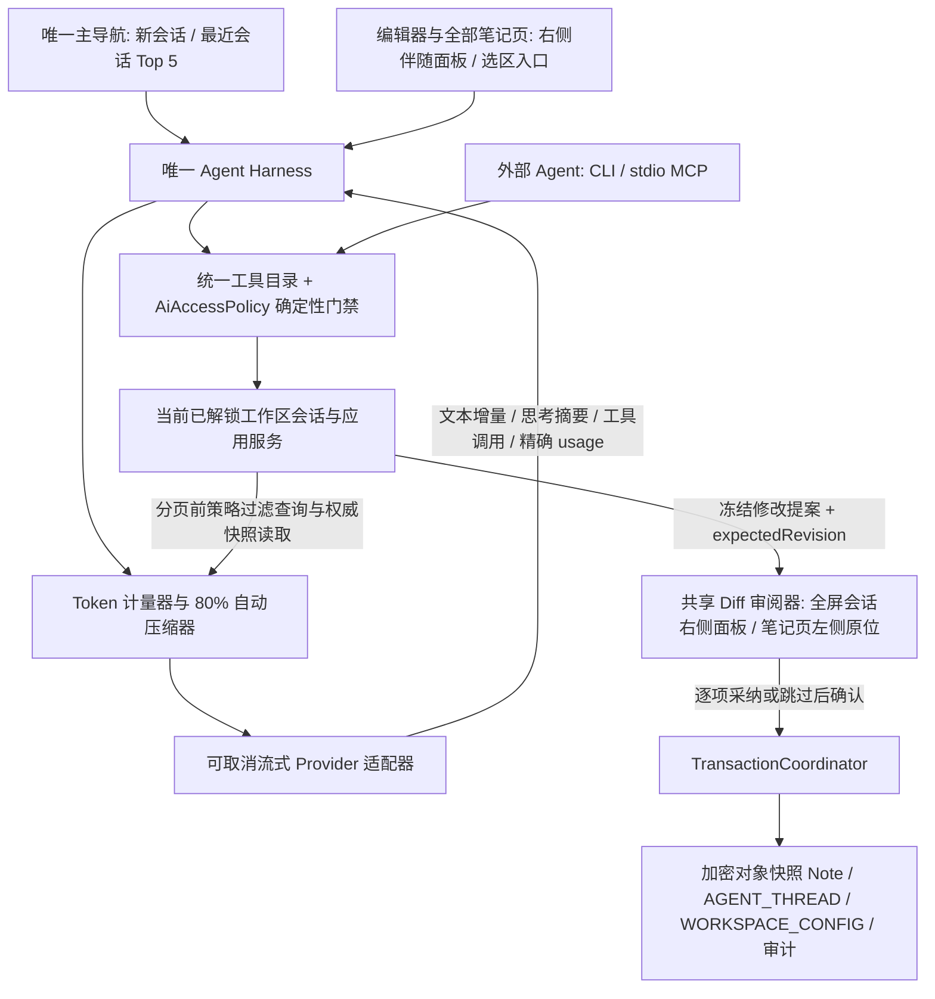

# Tagloom Agent Harness：功能、UI 与交互设计

状态：四阶段全部已编码落地并完成单元、双端盲同步与多视口 Compose UI 验收。仓库现已完整接入三协议流式模型适配器（OpenAI Chat Completions / OpenAI Responses / Anthropic Messages）、内置自有 `AgentHarness` 执行器、单左栏双形态界面（全屏对话主舞台 + 右侧伴随分栏/移动端底部抽屉）、系统默认笔记「全部笔记」投影页、`AiAccessPolicy` 三态门禁、`WORKSPACE_CONFIG` 与 `AGENT_THREAD` 双层加密快照与三方合并、`patch_note_blocks` / `update_note_metadata` 双方位共享原位 Diff 审阅以及 `StatsPills` 累计账单、`14.dp` `ContextMeter` 环形表与模型窗口 `80%` 两阶段无损压缩。

## 1. 产品目标与核心决策

Tagloom 内置**唯一一套自有 Agent Harness**，统一承载流式模型推理、受控工具循环、Token 与上下文窗口治理、来源追溯及结构化修改提案；外部 Agent（Codex、Claude Code、Pi、OpenCode 等）保留各自执行器，继续通过现有 CLI / MCP 调用同一套底层业务工具。

本轮定稿的七项核心拍板结论：

1. **精简唯一左侧工作区主导航 + 双形态入口共享同一会话内核**：不设第二列独立会话侧栏，且**移除冗余的「Agent 工作台」一级导航菜单项**。左侧唯一主导航直接提供顶部 `[+ 新建笔记]` 与 **`[✦ 新会话]`** 双快捷按钮、系统默认笔记 **`全部笔记`**（内置根类型 `Note` 的 `DatabaseDefinition` 全量投影页，防误删）、**`最近会话`**（默认展示非归档 Top 5，附无痕入口与 `全部 ▸` 历史检索/归档管理弹窗）及 **`最近笔记`**（默认展示 Top 5，附 `全部 ▸` 跳往 `全部笔记`）。**点击「最近会话」切换查看时严禁重排跳动顺序**，仅在新建会话或实际发送新消息后才置顶到首位。笔记编辑页与 `全部笔记` 页同时支持唤出右侧伴随面板及正文选区快捷入口。
2. **主舞台锚定双方位共享 Diff 审阅（全屏会话放右边，笔记伴随放左边）**：在全屏对话视图中，对话流固定在左侧主舞台，点击提案卡 **`[在右侧对照审阅 Diff]`** 从右侧滑出共享 Diff 审阅面板（支持 `[↗ 在笔记页打开]` 一键穿透）；在笔记编辑页中，笔记正文与原位逐块 Diff 固定在左侧主舞台，右侧展示 Agent 伴随面板。两处 100% 共用同一套逐块/逐属性 Diff 渲染器、逐项采纳/跳过状态机与 `expectedRevision` 原子提交流程。
3. **取消逐批远程外发弹窗，改用笔记与类型级 `AiAccessPolicy`**：用户配置模型并发起对话即代表授权读取允许范围内的笔记，不再在每次检索或读取时弹窗打断；敏感内容通过系统级三态策略（`ALLOW` / `REFERENCE_ONLY` / `LOCKED`）及笔记类型多父祖先链最严格收敛统一拦截，内置 Harness 与外部 API / CLI / MCP 共用确定性门禁。
4. **取消「问答 / 编辑」模式切换，升级块级与元数据细粒度工具**：所有写入、块替换与属性变更均先生成冻结提案卡，无需提问前切换模式；新增按稳定 `BlockId` 局部增删改的 `patch_note_blocks` 与遵循单自定义笔记类型约束的 `update_note_metadata`，完整保留未改动段落的稳定 `BlockId`、`BaseTable`、`Tabs` 与双向链接。
5. **无边框轻量化会话框、纯图标功能/消息动作按钮、模型与思考合一**：会话页头辅助动作采用无边框文本按钮；作曲框左下功能键（`@` 引用、`🌐` 全库检索开关）与回答消息底部动作栏（复制 Markdown、追加到当前笔记、存为新笔记）均采用**无文本纯图标按钮**（配悬浮提示与无障碍标签）；模型切换与深度思考档位合并为右下单一无边框文本按钮（如 `DeepSeek V3.2 · 思考:中 ▾`）及统一选择浮层。
6. **对标 DeepSeek Harness 的 Token 账单、上下文环形表与模型窗口 80% 自动压缩**：取代静态字符上限展示，作曲框下方状态栏左侧展示**会话累计 Token 用量与前缀缓存命中率**，右侧通过 **`14.dp` 环形进度环**展示当前活跃上下文占所选模型 `contextWindowTokens` 的百分比与三色分段明细；模型目录支持为每个模型配置上下文窗口（`16K ~ 1M`），达到模型窗口 **80%** 时自动将早期轮次与长工具结果折叠为可展开的摘要节点，同时逐字保留近期 **16%** 对话、活跃 `@` 引用与未决修改提案。
7. **会话历史与连接配置分层加密同步**：落地 `AGENT_THREAD` 与 `WORKSPACE_CONFIG` 加密对象快照，接入主密钥轮换与细粒度三方合并；同时保留不落盘的「无痕会话」。Provider 连接骨架与模型列表（含 `contextWindowTokens`）默认随 `WORKSPACE_CONFIG` 同步；API Key 默认保存在各设备系统安全存储或桌面环境变量引用中，另提供显式勾选将其纳入 `WORKSPACE_CONFIG` 双层加密信封跨端同步的选项。

| 能力域 | 当前代码已核对事实 | 本设计目标增量 |
| --- | --- | --- |
| 导航与全库笔记入口 | 侧栏直接平铺笔记列表；自定义 Database 仅通过 `/database` Block 原位创建 | 单一侧栏收敛为 `+ 新会话`、`全部笔记`（内置根 `Note` Database 投影页，防误删）、`最近会话 Top 5`（点击不跳序）与 `最近笔记 Top 5` |
| 笔记读取与结构查询 | `list_notes`、`get_note`、`get_block`、`search_notes`、`query_notes`、`get_backlinks`、`run_saved_query` 已实现 | 接入 `AiAccessPolicy` 分页前统一过滤、内置工具桥接与精确来源台账 `SourceLedger` |
| 笔记修改与 Diff 审阅 | `create_note`、`update_note`（整篇 Markdown 或完整 Note JSON）、`add_tag_to_note` 已实现预览与审批 | 新增 `patch_note_blocks` 与 `update_note_metadata`，支持全屏会话右侧滑出 Diff 与笔记编辑器左侧原位 Diff 共用逐项采纳组件 |
| 模型调用端口 | `AiCompletionPort` 仅返回单次完整字符串 | 演进为可取消流式事件端口（文本增量、思考摘要、工具调用、精确 `usage` 明细、错误分类）并实现协议适配器 |
| 上下文治理与压缩 | `AiContextBuilder` 按固定 Note / Block / `12_000` 字符裁剪单次输入 | 支持 `@` 多类型挂载、按模型配置 `contextWindowTokens`、Token 累计账单与 `ContextMeter` 环形表、达窗口 80% 自动摘要压缩 |
| 会话与配置持久化 | 仅在 `Snapshot.kt` 预留 `ObjectType.WORKSPACE_CONFIG`，尚无快照、manifest 类别或合并实现 | 落地 `AGENT_THREAD` 与 `WORKSPACE_CONFIG` 加密快照、主密钥轮换与三方合并，接入设备安全凭据存储及可选信封密钥同步 |
| 外部自动化 | 本机回环 API、CLI、stdio MCP 已共用已解锁会话 | 共享细粒度补丁工具与 `AiAccessPolicy` 确定性门禁，清理未使用的 `CALL_REMOTE_AI` 遗留枚举 |

事实来源：[本机外部入口](local-automation.md)、[权限与工具枚举](../core/src/commonMain/kotlin/com/oruke/tagloom/core/agent/AgentAccessModels.kt)、[工具定义](../core/src/commonMain/kotlin/com/oruke/tagloom/core/external/ExternalToolDefinitions.kt)、[模型端口](../core/src/commonMain/kotlin/com/oruke/tagloom/core/ai/AiContextModels.kt)、[根类型默认常量](../core/src/commonMain/kotlin/com/oruke/tagloom/core/workspace/WorkspaceDefaults.kt)、[工作区主界面](../app/shared/src/commonMain/kotlin/com/oruke/tagloom/ui/TagloomWorkspaceScreen.kt)。

---

## 2. 参考机制与设计取舍

参考成熟 Agent 工具的架构优点，结合 Tagloom 端到端加密与结构化对象笔记基因做明确取舍：

| 参考对象 | 成熟机制 | Tagloom 的设计取舍 |
| --- | --- | --- |
| DeepSeek Harness (`deepseek-harness`) | `StatsPills` 累计计费与缓存命中统计、`ContextMeter` 三色分段进度环、`dsh-compaction-basic` 达 80% 窗口自动修剪工具输出并浓缩早期历史（保留近期 16% 窗口） | 完整吸收双触发器底部状态栏（累计计费账单 + `14.dp` 上下文进度环）与按模型 `contextWindowTokens` 的 `80% / 16%` 自动摘要压缩，并额外保证活跃 `@` 引用与未决 Diff 提案在压缩后零丢失 |
| Codex / OpenCode | Provider（地址、协议、认证）与 Model（模型 ID、上下文窗口、能力）解耦维护；模型与推理强度同处快捷切换 | 同一连接挂载多个模型（各自配置 `contextWindowTokens`），右下角单一无边框文本按钮合并切换模型与思考档位；连接骨架默认同步而凭据默认本机隔离 |
| Zed Agent Panel | 多会话快速恢复与归档 + 逐块 Hunk 对照采纳/跳过 | 不设双层侧栏或冗余菜单，直接融合进主导航「最近会话 Top 5 + 全部弹窗」，并根据当前主舞台自适应右侧滑出或左侧原位共享 Diff |
| Notion Agent | 选区精准挂载、`@` 页面或数据集限定上下文范围 | `@` 同时支持单篇笔记、选中 `BlockId`、笔记类型与保存查询范围，采用无文本纯图标按钮保持编辑界面克制清爽，并与 `AiAccessPolicy` 正交组合 |

首版聚焦知识库整理、跨笔记研究与结构化写作辅助；本机 shell 命令执行、工作区外任意文件读写、公网网页爬取、多 Agent 编排市场与向量数据库暂不纳入首版范围。

---

## 3. 信息架构与双形态 UI 交互

延续 `TagloomTheme` 视觉体系：浅灰侧栏（`surfaceContainerLow`）、纸感画布（`surface`）、墨青绿功能强调色（`#006B5F` / 深色 `#87D5C9`）、细分隔线与无边框轻量化文本/纯图标操作按钮，严格遵循 ADR-008（界面使用不带 `#` 的“笔记类型”称呼，`#` 仅用于内置普通标签属性），不使用拟人头像或炫彩渐变边框。

### 3.1 单一主导航与双形态主舞台锚定布局

```text
形态 A：全屏对话视图（主舞台在左，点击提案后共享 Diff 审阅面板按需从右侧展开）
┌──────────────────────┬─────────────────────────────────────┬─────────────────────────────┐
│ 唯一工作区主侧栏     │ 会话标题 ✎  ☁ th-win:06  无痕 归档 伴随│ 对照审阅·《双向同步》 ↗笔记 ×│
│ 244.dp               ├─────────────────────────────────────┼─────────────────────────────┤
│ 🔍 搜索笔记与会话    │ 👤 结合验收纪要更新同步设计说明     │ 待审阅 3 处  [应用(3)] [退出]│
│ [+新建笔记][✦新会话] │                                     │                             │
│ 🗄 全部笔记       6  │ 🔎 已检索「会议纪要」· 精读 2 篇 ▾  │ # 工作区双向同步设计        │
│ 🏷 笔记类型与AI策略  │                                     │ 状态: [-评审中-] [+双端验收+]│
│                      │ 我已按稳定 BlockId 准备好补丁 [1][2]│       [采纳] [跳过]         │
│ 最近会话     👻 全部▸│ ┌─ 修改提案 · 《工作区双向同步》 ──┐│                             │
│ • 同步验收复盘       │ │ 属性 1 项 · 局部块补丁 2 处      ││ blk-sync-2                  │
│ • 派生索引分页核查   │ │ [收起右侧审阅]   放弃提案        ││ [-旧段落...-]               │
│ • 主密钥轮换走查     │ └──────────────────────────────────┘│ [+新段落...+] [采纳] [跳过] │
│ • 外部 MCP 白名单    │   [📋]  [➕]  [📄]  (纯图标动作栏)  │                             │
│ • 全部笔记视图规划   ├─────────────────────────────────────┤ blk-sync-3 (代码块未改保留) │
│                      │ ┌─────────────────────────────────┐ │                             │
│ 最近笔记       全部▸ │ │ [📄 双向同步 · 2段 ×]           │ │                             │
│ • 工作区双向同步设计 │ │ 输入问题，输入 @ 引用笔记或类型 │ │                             │
│ • 11月双端同步复盘   │ │ [@] [🌐]  DeepSeek V3.2·思考:中▾ ↑│ │                             │
│ • 可重建派生索引边界 │ └─────────────────────────────────┘ │                             │
│ • 11月随想       仅@ │ 48.2K tok · 缓存命中 76%  ◐ 26% ~33.9K/128K │                     │
│ • 离线恢复材料   禁读│                                     │                             │
│ ⚙ 设置 · Agent与模型 │                                     │                             │
└──────────────────────┴─────────────────────────────────────┴─────────────────────────────┘

形态 B：笔记编辑页（笔记正文与原位 Diff 固定在左侧主舞台，Agent 伴随面板在右侧）
┌──────────────────────┬─────────────────────────────────────┬─────────────────────────────┐
│ 唯一工作区主侧栏     │ 笔记 / 已保存 · dev-win:14  AI:可读 ✦│ 同步验收复盘 ▾    [+] [⤢] [×]│
│ （同上，无二级会话栏）├─────────────────────────────────────┼─────────────────────────────┤
│                      │ 待审阅 3 处  [应用所选(3)] [退出审阅]│ 对话流与可折叠工具轨迹条... │
│                      │ # 工作区双向同步设计                │ ┌─ 修改提案 · 3 处变更 ────┐│
│                      │ （复用同一套逐属性/逐块原位 Diff）  │ │ [正在左侧正文中审阅] 放弃││
│                      │ ┌─────────────────────────────────┐ │ └──────────────────────────┘│
│                      │ │ B I <> S 颜色 链接 加注 │ ✦ AI  │ ├─────────────────────────────┤
│                      │ └─────────────────────────────────┘ │ [@] [🌐]  DeepSeek·思考:中▾ ↑│
│                      │                                     │ 48.2K tok·76%  ◐ 26% ~33.9K │
└──────────────────────┴─────────────────────────────────────┴─────────────────────────────┘
```

### 3.2 系统默认笔记「全部笔记」（内置 Database 全量投影页）

为配合侧栏「最近笔记」收敛为默认 Top 5，侧栏固定提供系统默认笔记入口 **`全部笔记`**（内置受保护页面身份，如 `builtin-all-notes-page`）：

- **复用既有 Database 投影内核**：底层绑定内置 `DatabaseDefinition(sourceTypeId = WorkspaceDefaults.DEFAULT_NOTE_TAG_ID /* "default-note-tag" */, includeDescendants = true)`，直接通过 `DatasetProjection` 查询并展示工作区内根类型 `Note` 及全部子类型的所有活动笔记（**自动排除系统容器页自身行**，避免自指循环）。
- **防误删与边界清晰**：该系统默认页不可删除、不可解除根投影身份；用户自定义的局部数据库仍按第 14 节规范在普通笔记正文内输入 `/database` 创建，不在左侧主导航增设自定义 Database 列表。
- **多视图与伴随联动**：页面内支持 `Table / Kanban / Gallery` 视图切换、全文检索、按笔记类型及子类型闭包筛选、按更新时间或标题排序、显示每篇笔记的有效 `AiAccessPolicy` 标记，并可在页头一键唤出右侧 Agent 伴随面板做跨库整理。

### 3.3 唤起入口与三档窗口自适应

1. **协同唤起入口（无冗余「Agent 工作台」导航项）**：
   - **侧栏顶部 `[✦ 新会话]` 按钮、侧栏「最近会话」Top 5 条目及 `全部 ▸` 历史会话弹窗**：直接进入全屏对话主舞台（`AgentWorkspaceScreen`），适合不绑定单篇笔记的跨库研究、长对话续聊与归档检索。
   - **编辑器及「全部笔记」页头右侧 `[✦]` 按钮与快捷键 `Ctrl/Cmd + J`**：开关右侧 `AgentCompanionPane`。首次在单篇笔记页开启新会话时，若该笔记有效策略非 `LOCKED`，默认将其挂为可移除的候选引用 chip。
   - **文本选区浮动栏 `SelectionFormattingToolbar` 的 `✦ 询问 / 润色` 与块手柄 `EditorBlockHandle`**：选中一个或多个正文块（含代码块、`BaseTable`、`Tabs`）点击后，自动展开右侧伴随面板并将稳定 `BlockId` 列表挂为精确段落 chip，输入框直接获焦。
2. **三档响应式断点（Windows 桌面与 Android 共用）**：
   - **宽屏（`>= 1120.dp`）**：左侧工作区侧栏 `244.dp` + 中央主舞台自适应 + 按需右侧分栏（全屏会话右侧 Diff 面板默认 `460.dp`，或笔记页右侧伴随面板默认 `380.dp`，均支持拖拽调整宽度与一键互切）。
   - **中屏（`720.dp ~ 1119.dp`）**：当处于双栏分屏状态（全屏会话已展开右侧 Diff 审阅面板，或笔记页/全部笔记页已打开右侧伴随面板）时，**自动临时收起左侧工作区主侧栏**并在主舞台左上角展示抽屉唤出图标按钮，确保对话流与正文 Diff 均保有充足阅读宽度。
   - **窄屏与手机端（`< 720.dp`）**：顶部显示紧凑主导航栏（左侧汉堡按钮滑出包含「最近会话 Top 5」与「最近笔记 Top 5」的工作区侧栏抽屉）；全屏会话点击审阅提案时以全屏审阅覆盖层打开共享 Diff（左上角返回原对话），笔记页伴随面板采用底部上滑层；点击回答中的来源角标 `[1]` 跳回笔记原文高亮段落时，屏幕底部悬浮 **`[← 返回 Agent 对话]`** 胶囊条，一键回到原滚动位置并保留草稿。

### 3.4 会话与最近列表的稳定排序规则

- **「最近会话」零跳动铁律**：在左侧栏「最近会话」（默认显示非归档前 5 条）或伴随栏顶部会话选择器中**仅点击切换查看历史会话时，严禁改变会话列表的排列顺序**（避免用户连点对比会话时条目上下乱跳）；**唯有新建会话，或在该会话中实际发送了新消息时**（按真实消息活动时间 `lastMessageAt / createdAt` 排序，绝不按浏览时间 `lastViewedAt` 重排），才将该会话置顶到「最近会话」第 1 位。
- **「最近笔记」一致稳定体验**：直接在侧栏「最近笔记」（默认显示前 5 篇）点击切换查看时同样保持列表当前顺序不跳动；仅在新建笔记、从「全部笔记」/ 搜索弹窗 / 来源角标打开笔记或实际编辑保存后更新最近顺序。
- **新建、无痕、重命名、归档与全量检索**：
  - 点击 `[✦ 新会话]` 继承默认模型与默认检索范围；点击无痕图标开启「无痕会话」（仅驻留本次已解锁会话内存，不写快照、不同步）。
  - 会话标题默认取首轮问题摘要，支持在全屏会话页头点击原地重命名。
  - 点击「最近会话」旁 **`全部 ▸`** 打开会话历史与归档弹窗，支持按标题搜索全部活动会话、一键归档/恢复会话或写入快照 tombstone 删除会话（已归档会话自动移出侧栏 Top 5 与伴随栏默认下拉列表）。

---

## 4. 访问护栏、纯图标作曲栏与上下文挂载

### 4.1 笔记与类型级访问策略 `AiAccessPolicy`

采用系统级确定性访问策略统一约束内置 Agent Harness 与外部 API / CLI / MCP：

| 策略档位 | 全文/结构搜索与列表发现 | 反向链接摘要暴露 | 内置显式 `@` 引用读取 | 外部 API / CLI / MCP 按 `noteId` 直接访问 | 允许生成修改提案 |
| --- | --- | --- | --- | --- | --- |
| `ALLOW`（默认） | 允许 | 允许 | 允许 | 允许（须在 token 授权范围内） | 允许（须人工确认落盘） |
| `REFERENCE_ONLY` | **排除**（自动检索不可见） | **排除** | 允许（须用户亲手 `@` 挂载） | 全库范围 token（`allowedNoteIds == null`）**拒绝**；仅在 `grant` 显式将该 `noteId` 列入 `allowedNoteIds` 白名单或凭 owner token 直接按 ID 调用时允许 | 仅在满足左述显式挂载/单篇白名单条件时允许 |
| `LOCKED` | **禁止** | **禁止** | **禁止**（选择器置灰锁标；已挂旧 chip 在策略收紧后自动失效并标明禁读不发送） | **禁止**（含显式 `allowedNoteIds` 白名单与 owner token 的工具调用） | **禁止** |

边界与继承规则：

- **系统元数据隔离**：`aiAccessPolicy` 作为 `Note`（可空覆盖值）与 `TagDefinition`（类型默认策略，默认 `ALLOW`）的受控系统字段存储，**不建模为普通自定义 `PropertyDefinition`**，防止属性删除失效或被模型通过属性工具篡改。
- **多父祖先链最严格收敛**：每篇 `Note` 除内置根 `Note` 外最多绑定一个自定义笔记类型，而该笔记类型可拥有多父类型祖先链（`parentTagIds`）。当单篇 `Note` 未显式设置覆盖策略时，沿其绑定的自定义笔记类型及完整 `parentTagIds` 祖先链广度遍历解析有效策略，按 **`LOCKED` > `REFERENCE_ONLY` > `ALLOW`** 取最严格值；单篇笔记也可显式覆盖并清晰展示来源（「继承自笔记类型：密码与密钥库」或「本篇笔记单独设定」）。
- **配置入口**：笔记页头提供「AI 访问权限」三选一快捷切换；笔记类型管理页（`SupertagEditorScreen`）提供类型默认策略配置并实时预览后代继承影响。任何内置或外部工具均无权读取或修改 `LOCKED` 笔记，也无权修改任何对象的 `aiAccessPolicy`。

### 4.2 纯图标作曲控制栏、模型与思考合一浮层

为消除输入框周边的臃肿边框感，作曲区（`.composer-box`）底部工具栏统一采用无边框控件：

1. **左下纯图标功能键（零文本，配悬浮 Tooltip 与无障碍语义标签）**：
   - **`@` 引用图标按钮**（或在正文输入 `@` 字符）：唤起可搜索多类型引用浮层（支持键盘上下选择、Enter 确认、Esc 关闭），可挂载四类上下文（笔记类型均不带 `#` 前缀）：
     1. **单篇笔记**：生成 `[📄 笔记标题 ×]` chip，点击 chip 可二次勾选/排除具体稳定 `BlockId` 段落（有未保存脏草稿时提示先保存或引用已确认快照）；
     2. **精确正文段落**：从编辑器选区或块手柄一键挂入 `[📄 笔记标题 · N 段 ×]`；
     3. **笔记类型范围**：生成 `[🏷 类型: 会议纪要 ×]` chip，限定在该类型及子类型闭包中检索（自动排除 `REFERENCE_ONLY` 与 `LOCKED`）；
     4. **保存查询范围**：生成 `[🔎 查询: 进行中技术文档 ×]` chip，复用 `SavedQuery.QuerySpec` 命中范围（自动排除 `REFERENCE_ONLY` 与 `LOCKED`）。
   - **`🌐` 全库检索纯图标切换按钮**：
     - **未激活（默认 `仅引用`）**：图标呈次级中性色，`aria-pressed="false"`；模型仅能读取用户显式 `@` 挂载的笔记/段落，或在已挂类型/查询范围内调用只读工具；未挂载任何引用时作为纯对话回答。
     - **已激活（`全部笔记`）**：图标呈墨青绿主色柔和底高亮，`aria-pressed="true"`；授权模型在当前工作区所有有效策略为 `ALLOW` 的活动笔记内按需调用检索与读取工具（分页前在索引层过滤受限笔记，不将整库塞入首轮提示词）。
     - 当所选模型能力为 `CHAT_ONLY`（不支持工具调用）时，`🌐` 按钮自动置灰禁用并锁定为仅分析显式 `@` 引用内容。
2. **右下「模型 · 思考」合一无边框文本按钮**：
   - 将模型选择与深度思考强度合并为单一紧凑无边框文本按钮：支持思考档位的模型显示为 **`DeepSeek V3.2 · 思考:中 ▾`**（思考关闭时显示弱化态 `· 思考:关`），不支持思考档位的模型仅显示 **`Gemma 3 4B ▾`**。
   - 点击展开**同一复合选择浮层**：上半部分为已启用模型列表（展示模型显示名、连接名、配置的上下文窗口如 `128K` 及工具/连接就绪标记），下半部分为当前所选模型支持的「深度思考」分段切换器（如 `关闭 / 低 / 中 / 高`）。

---

## 5. 单一 Harness 执行循环、双方位共享 Diff 与 Token/上下文自动压缩

### 5.1 执行架构



内置 Harness 在同一客户端进程内直接调用应用服务与统一工具校验器，不绕行回环 HTTP。首版同一工作区同一时刻至多运行一个前台模型流；工具读取与网络等待期间绝不持有 `TransactionCoordinator` 写锁。工作区锁定或切换时立即取消在途 HTTP/SSE 流，按 `sessionId + runId` 丢弃任何晚到响应。

### 5.2 工具集对齐与细粒度修改升级

内置 Harness 与外部 CLI / MCP 共享同一套工具 schema 与权限校验逻辑：

1. **查询与读取工具（自动执行，分页前强制过滤 `AiAccessPolicy`）**：
   - 复用 `search_notes`、`query_notes`、`list_notes`、`get_note`、`get_block`、`get_backlinks`、`get_tags`、`get_tag_schema`、`get_workspace_schema`、`get_saved_queries`、`get_saved_query`、`run_saved_query`、`suggest_tags`、`suggest_properties`。
   - 对话界面将连续只读工具调用折叠为单行可展开轨迹条（如 `🔎 已检索类型「会议纪要」并精读 2 篇笔记 (4 个段落) · 自动跳过 2 篇受策略保护笔记 ▾`）。
2. **细粒度写入提案工具（生成冻结预览，确认后原子落盘）**：
   - **`patch_note_blocks`**：携带 `noteId`、`expectedRevision` 与有序补丁操作列表（`replace_block`、`insert_after_block`、`prepend_blocks`、`append_blocks`、`remove_block`）。正文输入采用局部轻量 Markdown，由宿主复用现有 Markdown 块解析器转换为结构化 `RichText`、`Code` 或 `BaseTable` Block，**未改动 Block 的稳定 `BlockId`、双链锚点、`Tabs` 层级及内联加注 100% 原样保留**。
   - **`update_note_metadata`**：携带 `noteId`、`expectedRevision`、可选 `title`、可选 `customTagId`（遵循 ADR-008 单自定义笔记类型约束，始终保留内置根 `Note`）及 `propertyUpdates`（按稳定 `PropertyId` 设置或清空属性值，普通 `#标签` 通过内置自由多选属性更新；严格校验类型与已确认 option ID，禁止覆盖只读/公式属性）。
   - 保留 `create_note`（新建带笔记类型、属性与初始正文的完整笔记提案），并保留现有 `update_note` 与 `add_tag_to_note` 供外部 CLI / MCP 向后兼容。
3. **收敛高危与清理遗留定义**：
   - 内置 Agent 首版不向模型暴露 `delete_note` 与文件导出 `export_note`（外部 CLI / MCP 继续按显式高危 scope 与二次确认管控）。
   - 清理 `AgentAccessModels.kt` 中未实际接入业务的远端调用遗留定义（移除 `AgentToolName.CALL_REMOTE_AI`、`AgentPermissionScope.CALL_REMOTE_AI`、`AgentDenialCode.REMOTE_AI_NOT_ALLOWED` 与 `AgentToolRequest.sendsContentRemotely`），模型通信统一归口至流式 Provider 适配器层。

### 5.3 防幻觉来源角标、纯图标消息动作栏与双方位共享 Diff 审阅

1. **防幻觉来源角标（`SourceLedger`）**：
   - 每次工具读取或引用注入均在当轮 `SourceLedger` 登记 `(sourceIndex, noteId, blockId, revision, excerpt)`。
   - 回答正文中的 `[1]` `[2]` 经台账核验后渲染为可交互角标（悬浮预览笔记标题与原摘录，点击定位到对应笔记并高亮目标 Block；若原段落后续被编辑或删除，诚实提示「来源已更新」或「原段落已移除」）；未在台账登记的伪造编号按纯文本输出。
2. **回答底部纯图标操作栏（零文本）**：
   - 每条 Agent 回答底部仅展示轻量无边框**纯图标按钮**（配悬浮 Tooltip 与无障碍 `contentDescription`）：依次为 **`复制 Markdown`**、**`追加到当前笔记`**、**`存为新笔记`**，保持长对话阅读面干净克制。
3. **主舞台锚定双方位共享 Diff 审阅**：
   - 模型调用 `create_note`、`patch_note_blocks` 或 `update_note_metadata` 后，先在对话流生成**修改提案摘要卡**（展示目标笔记、基准 `revision` 一致性状态、属性变更项数与局部块补丁数；次级「放弃提案」等采用无边框轻量文本按钮）。
   - **按当前宿主保持主舞台稳定不动**：
     - 若当前位于**全屏对话视图**：对话流留在左侧主舞台不动，点击提案卡 **`[在右侧对照审阅 Diff]`** 从右侧滑出 `HubRightDiffPane`（页头附 **`[↗ 在笔记页打开]`** 按钮可随时切入完整笔记编辑页，点击 `×` 收起右侧面板回到居中对话）；
     - 若当前位于**笔记编辑页（右侧伴随模式）**：笔记正文固定在左侧主舞台不动，点击 **`[在左侧正文中审阅]`** 直接在左侧正文画布展开原位 `InlineBlockDiff`。
   - **共享逐项采纳与乐观锁保护**：两处复用完全一致的审阅头与逐块 Diff 卡片——未改动 Block 正常显示以保留上下文，变更的属性行与正文 Block 原位对比旧值（删除线弱化）与新建议（`primaryContainer` 浅青绿标识），每项右上角提供独立 **`[采纳]` / `[跳过]`**，审阅栏汇总 **`[应用所选变更 (N)]`** 并经单次 `TransactionCoordinator` 原子事务提交（同步更新 Note 快照、会话提案状态、Change 与派生索引）。若提交前目标笔记 `revision` 已变化，立即拦截覆盖并提示过期，保留 **`[基于最新内容重算提案]`** 与建议文本复制能力。

### 5.4 对标 DeepSeek Harness 的 Token 计量与 80% 上下文自动压缩

在作曲框正下方设置极简双触发器状态栏（`.composer-dock`），严格区分**会话累计计费账单**与**当前活跃上下文窗口水位**：

1. **左侧触发器：会话累计 Token 账单（对标 `StatsPills`）**：
   - 常驻显示紧凑累计文本，如 **`48.2K tok · 缓存命中 76%`**（尚无缓存统计时仅显示总 Token）。
   - 点击弹出**会话累计 Token 用量明细浮层**：展示前缀缓存命中率（`cacheReadTokens / (uncachedInputTokens + cacheReadTokens)`）、未命中输入 `Input`、缓存读取 `Cache Read`、模型输出 `Output`（并单列其中包含的深度思考推理 `Reasoning` Token）。**执行上下文自动或手动压缩仅缩减后续请求的活跃窗口，绝不清零会话历史累计账单，压缩摘要请求自身消耗的少量 Token 亦如实计入累计账单**。
2. **右侧触发器：环形上下文状态表（对标 `ContextMeter`）**：
   - 常驻显示 **`14.dp` 环形 SVG/Canvas 进度环 + 占用百分比 + `~已用 / 模型窗口`**（如 `◐ 26% ~33.9K / 128K`；接近压缩阈值前 `12%` 转为琥珀警示色，达到或超过压缩阈值转为错误红色）。
   - 计量口径（参考 `dsh-token-meter` 混合投影）：回合落盘后以 Provider 返回的真实输入结构更新基准，编辑输入草稿或增删 `@` 引用 chip 时实时叠加本地启发式 Token 估算值，切换不同 `contextWindowTokens` 的模型时分母与百分比即时重算。
   - 点击弹出**上下文窗口占用明细浮层**：展示 `上下文已用 X%`、带 **80% 自动压缩刻度线**的**三色分段进度条**（第一段：系统提示词 `systemTokens`；第二段：工具定义与笔记上下文 `toolsTokens`；第三段：对话与思考消息 `messageTokens`）、三项精确数值图例，以及 **`[立即压缩]`** 手动整理按钮。
3. **达模型配置上下文 80% 自动无损脉络压缩（对标 `dsh-compaction-basic`）**：
   - **触发条件**：当开启自动压缩（默认开启）且单轮回复完成后的活跃上下文 `usedTokens >= floor(model.contextWindowTokens * autoCompactPercent / 100)`（默认 **`80%`**）时自动执行；用户也可在明细浮层随时点击 `[立即压缩]` 手动触发。
   - **两阶段压缩与保留边界**：先修剪早期历史轮次中体积庞大的只读工具原始返回载荷，再调用轻量摘要将早期多轮问答浓缩为结构化上下文摘要，使压缩后窗口回落至安全水位；同时**强制逐字保留近期约 `16%`（`retainPercent`，可配置）的新近对话轮次、当前作曲框挂载的所有活跃 `@` 引用 chip 及所有处于 `pending` 状态的修改提案**。
   - **可视化摘要节点与非破坏性存储**：在对话流对应位置插入可点击展开/收起的 **`CompactionItem`（`上下文已自动压缩`）** 卡片，单行展示触发阈值与释放 Token 数（如 `达到模型上下文 80% 阈值 · 已释放 ~78.5K tok`），展开可审阅摘要正文；底层 `AGENT_THREAD` 加密快照完整保留原始历史消息记录与最新压缩边界游标，既节省后续推理上下文，又不损毁用户的加密对话档案。

### 5.5 运行状态矩阵

| 状态 | 界面表现 | 可执行操作 |
| --- | --- | --- |
| 未配置可用模型 | 输入框与 `@` 引用可正常体验，发送按钮置灰并内联提示前往设置 | 打开 Agent 设置配置连接与模型 |
| 连接缺少本机密钥 | 同步来的连接在作曲框顶部展示温和内联提示条「连接骨架已同步，待填写本机 API Key」（不弹阻断弹窗） | 点击「去补充密钥」或切换其他已就绪模型 |
| 就绪 | 展示已挂 `@` 引用 chip、纯图标 `@`/`🌐` 状态、`模型 · 思考 ▾` 及底部累计 Token 与环形上下文表 | 发送、切换模型与思考档位、新建/切换/归档会话 |
| 流式生成 / 调工具中 | 实时渲染增量正文与折叠式工具轨迹条，发送键切换为红色方形「停止」图标按钮；后台不写快照 | 随时点击「停止」（保留已输出正文并落盘当前轮次） |
| 提案待审阅 | 对话内展示提案摘要卡；全屏会话可在右侧展开 Diff 面板，笔记页可在左侧正文展开原位 Diff | 逐项采纳/跳过、应用所选变更、穿透到笔记页、放弃提案或继续追问 |
| 触发 80% 自动压缩 | 回合完成自动插入可展开的 `上下文已自动压缩` 摘要节点，右侧进度环回落至健康水位 | 点击摘要节点查看保留脉络，无缝继续长对话 |
| 达到单轮步数 / 读取护栏 | 保留已获取结论并清晰说明触发的单轮 `maxToolRounds` 或 `AiContextBudget` 读取上限 | 缩小 `@` 引用范围继续追问，或点击上下文浮层手动压缩 |
| 网络 / 协议错误 | 保留用户草稿与已完成工具记录，展示脱敏稳定错误原因 | 原参数重试、切换模型或检查 API 连接 |

---

## 6. Provider 配置、模型级上下文窗口与分层同步

在 `WorkspaceSettingsScreen` 新增「Agent 与模型」分区入口，延续纵向二级设置页风格，分为 **API 连接**、**模型与上下文**、**自动压缩与偏好** 三块。

### 6.1 API 连接与快捷预设

- **快速预设模板**：新建连接顶部提供一键填表预设：**`OpenAI`**、**`OpenAI 兼容端点（DeepSeek / OpenRouter / 自建 vLLM）`**、**`Ollama（本机免密）`**、**`LM Studio（本机）`**；底层严格绑定具体协议适配器（首版实现 `OpenAI Responses` 与 `OpenAI Chat Completions`，后续独立验收后再开放原生 `Anthropic Messages` 等适配器，不靠猜测路径后缀拼接协议）。
- **本机与远程连接校验**：「测试连接」验证地址可达性与认证；「拉取 `/models`」自动导入候选模型，不支持时允许手动输入原始 `modelId`；提供独立的无笔记「工具调用实测」按钮，真实发起一次最小函数调用闭环以标记工具能力。

### 6.2 配置与 API Key 的分层同步规则

| 数据项 | 存储载体 | 跨设备同步与备份行为 |
| --- | --- | --- |
| 连接骨架（连接 ID、名称、Base URL、协议类型、超时、非敏感请求头、认证模式、是否开启密钥同步） | `WORKSPACE_CONFIG` 加密对象快照（外层 `EncryptionEnvelope`） | **默认随工作区同步与加密备份**，新设备无需重复录入地址与协议 |
| 模型目录（连接 ID + `modelId`、显示名、**`contextWindowTokens` 上下文窗口大小**、流式/工具/思考能力状态、启用状态）与运行偏好 | `WORKSPACE_CONFIG` 加密对象快照（外层 `EncryptionEnvelope`） | **默认随工作区同步与加密备份**，双端开箱共享模型列表、各模型上下文窗口配置与自动压缩阈值 |
| API Key（默认：本机隔离模式） | Windows DPAPI / 系统凭据库、Android Keystore，或桌面环境变量名（如 `OPENAI_API_KEY`） | **不进入工作区快照与备份包**；其他设备同步后在作曲框顶部温和提示补充该设备本地密钥 |
| API Key（可选：勾选「随工作区加密同步此 API Key」） | 承载于受工作区主密钥体系（经 `WorkspaceKeyService` HKDF `WrappingKeyPurpose.SNAPSHOT` 用途隔离派生密钥包装独立随机 DEK 的双层 XChaCha20-Poly1305 AEAD）保护的 `WORKSPACE_CONFIG` `EncryptionEnvelope` 快照内 | **随工作区密文同步与加密备份，并随 `rotateArtifact` 主密钥轮换自动重包装外层信封**；界面明确提示所有持有该工作区恢复能力的设备均可使用该密钥 |

安全硬约束：严禁将原始 `SecretKeyKind.WORKSPACE_MASTER` 直接用于字段级 AEAD；禁止任何 shell 命令执行型凭据来源；同步态密钥与桌面环境变量仅在已解锁会话内存中按需读取用于请求头并随锁定清空，不在界面回显、日志、聊天上下文或错误文本中展开真实密钥。

### 6.3 模型级上下文窗口配置与自动压缩运行偏好

- **模型能力诚实分级与 `contextWindowTokens` 配置**：
  - 每项模型标明 `[流式]`、`[工具: 已实测 / 手动声明 / 仅对话]` 及支持的 `[思考档位]`。选中 `CHAT_ONLY`（仅对话无工具）模型时，自动禁用 `🌐` 全库自动检索与结构化写入提案，仅分析用户显式 `@` 挂载的笔记内容，绝不通过正则解析正文伪造工具调用。
  - **独立上下文窗口配置**：支持在「模型与上下文」页为每个模型独立配置 **`contextWindowTokens`**（内置 `16K / 32K / 64K / 128K / 200K / 256K / 1M` 常用档位并支持自定义正整数，拉取常用已知模型时自动匹配推荐默认值），列表实时换算并展示该模型的 **`80% 自动压缩线`**（如 `128K -> 102.4K tok`、`200K -> 160K tok`），同步驱动对话底部的 `ContextMeter` 进度环分母。
- **自动压缩与单轮安全护栏偏好**：
  - **上下文自动压缩偏好**：配置 `autoCompactEnabled`（默认 `true`）、`autoCompactPercent`（默认 **`80%`**，合法范围 `50% ~ 95%`）与压缩后逐字保留近期窗口比例 `retainPercent`（默认 **`16%`**，合法范围 `8% ~ 40%`）。
  - **单轮检索与注入护栏**：设置新会话默认模型、默认检索范围（默认 `仅引用`）、单轮最大工具循环步数 `maxToolRounds`（默认 `6`）及单轮 `AiContextBudget`（单轮最多注入笔记数 `maxNotes = 8`、最多注入段落数 `maxBlocks = 32` 与单次工具读取字符安全保护上限），防止单次宽泛查询瞬间撑爆窗口。

---

## 7. 会话与配置持久化、模块边界与分阶段实施

### 7.1 `WORKSPACE_CONFIG` 与 `AGENT_THREAD` 加密快照及同步语义

- **权威存储模型**：启用 `Snapshot.kt` 已预留的 `ObjectType.WORKSPACE_CONFIG` 并新增 `ObjectType.AGENT_THREAD`，在 `ManifestObjectKind` **同时新增 `WORKSPACE_CONFIG` 与 `AGENT_THREAD`**，统一接入 `ObjectChange` 历史协议、`DesktopWorkspaceKeyRotationService` 密钥轮换角色、单写入者租约与 `TransactionCoordinator`。工作区目录下不创建任何明文 SQLite 聊天表或明文 JSON 日志；派生索引可索引非归档会话标题与 `lastMessageAt` 以支撑侧栏「最近会话 Top 5」稳定排序与弹窗快速检索，且完全可从加密快照重建。
- **低频事务落盘时机**：模型流式输出、中间工具执行及仅点击查看会话期间仅更新内存态视图状态，**禁止逐 token 写盘、禁止因纯浏览点击改写会话快照时间戳或触发服务器自动上传**；仅在以下确定性边界提交一次快照事务：
  1. 新建持久化会话，或单轮模型回复正常完成 / 被用户手动点击「停止」（同步更新 `lastMessageAt`、每轮 `usage` 明细、最新 `contextBreakdown` 及可能触发的自动压缩 `CompactionItem`）；
  2. 用户执行手动上下文压缩，或批准/放弃会话内的修改提案（批准提案时与目标 `Note` 快照变更在同一事务内原子确认）；
  3. 用户手动重命名、切换归档状态、删除会话，或在设置中保存 Provider / 模型 `contextWindowTokens` / 自动压缩偏好变更。
- **多端三方合并策略**：在 `WorkspaceReplicaMergePlanner` 中补齐两类对象的细粒度合并规则，避免并发修改退化为整对象冲突：
  - `WORKSPACE_CONFIG`：按稳定 `connectionId` 合并连接条目、按 `(connectionId, modelId)` 合并模型条目（含 `contextWindowTokens` 与启用状态），运行偏好（含 `autoCompactEnabled`、`autoCompactPercent`、`retainPercent`）按独立字段执行三方值合并；
  - `AGENT_THREAD`：按消息及压缩摘要节点的稳定 `messageId` 与因果顺序保序并集（最新活跃压缩游标取因果更晚边界，累计计费 Token 由已合并回合的 `usage` 记录确定性汇总而不被单端覆盖），会话标题、`lastMessageAt` 与 `archived` 标记按独立字段执行三方值合并。

### 7.2 KMP 模块职责划分

- **`core`（`commonMain`）**：`AiAccessPolicy` 与多父类型祖先链最严格收敛解析、`AiStreamPort` 流式事件（含精确 Token `usage`）与取消契约、单一 `AgentHarness` 状态机、混合 Token 计量器与 `80% / 16%` 自动摘要压缩器、`SourceLedger` 来源台账、`patch_note_blocks` / `update_note_metadata` 领域协议与校验器、内置「全部笔记」根类型 `DatabaseDefinition` 投影规约、`WORKSPACE_CONFIG` 与 `AGENT_THREAD` 快照模型及三方合并规则。
- **`app/file-system` & `app/sync` & `app/index`**：落地 `WORKSPACE_CONFIG` 与 `AGENT_THREAD` 快照持久化、主密钥轮换覆盖与盲同步归档纳入，索引层在分页前按 `AiAccessPolicy` 过滤查询并维护 `全部笔记` / `最近会话` 派生投影，以及平台本地凭据保险箱适配（JVM DPAPI / 环境变量读取、Android Keystore）。
- **`app/shared`（`commonMain`）**：重构唯一工作区主侧栏（移除冗余工作台菜单，落地 `+ 新会话`、`全部笔记` 系统默认 Database 页、`最近会话 Top 5` 稳定列表与 `全部 ▸` 历史归档弹窗、`最近笔记 Top 5`）、全屏对话左主舞台 + 右侧按需 `HubRightDiffPane`、笔记编辑页左侧原位 `InlineBlockDiff` + 右侧 `AgentCompanionPane`、无边框纯图标作曲栏与 `模型 · 思考 ▾` 合一浮层、底部 Token 账单与 `14.dp` `ContextMeter` 进度环浮层，以及 `AgentSettingsScreen`。
- **`app/automation`**：CLI 与 stdio MCP 同步暴露 `patch_note_blocks`、`update_note_metadata`，统一执行 `AiAccessPolicy`（含 `REFERENCE_ONLY` 对 `allowedNoteIds` 白名单的确定性校验）并清理 `CALL_REMOTE_AI` 遗留协议分支。

### 7.3 四阶段实施与验收切分

1. **阶段一（内核端口、连接/模型窗口配置与分层同步）**：演进可取消流式模型端口（含 `usage` 回传），落地 `WORKSPACE_CONFIG` 快照（含每模型 `contextWindowTokens` 与 `80%` 自动压缩偏好）、主密钥轮换与三方合并，完成 OpenAI Chat Completions / Responses 适配器、本机 DPAPI / Keystore / 环境变量凭据存储及可选随配置信封加密同步开关，交付 `AgentSettingsScreen`。
2. **阶段二（单侧栏重构、`全部笔记` 系统页、`AiAccessPolicy` 与只读对话闭环）**：重构唯一左侧主侧栏（`+ 新会话`、`最近会话 Top 5` 点击零跳动排序、`全部 ▸` 归档弹窗、`最近笔记 Top 5`）并交付内置防误删的 `全部笔记` Database 投影页；落地 `Note` / `TagDefinition` 三态 `AiAccessPolicy` 及继承过滤（同步覆盖 CLI / MCP）；完成 `AGENT_THREAD` 加密快照与跨端同步，打通纯图标 `@`/`🌐` 作曲栏、`模型 · 思考 ▾` 合一菜单、来源回跳高亮及纯图标消息沉淀动作。
3. **阶段三（细粒度补丁工具与双方位共享 Diff 审阅）**：实现 `patch_note_blocks` 与 `update_note_metadata`（同步接入内置 Harness 与 CLI / MCP），打通全屏会话**右侧滑出 Diff 面板**与笔记编辑页**左侧原位 Diff** 的 100% 组件复用、逐项采纳/跳过、`[↗ 在笔记页打开]` 穿透、`expectedRevision` 乐观锁保护及 `TransactionCoordinator` 原子提交。
4. **阶段四（选区快捷联动、Token 账单/环形表与 80% 自动压缩）**：接入 `SelectionFormattingToolbar` 与块手柄快捷挂入，落地 `.composer-dock` 累计 Token 账单浮层、`14.dp` 三色分段 `ContextMeter` 进度环及达模型上下文窗口 `80%` 阈值的自动摘要压缩（`CompactionItem` 可展开节点 + `16%` 近期窗口与活跃引用/提案完整保留），完成 Windows 桌面三档视口与实体 Android 真机双端交互及同步验收。

---

## 8. 交互原型基线与验收红线

早期探索阶段的 Stitch 草稿（基于“仅右侧栏、问答/编辑切换、远程逐批外发弹窗、会话仅留内存、冗余双侧栏”旧假设）已废弃；本地评审目录 `.impeccable/mocks/agent-harness/`（按 `.gitignore` 仅驻留本地工作区、不纳入版本库）下的双形态可点击原型已与本文第 1～7 节定稿决策一致，一切正式开发与验收均以本文规格为准并在 KMP + Compose 客户端中原生交付。

正式交付必须通过真实加密工作区与双端 UI 验收证明以下事实：

- 左侧唯一主导航无冗余「Agent 工作台」菜单项；点击「最近会话」仅切换查看而绝不跳动重排列表顺序，仅新建会话或实际发送新消息后才置顶；点击「全部笔记」稳定打开基于根类型 `Note` `DatabaseDefinition` 投影的系统默认页（自动排除容器页自身且防误删）；
- 全屏对话主舞台点击审阅提案在**右侧**展开共享 Diff 面板，笔记编辑页点击审阅提案在**左侧正文**展开原位 Diff，两边状态实时互通；作曲框左下功能键与消息底部动作栏均为纯图标按钮，模型与思考档位合并于同一无边框文本按钮及浮层；
- 底部状态栏准确展示会话累计计费 Token / 缓存命中率与 `14.dp` `ContextMeter` 上下文占用环；修改模型的 `contextWindowTokens` 即时重算 `80%` 压缩线，达到 `80%` 阈值时自动插入可展开的 `CompactionItem` 摘要节点且完整保留近期对话、活跃 `@` 引用与未决修改提案，历史累计账单不被清零；
- `LOCKED` 笔记与继承 `LOCKED` 笔记类型的笔记在内置全库检索、`@` 选择器及外部 API / CLI / MCP（含显式 `allowedNoteIds` 与 owner token 工具调用）中均不可发现、不可读取、不可修改，且模型无法通过任何工具篡改 `aiAccessPolicy`；
- `REFERENCE_ONLY` 笔记不会出现在内置与外部自动搜索、列表或双链结果中；内置仅在用户手动 `@` 挂载后可读，外部 API / CLI / MCP 仅在 `grant` 显式将该 `noteId` 列入 `allowedNoteIds` 白名单或凭 owner token 直接按 ID 调用时可读，全库范围外部 token 按 ID 读取严格拒绝；
- 流式生成与仅点击查看会话期间不产生高频磁盘事务，回合结束后重开应用或跨 Windows / Android 同步均可完整恢复活动会话、压缩摘要节点与归档会话；
- 未勾选密钥同步时，工作区快照、同步归档与导出备份包中零 API Key 残留；勾选同步后，API Key 仅存在于受 HKDF `WrappingKeyPurpose.SNAPSHOT` + 随机 DEK 双层 AEAD 信封保护的 `WORKSPACE_CONFIG` 加密快照内，并在执行工作区主密钥轮换后仍可正常解密调用；
- `patch_note_blocks` 与 `update_note_metadata` 批准后，未改动段落的稳定 `BlockId`、`BaseTable`、`Tabs`、单自定义笔记类型约束与双向链接完好无损，`revision` 过期提案严格拒绝直接覆盖；
- 工作区锁定瞬间取消在途模型流并清空内存会话视图与敏感凭据缓存，日志与异常中零正文、零标题、零密钥泄露。
