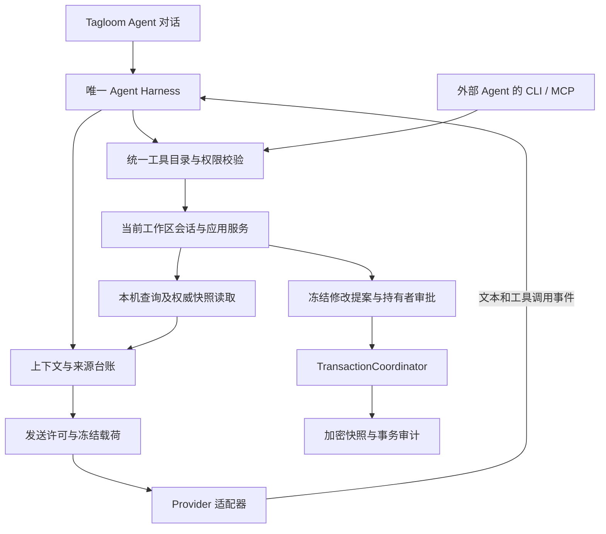

# Tagloom Agent Harness：功能、UI 与交互设计

状态：修订后的待评审方案。用户已明确首版做 Tagloom 自己的一个 Agent Harness，外部 Agent 通过现有 CLI 或 MCP 使用笔记能力。本轮交付设计与独立交互原型，尚未实现正式模型适配器、Agent 执行器或 Compose 页面。

## 1. 产品目标与当前事实

用户在一个 Agent 对话中引用指定笔记，或者允许 Agent 搜索全部笔记；Agent 按需搜索、读取、回答并给出可审阅的修改建议。用户配置自己的 API 连接、模型与运行偏好，不需要创建多个 Agent 身份或选择助手人设。

“一个 Harness”指一套执行内核与工具规则，可以承载多个对话；切换模型、问答/编辑模式、开启新对话均不创建第二套执行器。Codex、Pi、OpenCode 等外部程序保留自己的模型与执行循环，只通过 CLI/MCP 调用 Tagloom 的业务工具。

| 能力 | 已核对的实现 | 首版设计增量 |
| --- | --- | --- |
| 笔记读取、全文与结构查询 | get_note、get_block、search_notes、query_notes 已有受控实现 | 内置工具桥接与逐步来源记录 |
| 外部调用 | 本机 API、CLI、stdio MCP 共用已解锁工作区会话 | 沿用现有入口，不以外部 Agent 目录作为本轮主功能 |
| 模型调用 | AiCompletionPort 目前返回一个完整字符串 | Provider 适配、流事件、工具调用、取消及 usage |
| 上下文 | AiContextBuilder 已有 Note/Block/字符预算 | 引用选择、来源 revision、历史与工具结果预算 |
| 修改 | 已有统一预览、审批、revision 复核与事务写入 | 对话内提出修改并打开同一审阅入口 |
| 持久会话、向量检索 | 尚无完整可用入口 | 首版不依赖；对话仅在本次解锁内保留 |

事实来源：[本机外部入口](local-automation.md)、[工具目录](../core/src/commonMain/kotlin/com/oruke/tagloom/core/external/ExternalToolCatalog.kt)、[笔记读取与搜索](../app/shared/src/jvmAndroidMain/kotlin/com/oruke/tagloom/workspace/DesktopAgentReadService.kt)、[模型端口](../core/src/commonMain/kotlin/com/oruke/tagloom/core/ai/AiContextModels.kt)。

## 2. 参考与取舍

参考成熟 Agent 的配置与运行机制，不复刻编码终端或引入各自的执行器。

| 参考 | 官方材料中的机制 | Tagloom 的设计取舍 |
| --- | --- | --- |
| Codex | Provider 分离地址、协议和认证；模型、运行配置与权限另行定义 | API 连接与模型分开维护，切换模型保持同一 Harness；工具规则由宿主强制执行 |
| Pi | 按 Provider 搜索模型，思考档位取决于模型；默认与当前会话选择分开；上下文可压缩 | 模型选择可搜索，思考强度按能力显示；压缩保留引用和未完成审批 |
| OpenCode | Provider 凭据与模型配置分离；同一模型可配置不同参数变体 | 同一连接维护多个模型，参数放到高级设置，不把每套参数命名成新的 Agent |

资料：[Codex 高级配置](https://learn.chatgpt.com/docs/config-file/config-advanced)、[Pi 模型与兼容端点](https://github.com/earendil-works/pi/blob/main/packages/coding-agent/docs/models.md)、[Pi 设置](https://github.com/earendil-works/pi/blob/main/packages/coding-agent/docs/settings.md)、[OpenCode Providers](https://opencode.ai/docs/providers/)、[OpenCode Models](https://opencode.ai/docs/models/)。本轮已读取官方内容；实际依赖与协议仍需实施时验收。

首版专注笔记工具。命令执行、任意文件读写、联网搜索、多 Agent 协作、外部进程托管与 Agent 市场后置。问答与编辑是同一个 Agent 的工具许可模式。

## 3. 信息架构与界面

```text
笔记编辑器工具栏 → Tagloom Agent（右侧面板，可展开）
├─ 当前对话、新对话、本次解锁内的历史
├─ 模型选择、当前模型的思考强度
├─ 问题、可展开工具步骤、回答与来源
└─ 固定输入区
   ├─ @笔记引用、引用笔记按钮
   ├─ 问答 / 编辑
   └─ 检索范围：引用的笔记 / 全部笔记
设置 → Agent
├─ API 连接
├─ 模型
└─ 运行偏好
外部 Codex / Pi / OpenCode → 现有 CLI / MCP → 统一业务工具
```

延续灰侧栏、青绿功能色、线性图标和居中正文。常规桌面 Agent 位于右侧，正文在剩余区域居中；展开后提供独立对话阅读区域。窄窗口采用覆盖面板，网页原型有单栏回退，不据此宣称原生手机端已实现。

设置采用纵向列表和表单。Agent 设置只有 API 连接、模型、运行偏好三项。模型齿轮直接定位当前连接；凭据、PIN 和连接编辑不放右上角菜单。外部工具授权遵循已有入口规则，不新增外部 Agent 人设目录。

## 4. 引用与全部笔记搜索

### 4.1 指定引用

输入 `@` 或点击“引用笔记”，打开可搜索的笔记选择浮层。结果显示笔记类型图标、标题与短摘录，支持方向键、Enter 选中、Esc 返回输入；选中后生成可移除引用 chip，同一笔记不可重复添加。引用详情可选择具体段落。

从已选 Block 打开 Agent 时预选这些 Block；从工具栏打开时将当前笔记作为可移除引用。切换编辑器笔记不自动更换对话引用。未保存草稿不静默加入上下文，提供“保存后引用”。

“引用的笔记”仅在引用 Note allow-list 内检索和读取；没有引用时仍可普通提问并显示“未引用笔记”。模型不能通过工具参数扩大范围。

### 4.2 搜索全部笔记

用户显式切为“全部笔记”，授权本对话在当前解锁工作区内检索可访问的活动笔记，输入区持续显示范围。既有引用仍是重点上下文；全库开关只扩展候选范围，不将整库塞进首次请求。

Harness 提供分页和预算约束的 search_notes 与按需 get_note/get_block。工具复用派生索引与权威快照，只把相关且授权的内容加入上下文。索引落后时提示重建或等待，不将未命中伪装成工作区没有内容。

Agent 可选择检索词、重复搜索并读取段落。对话显示“搜索全部笔记 · 查询词 · 命中数量”“读取相关内容 · 笔记与段落数量”；展开查看查询和结果，点击可打开笔记或加为引用。来源编号只绑定实际使用的摘录。

首版使用已有本机全文与属性查询，不宣传语义检索。“全部笔记”仍受会话权限、锁定、删除状态与预算约束。

### 4.3 本机搜索与远程发送

本机检索范围与模型发送许可分开。本地存储不禁止用户自行配置远程 API；服务器存储不自动授权远程 AI。

远程调用前预览用户问题、明确带入的历史、引用与必要工具结果，展示配置解析出的实际目的主机；最终确认绑定冻结载荷及当前解锁会话。工具结果中的标题、命中摘录同样需要确认。

远程运行期间，新增检索结果或正文先进入本机待发送区，按批预览并确认后才作为 tool result 发送。拒绝时仅返回不含正文的拒绝状态，基于已有许可继续。同一运行、同一端点下完全相同的已确认内容可复用许可；变化的正文、历史、端点或会话必须重新确认。

不提供“全库检索即永久整库上传”的开关。设备外自部署服务仍属于远程；本机目标由平台验证回环及重定向，不根据连接名称猜测。

## 5. 单一 Harness 的执行与交互

运行遵循“收集输入 → 建立工具范围 → 构建请求 → 接收流事件 → 校验执行工具 → 追加受控结果 → 继续模型 → 回答或提案”。Harness 是执行循环；UI 呈现状态，Provider 做协议适配。



内置桥接直接调用统一工具与应用服务，不为了复用 MCP 绕行回环 HTTP。外部 Agent 使用自己的 Harness，共享业务工具而非内置模型执行器。

首版每个工作区只运行一个前台模型任务；对话可切换查看，发起新运行先停止或等待当前任务。工具读取受限并发，写入经唯一协调器串行确认；等待网络或用户决定时不持有写锁。

### 5.1 模式与工具

“问答”开放检索、读取、双链及已有 schema 查询，不开放修改。“编辑”增加准备 create_note/update_note 等已有受控提案的能力；所有保存先审阅。首版不为内置 Agent 开放删除或导出。

工具按类型化 schema 校验，宿主绑定主体、Note 范围、会话与预算；不接受模型提供的主密钥、目录、owner token 或权限声明。工具结果区分成功、缺失、拒绝、过期、失败。笔记正文是资料，正文里的指令不能改变权限与审批规则。

### 5.2 运行状态

| 状态 | 界面反馈 | 用户动作 |
| --- | --- | --- |
| 未配置模型 | 引用和草稿可编辑，发送不可用 | 配置 API 和模型 |
| 就绪 | 模型、引用、范围、问答/编辑 | 发送、新对话、切换模型 |
| 生成/工具调用中 | 已收到正文和真实工具步骤 | 停止、查看已使用来源 |
| 等待发送许可 | 新增结果的实际摘录与目的服务 | 确认、返回调整、拒绝 |
| 等待审阅 | 目标、原文和完整建议 | 批准、拒绝、取消 |
| 达到步数/预算 | 保留结果，说明停止原因 | 调整范围后新运行 |
| API 错误 | 保留草稿与已完成步骤 | 重试、修改连接 |
| 工作区锁定 | 清除正文和对话并取消任务 | 解锁后新会话 |

步骤展示可观察动作，不伪造思考全文。用量区分估算与供应商实际 usage；无定价数据不编造费用。压缩保留来源映射、调用关联与待审提案，不把已拒绝内容重新加入载荷。

停止取消模型流和未开始工具，按 runId 与会话世代丢弃晚到结果。工具重试查询原调用状态，禁止重复创建；无法确定上次副作用结果时提示，不能盲目重放。

### 5.3 回答、来源与修改

来源绑定 `(noteId, blockId, revision)` 与发送时摘录；点击回到段落并短暂高亮。无法并排显示正文与对话的窄窗口暂切到目标笔记，并提供“返回 Agent 对话”；返回保留原消息、引用与检索范围。更新显示“来源已更新”；删除显示原因，不定位到别的 Block。模型给出的来源编号经台账验证。

保存新笔记预览标题、笔记类型和正文；修改建议对照原文、结构及属性影响。审批前复核权限、会话、Note/schema revision 与有效期；过期禁用应用，只能重新生成。批准后走同一事务，保留 Block ID、RichText、附件引用和未知字段。

## 6. API、模型与运行配置

### 6.1 API 连接

一个连接支持多个模型。纵向列表显示名称、协议、运行位置与最近检测；详情编辑名称、Base URL、API 协议、认证方式、凭据及高级超时和请求头。

首版按明确适配器实现 OpenAI Chat Completions 兼容协议和 Responses，不能用“兼容”猜测端点支持任何工具/流式能力。Anthropic Messages 等原生协议在独立适配器验收后开放，不提前展示可用供应商。

API Key 支持系统安全存储引用与设备环境变量引用；本机无需认证时可选“无需认证”。禁止 shell 命令型凭据来源。平台读取环境变量而不展开显示值；认证请求头使用凭据引用，不进入普通配置或日志。

“测试连接”只检验地址、认证和协议；“获取模型”仅在支持目录接口时调用，否则手动填写模型 ID。连接检测不代表工具能力或持续在线。“工具调用检测”是独立的无笔记测试，用户明确点击后验证调用与关联结果。

凭据只在设备安全存储或会话内存；非敏感配置拟写入加密设置快照。恢复后可能需要重新配置凭据，API Key 不随工作区同步；复制、导出、聊天与审计不得包含真实密钥。

### 6.2 模型

按连接分组，支持搜索、手动添加、编辑 ID 与显示名称、设为默认和停用。稳定模型身份由连接 ID 与原始 modelId 组成，不依赖显示名称。

能力包括流式、工具调用、思考档位、上下文窗口、输出上限；标明“未检测”“手动声明”或“已检测”，不能把目录与手工勾选伪装成已验证。

不支持工具的模型标为“仅对话”，可处理显式引用，禁用自动检索和编辑工具；不通过解析任意文本执行工具。思考强度、temperature、输出参数只在支持时显示并发送。

对话中临时切换不改变默认模型；切换端点或运行位置时重新确认要带入的历史，不自动转发旧会话。

### 6.3 运行偏好

常用项为新对话默认模型、问答/编辑模式、默认“引用的笔记”范围及个人回答偏好。全库检索在对话内显式开启，不默认整库发送。

高级项包含最大工具轮次、每次检索数量、Note/Block/上下文预算、最大输出、所选模型支持的思考档位、超时和历史压缩。实施时定义范围并校验，原型值只是示例；压缩失败保留会话，提示开启新对话。

个人偏好不覆盖权限、来源验证和写入规则。不自动跨供应商回退，不将本机失败转成远程发送。

## 7. 模块、交付顺序与验收

core/commonMain 承担 Harness 状态、模型事件、工具意图、来源台账、预算和许可；AiCompletionPort 演进为可取消事件契约并保留兼容。app/shared/commonMain 拆分 Agent、引用、工具步骤、审阅及三类设置；平台实现 HTTP/SSE、模型发现、凭据与回环验证。app/automation 继续外部协议适配，server 继续保存工作区密文。

首版对话和草稿只在本次解锁内保留，历史按钮说明有效范围。持久历史后续设计加密快照与恢复，不新增明文聊天库。锁定清除正文和授权，取消任务；已发送的远程数据无法撤回。

先完成一个 Provider 的真实模型流与取消，再实现引用、全库检索与工具循环，再接来源回跳、远程逐批预览与修改审阅，最后补第二种协议和高级配置。外部管理页不作前置工作。

验收从真实入口验证：API 配置、发现/手动模型；搜索读取两篇未预选笔记并准确引用；问答拒绝修改；编辑批准后持久化且拒绝不写；revision 变化拒绝旧提案；实际远程请求等于许可；无权限标题和摘录不泄漏；停止、锁定使旧结果失效；无工具模型降级；CLI/MCP 沿用既有权限与事务。日志不含正文或凭据。

## 8. 设计工件与边界

[Stitch：Tagloom · 单一 Agent Harness](https://stitch.withgoogle.com/projects/4248195413890944485) 是当前方向项目，旧外部 Agent 目录不再作为实施基线。

独立网页原型含七个场景：Tagloom Agent、引用笔记、全库搜索与工具结果、修改审阅、API 连接、模型、运行偏好。顶部场景选择仅供评审。笔记、模型、连接、回答、检测和成功反馈均为合成示例，只在页面内存运行；没有真实 API 调用、凭据存储、工作区写入或正式客户端功能。

已通过浏览器点击核对引用搜索与段落排除、限定引用与全库检索的结果差异、来源回跳、发送内容预览和拒绝新增摘录、连接与模型表单、偏好在新对话生效、停止保留草稿、历史恢复，以及提案过期、重新生成、应用和独立新建笔记。已检查 1280×720 桌面与 390×844 网页回退布局；这些结果只验证原型交互。检索数量与正文字符预算有示例约束，真实工具轮次、历史压缩和模型偏好效果尚未验证。

Stitch 生成的两张桌面初稿用于结构参考，独立原型继承现有 Tagloom 视觉并补齐可点击状态；自动生成的接口、能力、速度或状态文案不作为已实现事实。网页静态设计检测因缺少解析依赖而降级为正则检查，不能据此声明计算后的对比度或完整无障碍检查通过。

独立审阅发现的窄屏来源不可见问题已修复：点击来源显示目标笔记及高亮段落，返回后保留对话、引用与检索范围。该项修复的复核结论为通过，仅对应已评分的来源回跳交互，不扩大为正式功能或完整无障碍认证。

原型不证明模型质量、协议、加密与持久化正确；正式实施仍需第 7 节验收。
