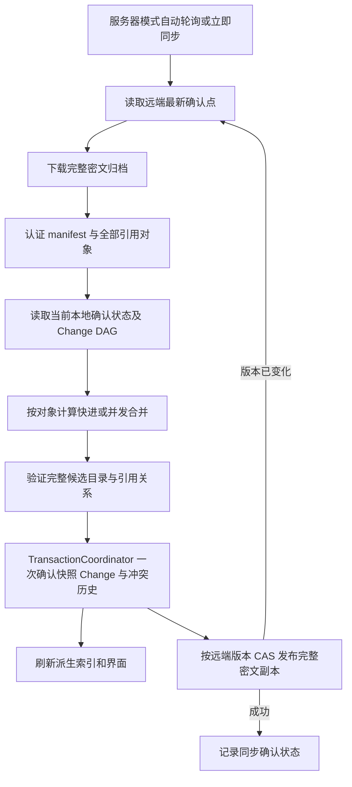

# 工作区双向同步设计

状态：已实现并通过 Windows 双设备宽窄窗口验收，以及 Windows 桌面与实体 Android 针对自部署 HTTPS 服务的双端现场同步及 UI 主流程验收；iOS 设备能力与交互未实现。本文区分当前双向快照同步与尚未接入的 artifact 增量传输。

本轮目标是在现有本地模式／服务器模式和 Recovery Key 恢复入口上，接通自动拉取、离线变更合并、事务落盘、重新发布以及冲突查看与恢复。同一用户的两台设备可以分别编辑，恢复网络后交换已确认内容。工作区明文和主密钥始终留在客户端。

## 1. 本轮范围与传输边界

本轮复用服务器已有的完整密文恢复归档及带版本条件的发布接口。客户端主动读取远端最新确认点，必要时下载归档，在本机认证与合并后重新发布。恢复密钥入口继续用于新设备引导，之后该设备取得自己的连接凭据和 Actor 身份。

这是**双向快照同步**，不是按 artifact 下载差集的增量同步。已经存在的 Change DAG／artifact 交换能力保留，但本轮不宣称已完成它与权威快照应用的集成；WebDAV、附件分块传输、服务端合并和多人实时协作也不在本轮交付范围。

| 内容 | 本轮处理 |
| --- | --- |
| Note 与 Block、RichText、加注 | 按对象因果关系推进；并发时进行可验证的三方合并或保留完整冲突版本 |
| Tag、Property、SavedQuery、Database、View | 因果后继优先；有真实基线时按字段和稳定集合身份三方合并，重叠字段保留完整加密版本 |
| Blob | 保留稳定身份和密文，按已认证 manifest 引用导入；同一身份异内容不能静默覆盖 |
| ObjectChange | 保留原始不可变节点及父边，合并节点由当前设备创建 |
| 冲突及审计历史 | 作为加密历史保留；冲突提供查看与恢复入口，不以计数代替内容 |
| 本机 PIN、设备保护凭据、服务器访问凭据 | 保持设备本地，不从远端归档覆盖或复制为其他设备身份 |

只读旧格式、未知对象或协议版本仍遵守现有兼容门禁。链接笔记与层级选项所需的 v2 最低读取版本随合并结果保留，不得因拉取旧设备归档降级。

本轮新增已认证的 `GET /v1/workspaces/{workspaceId}/recovery-snapshot/metadata`，启用双向同步需要同步更新服务器与客户端。旧服务器没有该读取入口时不能作为本轮同步服务使用；现有密文归档与设备登记不需要清空或重建。

## 2. 权威状态与执行链路

已确认的本地加密对象快照仍是当前业务状态的唯一权威来源。服务器确认点没有覆盖本地状态的特殊权限；远端 manifest 只是本次认证及候选对象目录，不直接替换本机 `manifest.enc`。

同步按以下顺序执行：

1. 检查当前工作区仍已解锁、当前设备已登记、服务器模式仍有效且主密钥版本匹配；为该次运行绑定会话身份和取消信号。
2. 读取远端最新确认点。即使本地没有修改也要检查远端，不能继续只在 `pendingChanges` 时上传。
3. 下载到受控临时密文归档，验证传输大小与摘要；认证 manifest 工作区身份、密钥版本、格式门禁与全部被引用对象的密文摘要、信封身份及 AEAD。
4. 在当前唯一写入协调器保护下读取最新本地确认状态，计算合并计划。网络等待期间出现的本地写入必须纳入计划，不能用开始下载时的旧 manifest 直接覆盖。
5. 完整校验 Note、类型与属性目录、Database／View、父子 Block、引用、删除状态和所有 Change。任何候选结果不合法都不发布半套对象。
6. 将所有新快照、导入 Change、新 Merge Change、冲突与历史作为同一事务准备并确认；manifest 是唯一确认点。崩溃恢复只能得到完整旧状态或完整新状态。
7. 提交成功后才刷新内存和派生索引。索引失败标记落后并重建，不回滚已确认快照，也不能把尚未确认的远端候选加入搜索。
8. 以刚观测的服务器版本为 `expectedRevision` 发布合并副本；成功后才记录该次同步确认。服务器版本冲突重新拉取并合并，重试有界，超限转为可重试状态。

本机 manifest revision、对象 revision 和服务器归档 revision 属于不同计数域，不能直接用数值大小比较两台设备的业务先后。

首次把同一工作区的本地文件夹副本接入已有服务器时，也先下载认证并合并两边的离线分支，不再要求对象目录事先完全相同。设备登记成功只授予访问权限，不将返回的服务器版本号直接当作覆盖许可；错误密钥或不同工作区的密钥不能改变本地内容。

## 3. 因果关系与对象合并

### 3.1 Change DAG 与设备身份

以已认证的原始 `ObjectChange` 集合和快照头的 `lastChangeId` 判断因果关系。相同 Change ID 的不同内容属于完整性错误；父边、对象身份和无环结构必须校验。不能依据文件修改时间或归档上传时间推断笔记修改顺序。

旧 Change 原样保留，不能用当前设备私钥重新签成原 Actor 的节点。恢复后的设备使用自己的随机 Actor 和凭据，新写入与 Merge Change 属于当前实际执行设备；HLC 必须观察远端时间后继续递增。

同一 head 表示已经收敛；远端是本地因果后继时快进，本地是远端后继时保留本地；没有祖先关系才进入并发处理。新的 Merge Change 引用全部被合并 heads，不能只引用胜方，否则下一轮会重新产生相同冲突。

### 3.2 Note

Note 复用已有按 Block 隔离和 RichText 三方合并规则：不同 Block 的独立编辑保留，非重叠文本修改自动合并，同一范围无法合并的修改产生冲突。

三方合并必须使用能够从已认证历史恢复的真实共同祖先。旧归档或已压缩日志无法提供 Base 时，不能把当前 Note、空 Note 或任意一侧伪装成共同祖先；此时按确定性规则选整个对象的临时版本，并保留双方完整快照供恢复。

字段临时胜者沿用因果优先、并发 HLC、完全相同时更新优于删除及 Actor／Change ID 的稳定排序。临时胜者不代表败方可删除。

### 3.3 类型、属性及结构化对象

Tag、Property、SavedQuery、Database、View 保留稳定 ID。因果后继可以快进；有真实共同祖先时，不同字段独立修改自动组合，同字段不同值才保留冲突。选项按 id、绑定及属性过滤按 propertyId 定位；无唯一身份的有序数组保守作为一个字段。集合成员路径不得使用数组下标。缺少真实基线时仍按确定性规则选临时版本，并保留双方完整版本。

稳定集合的单侧重排保留；双方同时重排时使用确定性临时胜者的顺序，保留所有成员和已合并字段，但本轮不提供独立的顺序冲突选择器。模板按 Block 身份组合后仍验证完整父子树，循环、缺父及重复同级顺序均不能发布。

合并后必须校验类型继承环、属性与选项引用、层级目录父链、Database／View 归属和查询依赖。两份独立合法的目录若合并成环或悬空引用，按已知最大 HLC 及规范内容稳定排序，成组采用一侧的共有目录，并为每个差异保留完整双版本；Note 的独立正文合并和独有对象仍保留。首选目录无效时尝试另一份，均无法形成合法并集则返回 `sync_schema_invalid`，不发布半套目录，也不默默删除笔记。

### 3.4 删除与历史

删除由 tombstone 表达，缺少某个远端文件或目录项本身不等于删除。删除／更新竞争遵守同样的因果和确定性规则，败方版本进入加密历史。

冲突历史及同步所需祖先不能因一次成功上传就被清理。设备确认、checkpoint 与保留期尚未形成完整闭环时，不启用跨设备历史压缩；现有本地压缩也必须保留本轮同步重建共同祖先与恢复冲突所需的材料。

## 4. 冲突查看与恢复

每项无法自动合并的冲突至少保留对象身份、双方 Change、创建时间、临时胜者和双方完整可恢复版本；Note 字段冲突还保留已有 Base／Local／Remote 证据。文件名、manifest 对象 ID 和公开状态使用不透明身份，不包含标题、正文或属性值。

设置中的同步区域提供待处理数量及列表入口。列表在已解锁会话中读取加密历史，可查看完整版本一／版本二。两个版本按稳定的版本身份排序，冲突时间使用双方确认时间的较晚值；因此换到另一台设备仍得到同一份历史，而不把“本地／远端”方向混成版本身份。

冲突字段提供独立选择入口：Note 按标题、属性、绑定、样式、Block、加注和默认页签处理，定义对象按字段与稳定集合身份处理。恢复时把所选字段应用到当前确认快照，保留其他已合并内容；不把整份历史快照覆盖回去。同一 Block 的重叠富文本本轮仍按整个 Block 选择，不宣称字符级 CRDT 或任意文本区间恢复。旧历史、无共同祖先、删除竞争及目录整体约束冲突继续使用明确的整版本恢复。

每次选择必须基于当前对象 revision 生成新 Change，并在同一事务记录字段处理标记；不能直接覆盖文件、倒退 revision 或改写原 Change。仅在全部冲突字段确认后标记整项已处理。操作期间对象已经变化时拒绝过期确认并重新加载。不同设备分别确认不同字段后合并处理标记；同字段并发选择不同版本时保留双方确认并重新提示核对，即使其中一方确认的是当前临时值、没有实际改变 payload，也不能静默吞掉其选择。后续选择以已合并 head 为父节点，才能覆盖已审阅的旧确认。完整历史始终保留。

## 5. 自动运行、草稿与界面

继续沿用工作区模式设置入口及现有主题、尺寸、公共按钮和中英文资源。同步状态区分未配置、本地模式、同步中、已同步、待重试、需要认证及待处理冲突，错误仅展示稳定分类，不透传路径、响应体或凭据。

后台轮询不禁用冲突审阅和选择，也不在页面顶部反复插入进度条推动滚动位置。前台读取或提交期间禁用重复操作；正式恢复始终在唯一写入锁内重验当前 revision。Block 冲突同时展示可读类型、同级位置、父级与删除状态，不用相同正文掩盖结构差异。

服务器模式自动检查远端并合并已确认快照；断网不阻止本地编辑和保存。立即同步与后台同步共用同一业务入口及互斥，不形成第二个写入协调器。

远端提交完成后，已保存且没有本地草稿的笔记可刷新；未保存草稿必须保留，并在正常保存时按 expectedRevision 处理版本变化。不能通过重建整个编辑器状态抹掉用户输入，也不能把“未同步”误显示为“未保存”。

锁定、关闭工作区或切回本地模式取消在途请求和解密任务，同时使已经排队的旧代传输失效。每个 await／阻塞操作后的提交与界面回填都检查原会话仍有效，旧会话完成的结果不能进入新工作区。已经开始的本地原子发布在有限的 `NonCancellable` 作用域完成或恢复确认后再响应取消，避免内存与磁盘确认点不一致。下载和上传中的临时文件只包含密文，正常退出与失败路径均清理。

## 6. 兼容与失败模式

| 情况 | 必须保证的结果 |
| --- | --- |
| 网络不可达、请求超时 | 本地确认内容和草稿继续可用；后台退避，提供立即重试 |
| 发布成功但响应丢失 | 下一轮先读远端再判定，重复同步幂等，不伪造新业务修改 |
| CAS 冲突 | 重新下载最新确认点并合并，不使用强制覆盖或偷偷推进 expectedRevision |
| 密文损坏、对象调包、缺失条目、非法路径 | 拒绝该候选，不修改本地权威快照及索引 |
| 主密钥版本不匹配 | 暂停并进入现有恢复／轮换处理，不尝试用另一设备 PIN 解锁 |
| 设备撤销、访问凭据失效 | 停止自动请求，保留本地内容并提示重新认证 |
| 合并期间本地继续写入 | 重新基于最新本地确认点计算，不丢弃新写入 |
| 本地合并提交中断 | 由 TransactionCoordinator 恢复完整旧／新状态，不发布部分 schema 或 Note |
| 合并后索引失败 | 保留已确认快照、标记派生索引落后并重建 |
| 远端较旧格式或不同解锁槽 | 不降级格式；保留本机 PIN、设备保护和解锁槽，重新认证本地 manifest |

服务器完整归档的既有大小上限继续有效。本轮完整传输会随工作区增长增加带宽和存储成本；不把有界响应或一次小数据测试当作大型工作区性能验收。

## 7. ADR-016：以密文确认点接通客户端双向合并

**状态**：Accepted，已实现；实际平台与验证边界见下节。

**背景**：现有服务器模式只自动上传完整密文恢复副本，旧设备遇到服务器版本变化只能拒绝覆盖；Change DAG、Note 三方合并、事务协调器和客户端设备凭据已有独立实现，但尚未形成产品级闭环。

**决定**：先复用完整密文确认点的读取、下载和 CAS 发布协议，在客户端完成全量认证、按对象因果合并和单事务发布。将恢复副本升级为双向快照同步，同时保留恢复密钥的新设备引导流程。对象内容始终经统一应用服务和 TransactionCoordinator，不让 UI、网络层或服务器直接覆盖本地对象。

**取舍**：复用已实现的认证和归档流程，可以在本轮验证真实多设备离线修改与冲突恢复；代价是传输粒度较大。直接替换远端 manifest 会丢失本地分支和设备 PIN，不能采用；立即切换 artifact 增量则还需补齐逻辑 Change 与传输 artifact 映射、历史快照定位、设备确认及 checkpoint，不能以现有接口存在声称完成。

**后续边界**：逐 artifact 增量、WebDAV、断点／分块传输、设备确认驱动的 checkpoint 压缩及归档清理另行实施。未来替换传输层不得改变本轮确认的本地权威、因果判断、冲突保留与事务边界。

## 8. 验收清单

以下是验收目标，实际执行结果及未覆盖范围在后文单独记录。使用真实 Netty 服务、独立设备目录、正式加密工作区、SQLite 及生产 App 根节点，不以 Mock 或纯序列化测试替代业务闭环。

- 双独立本机目录使用同一工作区主密钥、不同 Actor 及设备凭据，恢复后对象 ID 保持一致。
- 两台设备离线新增不同笔记、修改同笔记不同 Block，联网交替同步后持久化内容及搜索、双链一致；重复同步不产生无限 Merge Change。
- 同 Block 重叠编辑、标题与属性竞争、删除／更新竞争得到确定性结果，双方完整加密版本可查看并恢复；重启后仍可读。
- Tag、Property、层级分组、SavedQuery、Database、View 与 Note 同批落盘，引用完整；旧客户端格式门禁不被降级。
- 新设备同步保留自己的 PIN 和本机解锁登记；锁定重开、错误 PIN、主密钥轮换及撤销设备的处理正确。
- 断网本地编辑、服务重启、响应丢失及 CAS 竞争可恢复，不丢本地新写入、不强制覆盖服务器。
- 锁定／切本地模式时取消在途同步，旧响应不回填；未保存草稿不被远端刷新覆盖。
- 篡改摘要、信封、对象身份或路径的归档被拒绝；正式工作区与服务器仅持久化密文，日志和截图无凭据。
- 在本地提交阶段故障后重开，只出现完整旧／新状态；删除派生索引后仍可从确认快照重建。
- 从生产 App 验证立即同步、自动状态、冲突查看和版本恢复，并核对桌面与窄窗口布局；Android 构建、Host 测试和设备交互分别记录，Windows 不替代 iOS 验收。

### 2026-10-29 实际验证

| 验证范围 | 结果 |
| --- | --- |
| core JVM：合并、目录预校验及整目录冲突回退 | 109 项通过 |
| server：登记、撤销、恢复、元数据、CAS 与 YAML | 16 项通过 |
| file-system：真实加密 staging、Database/View 中断恢复与回滚 | 7 项通过 |
| app:sync：密文副本契约 | 3 项通过 |
| API、CLI、stdio MCP | 11 项通过 |
| shared JVM：完整编辑器、实际双设备、设置与版本恢复 | 167 项通过 |
| shared Android Host | 81 项通过 |

上述共 394 项，失败、错误与跳过均为零。桌面入口编译及 AndroidMain 编译通过。首次 IDEA MCP 构建调用超时，后续使用仓库 Gradle Wrapper 与隔离输出目录验证；不把超时视为构建成功。

双设备测试实际核对了离线独立笔记、同笔记不同 Block、同 Block 冲突及显式恢复、类型与属性、Database/View 双向更新、查询和双链、重开及 PIN、断网重连、重复同步无额外确认、相同归档的新服务器版本、真实 HTTP 挂起时取消活跃及排队任务、恢复后时钟回拨、首次文件夹接入和错误密钥拒绝。生产 App 在 1280 与 480 宽窗口执行版本审阅、确认恢复、已处理历史和重开检查，生成的测试截图已人工核对。

没有连接 Android 设备，Windows 无法执行 iOS 的 Xcode／模拟器验证。本轮没有部署公网服务器、重新安装桌面发行包或运行大容量性能压测；没有据此宣称验证全部磁盘故障点、所有任意网络交错或密钥轮换期间的跨版本自动合并。主密钥变化仍暂停旧设备并使用独立恢复流程。增量 artifact、WebDAV、分块续传与归档自动清理仍未实现。

## 9. 相关实现与基线

- [同步契约与传输边界](../app/sync/src/commonMain/kotlin/com/oruke/tagloom/sync/SyncCapability.kt)
- [现有 Note 三方合并](../core/src/commonMain/kotlin/com/oruke/tagloom/core/sync/NoteThreeWayMergeService.kt)
- [现有 Note 合并事务](../core/src/commonMain/kotlin/com/oruke/tagloom/core/sync/NoteMergeTransactionService.kt)
- [服务器恢复应用服务](../app/shared/src/jvmAndroidMain/kotlin/com/oruke/tagloom/workspace/DesktopServerRecoveryService.kt)
- [真实双设备测试环境](../app/shared/src/jvmTest/kotlin/com/oruke/tagloom/workspace/ServerRecoveryTestEnvironment.kt)
- [产品与技术设计基线](../Tagloom_产品与技术设计草案.md)

## 10. ADR-017：字段合并与针对当前状态的局部冲突恢复

**状态**：Accepted，已实现；验证范围见下节。

**背景**：整对象定义 LWW 会把不同字段的独立编辑视为冲突；恢复整份旧笔记会撤回其他已自动合并或后续确认的修改。

**决定**：保留完整双版本证据，在加密历史中追加兼容旧记录的字段路径和逐项解决标记。使用字段名及集合稳定身份定位，区分缺失与显式 null。针对当前快照应用所选字段，再经过完整目录校验和原子业务事务。路径的父成员已不存在或候选破坏领域约束时拒绝恢复，不能伪造结构或绕过验证。

**边界**：不引入完整 CRDT，不改传输协议，不按数组下标定位。无基线、删除或跨对象不变量仍允许整版本恢复；细粒度字段的解决状态跨设备合并，但其内容仍遵守对象 Change DAG 与正常冲突保留规则。

### 2026-10-29 字段细化验收

本切片按受影响范围分批回归，去重合计 **388 项通过，失败、错误和跳过均为零**：core JVM 137 项、共享 JVM 170 项、Android Host 81 项。共享 JVM 的业务场景、设置页与新冲突界面分别运行；首次界面用例暴露后台轮询禁用按钮的问题，修复后重新通过，不把首次失败计为成功。AndroidMain 与桌面入口编译通过。IDEA 没有可用测试运行配置，使用仓库 Wrapper 和隔离构建目录。

真实服务与独立设备目录已验证：同一类型名称／图标和不同选项身份的离线修改自动组合；标题与正文分别确认保留其它独立 Block；两台设备分别解决不同字段后合并处理标记；同字段并发相反选择（包括一次无 payload 变化的确认）重新待核对，后继选择才关闭；锁定重开、第三设备恢复、索引查询和历史保留均核对实际结果。旧格式完整恢复、不同目录解释的保守降级、模板树循环回退、缺失与 JsonNull 的历史往返由核心场景覆盖。

生产 App 在 1280 与 480 宽窗口使用真实鼠标完成展开历史、逐项选择、确认、部分／全部处理状态及持久化回读；两种截图已人工核对。同步轮询期间审阅不再失效，原有服务器恢复与模式设置页面的回归通过。中英文资源键一致，相关 UI 静态检测没有发现项。

本轮没有 Android／iOS 真机交互验收、发行包重新安装、公网部署或大容量压测。同一 Block 重叠正文仍保守按完整 Block 选择，并发集合重排仍采用确定性顺序；不据此宣称实现完整 CRDT、增量 artifact 传输或任意文本区间恢复。

### 2026-10-29 自部署 HTTPS 服务与实体 Android 双端现场验收

部署独立自部署盲同步服务容器并启用可信 HTTPS 转发后，使用隔离工作区、生产密码学实现（JVM/Android libsodium、Windows DPAPI、Android Keystore/SQLCipher）与脱敏样例执行 Windows 桌面及实体 Android 手机的 **19 个分阶段现场验收**，全部通过：

- Windows 新建工作区并发布首份密文确认点，实体 Android 仅凭 HTTPS 地址与 Recovery Key 从远端恢复。
- Android 修改共享笔记正文并独立新增笔记，Windows 拉取后核对持久化正文与可重建全文索引。
- 双端分别切为本地模式离线修改同一笔记的不同 Block，切回服务器模式同步后自动无冲突合并。
- 双端离线竞争修改同一 Block，两端均收到同一待处理冲突并保留完整双版本证据；Windows 按字段选择 Android 版本并发布后，双端正文一致、待处理冲突归零且已处理历史保留。
- 重启远端同步服务容器后，设备登记、密文副本与历史完整保留；双端重开工作区、解密查询及从生产 `App` 根节点进入设置页点击“立即同步”均通过真实 UI 与截图核对。

本轮同时修复 Android 系统默认临时缓存目录别名导致密文归档校验失败的问题：`createEncryptedTemporaryArchive` 仅规范化应用刚创建的随机临时 ZIP 文件真实路径，外部备份目标父级符号链接与工作区内部符号链接继续由 `AndroidEncryptedArchivePathTest` 验证拒绝。补充回归全部通过：JVM 恢复集成 3 项、配置及 DPAPI 异常脱敏 2 项、实体 Android 加密归档恢复与符号链接拒绝 1 项。

现场验收入口（`NasSyncAcceptanceRunner` 与 `AndroidNasSyncAcceptanceTest`）绑定独立隔离目录与显式 `runId`/`phase`，不触碰用户默认工作区；常规测试未提供现场参数时明确标记跳过，不伪装现场验收已执行。本轮仍未覆盖附件录入、iOS 设备或大容量压力场景。
